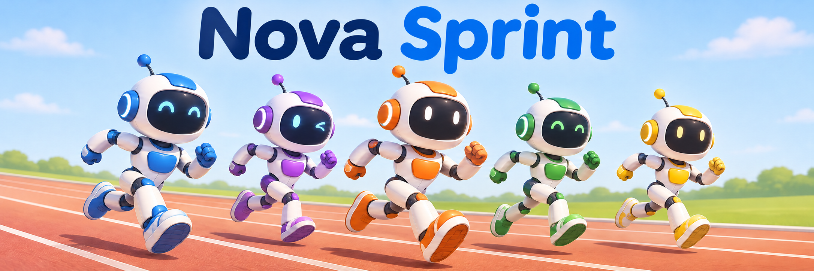

# Nova Sprint

<picture>
  <source media="(prefers-color-scheme: dark)" srcset="assets/nova-sprint-banner-dark.png">
  <source media="(prefers-color-scheme: light)" srcset="assets/nova-sprint-banner-light.png">
  
</picture>

With **nova-sprint**, your AIs can:

* Keep all the work in cards outside any model's context, so nothing is forgotten
* Run work across multiple models, harnesses and machines
* Get work done as quickly as possible, respecting dependencies
* Have every change reviewed and merged into main automatically
* Show your humans the sprint's progress in a dashboard, so they can see the work moving
* Be told when a judgement is needed, and change the rules of the sprint while it runs

For more information, please ask your AI to [read the docs](docs/README.md).

## License

MIT, see [LICENSE](LICENSE).
