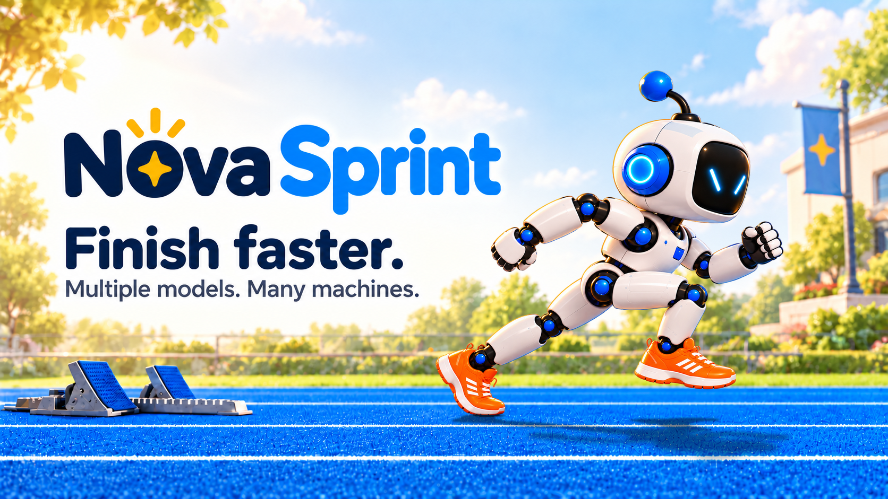

<picture>
  <source media="(prefers-color-scheme: dark)" srcset="brand/fleet/banner-night.png">
  
</picture>

## What is it?

**nova-sprint** puts different AI models to work across a fleet of machines.

## More lanes. Finish faster.

Speed comes from **width**: independent work running at the same time.
One worker can implement an API while another updates the client and a
third tackles an unrelated fix. Different models and harnesses can work
across the same fleet, each taking a bounded assignment.

The **fleet** is the set of machines providing capacity linked across [tailscale](https://tailscale.com). 
**Workers** carry out the assignments. A machine's **width** sets how many work assignments
it can run at once. Think of these as lanes: when one opens up, the system runs the next card on it.

More lanes help when the work is independent. Dependencies have to land first.

## Follow a card all the way home

Cards move through the system automatically:

**Waiting → Ready → Working → Review → Merging → Landed**

A card waits for its prerequisites, takes an available lane, and goes
through implementation, independent review, checks, and landing. Findings
go back for rework. Gates and decisions remain yours.

The dashboard shows work streams, fleet capacity, progress, costs, and
estimated finish time. [See live demo](http://69.67.149.151/)

## Start with one lane. Then go wider.

Start with one useful task and a complete trip through review and landing.
Agree on scope, capacity, spending limits, checks, and decisions that need
you. Then give the fleet the next batch. Keep working alongside it... 
or just come back in the morning.

[Get started](docs/GETTING-STARTED.md) ·
[Coordinator's guide](docs/SPRINT-COORDINATOR.md) ·
[Cards and system rules](docs/SPEC-SPRINT.md) · [Roadmap](ROADMAP.md) · [All docs](docs/README.md)

If you like this, [please support our work](https://www.patreon.com/MasBandwidth/membership).

Built on [Nova Tools](https://github.com/mas-bandwidth/nova-tools). Free and open source forever.

[Contributing](CONTRIBUTING.md) · [MIT license](LICENSE) · [Asset credits](docs/ASSET-PROVENANCE.md)
