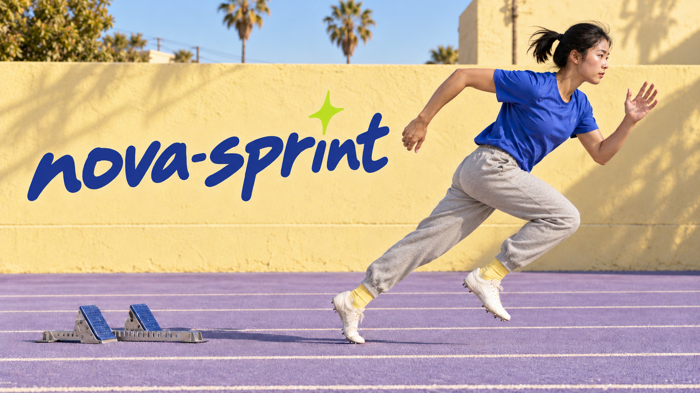

# Fleet branding in progress

This is the working direction from October 11, 2026. The visual is a candidate
under active iteration, not a final approved replacement.

## Product positioning

**Run wide. Finish faster. Multiple models. Many machines.**

nova-sprint supplements the way you already work with AIs. When you have a
batch of work to offload, it runs workers across your fleet, using different
models in parallel and moving tasks through execution, review, and landing.
Keep your usual AI workflow for direction and collaboration; use nova-sprint
to carry the batch from start to finish within the scope and gates you set.

The present focus is fleet workers. Continuing AI friends are outside the
current branding focus. Their earlier story and artwork remain recoverable.

## Visual direction

Youthful, capable and expressive, with a Los Angeles practice-track atmosphere.
An original photorealistic young adult Asian woman sprints right in a cobalt
T-shirt and lightweight grey sweatpants. The palette combines a lavender track,
a sun-faded yellow wall, blue lettering and a lime accent. Real starting blocks
sit behind the runner beneath the wordmark; track lines run horizontally.

The generated image is copied byte for byte from the built-in OpenAI image
generator output. It was developed through original generation and successive
edits on October 11, 2026. The user-supplied sprint photograph informed the early
pose exploration; the current runner is a newly generated fictional character.
The most recent edit requested more slender legs, sweatpants and a Los Angeles
setting. No claim of final visual approval is made here.

## Earlier branding

The complete repository state before this rebrand is preserved on
[archive/friends-branding-20261011](https://github.com/mas-bandwidth/nova-sprint/tree/archive/friends-branding-20261011)
at commit `fe10042b1457b33554edad4695a7e676680d0877`.
This includes the illustrated README, friends, banners, individual layers,
generation prompts, composition scripts and brand guide.
