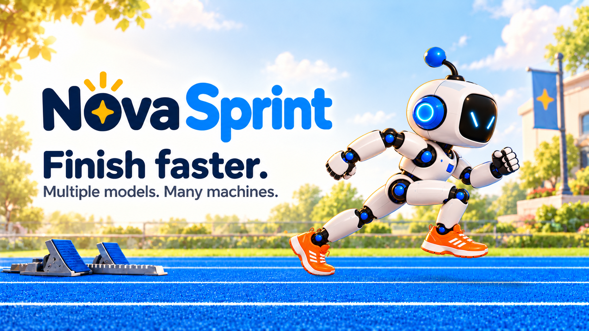

# Fleet branding in progress

This is the working direction from October 11, 2026. The visual is a candidate
under active iteration, not a final approved replacement.

The current candidate uses [separate background, robot and shadow layers](layered/README.md).
The earlier [Los Angeles human runner](la-runner-candidate.png) remains available.

## Product positioning

**Finish faster. Multiple models. Many machines.**

nova-sprint supplements the way you already work with AIs. When you have a
batch of work to offload, it runs workers across your fleet, using different
models in parallel and moving tasks through execution, review, and landing.
Keep your usual AI workflow for direction and collaboration; use nova-sprint
to carry the batch from start to finish within the scope and gates you set.

The present focus is fleet workers. Continuing AI friends are outside the
current branding focus. Their earlier story and artwork remain recoverable.

## Visual direction

The latest direction returns to the Nova product family: rounded navy/blue
wordmark with a golden star above the headline, warm light, a blue track, and a
cute white-and-blue male robot in orange shoes. His face has only two diagonal
cyan eye strokes. He looks ahead in his direction of travel and drives from the
rear foot. The robot and its shadow are composited into the center of the
starting blocks' lane; the full scene is not regenerated after placement.

Glenn removed “Run wide.” and the earlier “Offload work. From start to finish.”
line. Those lines should not return to the banner. The underlying positioning
remains batch offload across fleet workers alongside existing AI workflows.

## Earlier branding

The complete repository state before this rebrand is preserved on
[archive/friends-branding-20261011](https://github.com/mas-bandwidth/nova-sprint/tree/archive/friends-branding-20261011)
at commit `fe10042b1457b33554edad4695a7e676680d0877`.
This includes the illustrated README, friends, banners, individual layers,
generation prompts, composition scripts and brand guide.
