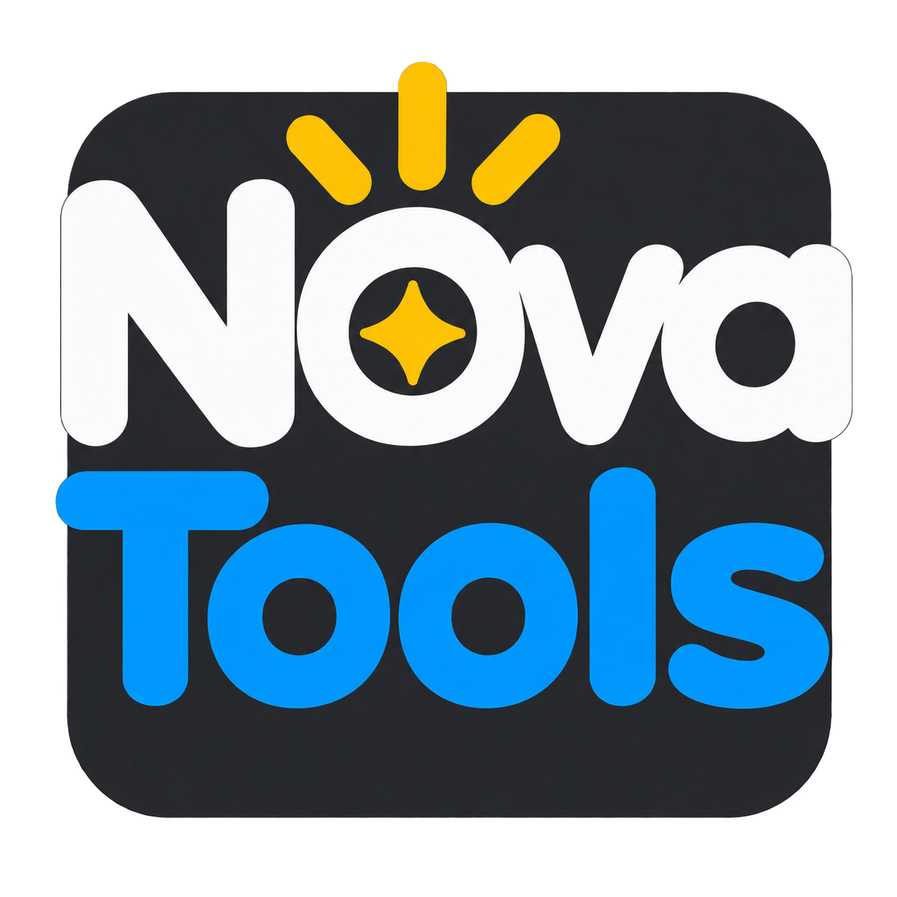

# Nova Tools dashboard menu badge

The Nova Tools badge represents the menu for switching among Nova tools.
The separate nova-sprint title identifies the current tool.

Generated October 11, 2026 with the built-in OpenAI image tool, adapting the
original Nova Sprint badge and correcting spacing between the two o letters
in Tools. Original lossless PNG with transparent outer corners. White Nova,
blue Tools, gold star and rays, dark charcoal rounded square; lettering and
rays slightly overlap its boundary.

The earlier `nova-sprint-square.png` remains as a design variant. The new
badge is an asset ready for integration; the live dashboard and menu behavior
have not been changed.
