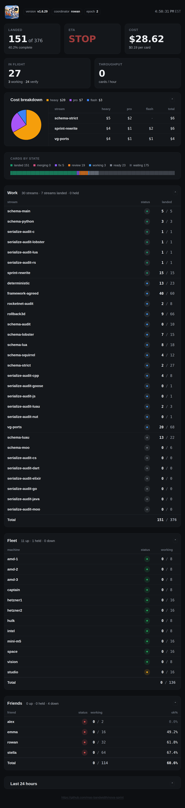
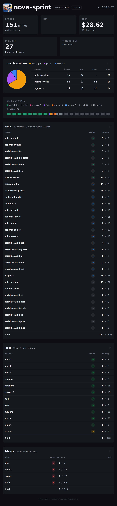

# Dashboard shim

The embedded page and assets are carried from v1 `internal/sprintdash/page`. The HTTP server is a reduced v2 adapter, with the v1 page routes and JSON envelope; it is not the full v1 Go server. Run against an existing v2 store:

```sh
NOVA_PG_DSN='postgres://user@host/db?sslmode=disable' NOVA_PG_PASSWORD='...' \
  go run ./cmd/nova-sprint-dash --listen 127.0.0.1:8080
```

`--pg` overrides `NOVA_PG_DSN`. The store must already be migrated. The process reads one consistent snapshot at startup, then pages the event log from its local sequence every second; HTTP requests read the resulting cached view. Restart begins with a new snapshot. `/healthz` returns 503 when the last read failed or is stale; `/api/sprint` is no-store and supports gzip. The clock is the time of the last successful event poll.

The page maps producer states to Work and the state bar, with `fail` black after `landed`; sentinels are excluded. Blocked producers appear in a dark-grey column immediately before waiting and count as in flight. A non-blocker/non-critical producer ready after its first attempt or working after its second is shown as fix. Streams supply names and held; consumer costs are summed by stream and tier; unpriced runs leave cost blank. Rows supply Fleet (worker) and Friends (kin), state/held, and width. Ready, working, done, and track colours count consumers by holder, including reads. Read results attributed to their author supply ok%; read consumers also supply the optional readers table. Queued and merged are producers in merging and landed.

The store has no coordinator, machine stop, row load or subscription window, provider status, stream state-since, stuck or CI status, or stats-tidy mark. These are left blank or omitted. ETA and throughput history are not yet computed; their display is blank. The last-24-hours stats panel is omitted. The cached event cursor is process-local and is not written back to the store.

## Visual comparison

The live v1 board was captured on 2026-11-06 at 21:03 UTC, in `America/New_York`, with a Linux browser. The v2 fixture projects its captured work-state counts and row shape into synthetic store records: 30 streams, 151 landed of 376 producers, 12 worker and four kin rows, with representative per-tier costs. It is not the live store; it does not reproduce verdict history, so its ok% cells are blank. [Fixture source](testdata/visual-fixture.go.txt), captured envelopes and browser checks are in `testdata/`.

| Width | Live v1 | v2 fixture |
|---|---|---|
| 1440 |  |  |
| 375 |  |  |
| 2000 | [v1](testdata/v1-live-2000.png) | [v2](testdata/v2-2000.png) |
| 1100 | [v1](testdata/v1-live-1100.png) | [v2](testdata/v2-1100.png) |
| 760 | [v1](testdata/v1-live-760.png) | [v2](testdata/v2-760.png) |

The added blocked and fail columns make Work compact at 2000 px where v1 is full; [v2 at 2800 px](testdata/v2-2800.png) shows the full table. A separate [synthetic browser render probe](testdata/render-probe.json) checks nonzero blocked/fail, zero cost and zero percent, and missing cells; it is not a live-store capture. The browser checks report loaded fonts, no horizontal overflow, no console or HTTP errors, and a one-second poll timer (actual request intervals have browser jitter).

## Validation

On Linux amd-1 with Go 1.26.10 and PostgreSQL 18.6, format, build, vet, unit race and PG functional race checks passed. One earlier full functional run saw a PostgreSQL connection reset in the store's rebuild test; the targeted test and subsequent full functional run passed ([failure](testdata/gates5.log), [recheck](testdata/functional-recheck.log)). A three-trial, 5,000-producer Fake-store microtest measured incremental advance at 0.90–1.52 ms and cached HTTP JSON at 0.03–0.15 ms; it checks that Snapshot is called once ([log](testdata/performance-final.log)). This is not a fleet-scale performance acceptance.

