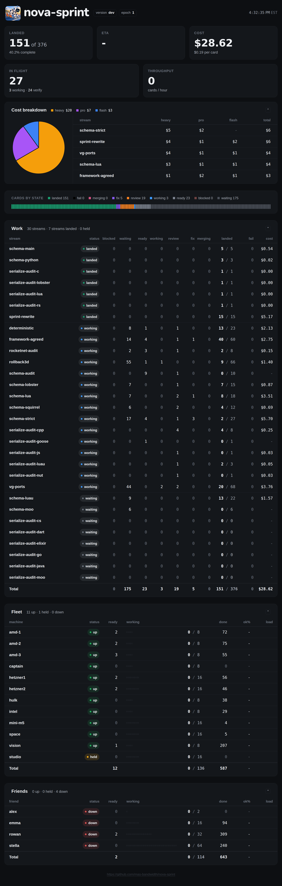

# Dashboard shim

The embedded page and assets are carried from v1 `internal/sprintdash/page`. The HTTP server is a reduced v2 adapter, with the v1 page routes and JSON envelope; it is not the full v1 Go server. Run against an existing v2 store:

```sh
NOVA_PG_DSN='postgres://user@host/db?sslmode=disable' NOVA_PG_PASSWORD='...' \
  go run ./cmd/nova-sprint-dash --listen 127.0.0.1:8080
```

`--pg` overrides `NOVA_PG_DSN`. The store must already be migrated. A build may set the version chip with `-ldflags '-X github.com/mas-bandwidth/nova-sprint/dash.Version=v1.2.3'`; the default is `dev`.

The process takes one cold Snapshot at every start, then pages Events from that snapshot's sequence; requests read the cached view. After consuming input it saves the global `dashboard` cursor with `SetCursor`, then folds through that cursor's receipt event, including intervening writers. The saved watermark is the consumed input prefix and excludes its own receipt; idle polls do not create cursor events. Restart deliberately takes a fresh snapshot rather than treating a cursor as a stored image. Throughput samples live in memory and reset on restart.

The page maps producers to Work and the state bar; sentinels are excluded. `blocked` is a separate red-brown column before waiting and a separate in-flight subline count, but is excluded from the in-flight figure; `fail` is black after landed and excluded from in-flight. Both count in the total; DONE means all producers are landed or failed. A non-blocker/non-critical producer ready after its first attempt or working after its second appears as fix. Streams show landed when all their cards landed, held when held, working when work is in flight, and waiting otherwise, including empty streams. Rows supply Fleet (worker) and Friends (kin), state/held, and width. Ready, working, done and track colours count consumers by holder, including reads. Read results attributed to their author supply ok%; read consumers also supply the optional readers table. Queued and merged count producers in merging and landed.

Costs are the sum of priced consumers by stream and tier, even when other runs are unpriced; a stream with no priced run displays `-`. Throughput samples landed over the last hour, with a ten-minute warmup displayed as 0 and a reset when the count falls. The clock is the last successful poll's end time. Healthy cache data pulses the bar; a failed or stale poll holds the last figures and clock. Data older than two seconds for 30 seconds raises `ALARM stale` and `/healthz` returns 503 until recovery. `/api/sprint` is no-store and supports gzip. `/public.html` omits charts; stream and history routes redirect to `/` until their layer-6 implementations exist.

The store has no coordinator, machine stop, row load or subscription window, provider status, stream state-since, stuck or CI status, or stats-tidy mark. These are left blank or omitted. ETA is unavailable. The last-24-hours stats panel is omitted. Missing ok% retains v1's `-`.

The tests in `coldread_test.go` originated with Rowan's 2026-11-06 cold reader; the unchanged original is [preserved](testdata/coldread-original.go.txt). The health test now checks the ruled 30-second grace, the cursor test permits the additional cursor events while requiring monotonic reads, the throughput test uses a controlled clock, and the unpriced test checks the actual priced sum instead of unconditionally failing from the v1 capture alone.

## Visual comparison

The live v1 board was captured on 2026-11-06 at 21:30 UTC, in `America/New_York`, with a Linux browser. The v2 fixture projects its captured work-state counts and row shape into synthetic store records: 30 streams, 151 landed of 376 producers, 12 worker and four kin rows, with representative per-tier costs and one additional unpriced waiting consumer. It is not the live store; it does not reproduce verdict history, so its ok% cells show `-`. [Fixture source](testdata/visual-fixture.go.txt), captured envelopes and browser checks are in `testdata/`.

| Width | Live v1 | v2 fixture |
|---|---|---|
| 1440 |  |  |
| 375 |  |  |
| 2000 |  |  |
| 2800 |  |  |
| 1100 | [v1](testdata/v1-live-1100.png) | [v2](testdata/v2-1100.png) |
| 760 | [v1](testdata/v1-live-760.png) | [v2](testdata/v2-760.png) |

The full Work table fits at both 2000 and 2800 px. Its gutter is 16 px at 2000 and 40 px at 2800, leaving room for blocked and fail while preserving the column minima; at 375 px it uses the compact layout. A separate [round-two browser probe](testdata/round2-browser-probe.json) checks blocked/fail, zero cost and zero percent, missing cells, redirects, DONE and stale-poll recovery; it is not a live-store capture. The browser checks report loaded fonts, no horizontal overflow, no console or HTTP errors, and a one-second poll timer (actual request intervals have browser jitter).

## Validation

On Linux amd-1 with Go 1.26.10 and PostgreSQL 18.6, format, build, vet, unit race and PG functional race checks passed. One earlier full functional run saw a PostgreSQL connection reset in the store's rebuild test; the targeted test and subsequent full functional run passed ([failure](testdata/gates5.log), [recheck](testdata/functional-recheck.log)). Before cursor persistence, a three-trial, 5,000-producer Fake-store microtest measured incremental advance at 0.90–1.52 ms and cached HTTP JSON at 0.03–0.15 ms; it checks that Snapshot is called once ([log](testdata/performance-final.log)). This is not a fleet-scale performance acceptance.


The full-width adjustment passed the focused Linux build, vet and race tests, including the PostgreSQL golden ([log](testdata/fullwidth-gates.log)).

## Round-two rulings

1. Throughput samples the last hour, rounds as v1, and displays 0 during warmup or no landings.
2. Priced costs remain visible alongside unpriced runs; no priced run displays `-`.
3. Empty and blocked-only streams wait; landed, held and working follow their stored states and counts.
4. Missing values stay blank; v1's cost, ok%, ETA and throughput fallbacks remain.
5. Stream/history routes redirect to `/`; the link styling remains.
6. The bar pulses with fresh cache health, and stops after a lost or stale poll; a future machine state takes precedence.
7. The page envelope uses v1's field types, including numeric timings and null error on success.
8. The version comes from `dash.Version`, settable with `-ldflags -X`; its default is `dev`.
9. Blocked has a separate subline count and is excluded from in-flight.
10. Landed and fail together determine DONE; blocked and fail remain in the total.
11. A durable global `dashboard` cursor records each consumed prefix; a restart takes one new Snapshot.
12. Fail is black and blocked is a desaturated red-brown, both sheet tokens.
13. Two seconds of staleness held for 30 seconds alarms and fails health; `/public.html` omits charts.
14. Cost aggregation checks pricing once per consumer; the stray cache-loop blank line is removed.

Round-two Linux format, build, vet, unit race and PostgreSQL functional race checks passed ([log](testdata/round2-gates.log)). The attributed cold-reader's 5,000-producer PostgreSQL test measured a worst incremental advance of 15.418 ms across 20 iterations, with one Snapshot ([log](testdata/round2-pg5000.log)); this is a bounded bench result, not fleet acceptance. The original cold-reader probe file remains in `testdata/coldread-original.go.txt`.
