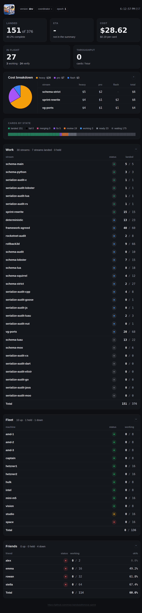
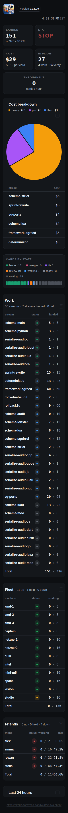
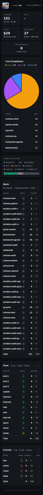
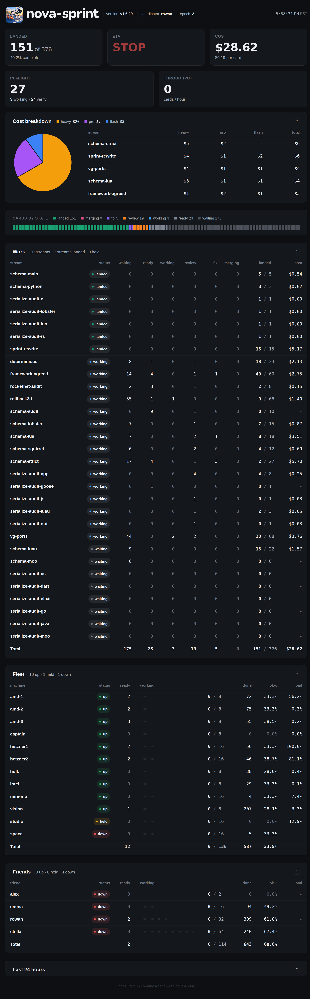
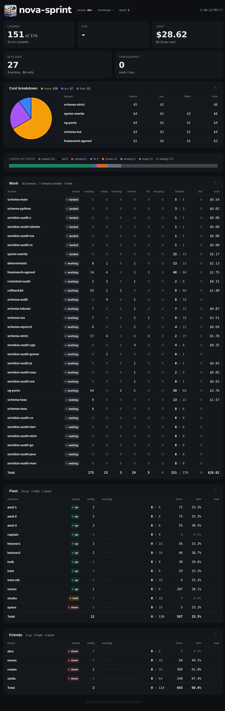
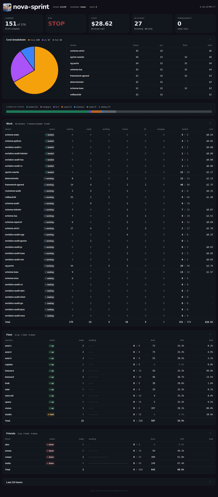
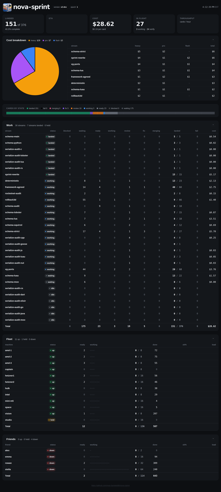

# Dashboard shim

The embedded page and assets are carried from v1 `internal/sprintdash/page`. The HTTP server is a reduced v2 adapter, with the v1 page routes and JSON envelope; it is not the full v1 Go server. Run against an existing v2 store:

```sh
NOVA_PG_DSN='postgres://user@host/db?sslmode=disable' NOVA_PG_PASSWORD='...' \
  go run ./cmd/nova-sprint-dash --listen 127.0.0.1:8080
```

`--pg` overrides `NOVA_PG_DSN`. The store must already be migrated. A build may set the version chip with `-ldflags '-X github.com/mas-bandwidth/nova-sprint/dash.Version=v1.2.3'`; the default is `dev`.

The process takes a cold Snapshot at startup, then pages Events from that snapshot's sequence; requests read the cached view. If that Snapshot fails after the store has opened, the dashboard serves an unavailable cache and retries the Snapshot on each poll until it succeeds. A failure to open the PostgreSQL connection itself still exits the standalone process. After consuming input it saves the global `dashboard` cursor with `SetCursor`, then folds through that cursor's receipt event, including intervening writers. The saved watermark is the consumed input prefix and excludes its own receipt; if an input arrives before that receipt, the following poll advances the watermark to cover it. Idle polls do not create cursor events, including the first poll of an empty store. Restart deliberately takes a fresh snapshot rather than treating a cursor as a stored image. Each poll checks the identity of the last folded event without loading its images; if the log is restored behind that point, the dashboard takes a new Snapshot, and a missing or changed anchor at the same or a later sequence fails the read. This is a continuity check, not full history authentication: a replacement before the first anchor or a rewrite preserving the anchor identity may go undetected. Throughput samples live in memory and reset on restart.

The page maps producers to Work and the state bar; sentinels are excluded. `blocked` appears as a separate red-brown column before waiting and in the legend only when nonzero; it has a separate subline count and is excluded from the in-flight figure; `fail` is black and excluded from in-flight; it appears after waiting in the state bar and legend, and last in the Work columns and stream-status ordering. Both count in the total; DONE means all producers are landed or failed. A non-blocker/non-critical producer ready after its first attempt or working at attempt ≥ 2 appears as fix. Streams show landed when all cards landed, fail when all are final and at least one failed, held when held, working when work is in flight, and waiting otherwise, including empty streams. Rows supply Fleet (worker) and Friends (kin), state/held, and width. An empty Friends table retains its headers and total row. Ready, working, done and track colours count consumers by holder, including reads. The Fleet and Friends fix track counts working work consumers with attempt ≥ 2 unless the producer’s blocker or critical priority takes precedence. Read results attributed to their author supply ok% as yes / (yes + no); faults and fails are excluded; read consumers also supply the optional readers table. Queued and merged count producers in merging and landed.

Costs are the sum of priced consumers by stream and tier, even when other runs are unpriced; a stream with no priced run displays `-`. Exact micro-dollar tier totals are partitioned into display cents by largest remainder, with alphabetical ties, so tier cells sum to the rounded stream cost. The `stream_costs` dollar fields use currency strings; unpriced-run counts remain numeric. Server and browser cost sums use exact integer cents; work and read subtotals partition the rounded total by largest fractional cent with alphabetical ties, so their displayed sum equals that total. The Cost breakdown legend shows whole dollars rounded up, while its stream rows and tier cells show cents. Throughput samples landed over the last hour, with a ten-minute warmup displayed as 0 and a reset when the count falls or the epoch changes. The server polls every second even without viewers (unlike v1's 30-second viewer gate), and each advance has a five-second context deadline; store opening and the startup Snapshot each have a 30-second deadline. Running two dashboards on one store is unsupported until `run` owns their coordination. The clock is the last successful data read. Healthy cache data pulses the bar; a failed or stale data read holds the last figures and clock. A failed cursor write logs a warning and is retried without suppressing a successfully read view. Pulse freshness uses server-reported data age plus client monotonic elapsed time, so viewer clock skew does not change it. Data older than two seconds for 30 seconds raises `ALARM stale` and `/healthz` returns 503 until recovery. `/api/sprint` is no-store and supports gzip. `/public.html` omits charts; stream and history routes redirect to `/` until their layer-6 implementations exist.

The store has no coordinator, row load or subscription window, provider status, stream state-since, stuck or CI status, or stats-tidy mark. The sprint-wide stopped state shows a STOPPED banner with its reason, including when all work has finished; starting the sprint hides it. Rows absent from the current roster display as down at width zero. The synthetic stopped/start browser check `dash/testdata/stop-banner-browser-check.cjs` requires the amd-1 Playwright installation at `/var/tmp/stella-dash-visual-20261106/node_modules/playwright`. The unavailable fields are left blank or omitted; the coordinator chip shows `coordinator -` as v1 does. ETA is unavailable, so its subline is blank (Glenn, 2026-11-06: v2 has no summary; v1's "not in the summary" was never asked for). The last-24-hours stats panel is omitted. Rows without read verdicts show `0.0%`, matching v1.

The tests in `coldread_test.go` originated with Rowan's 2026-11-06 cold reader; the unchanged original is [preserved](testdata/coldread-original.go.txt). The health test checks the ruled 30-second grace, the cursor test checks ordered progression including the initial continuity read, the throughput test uses a controlled clock, and the unpriced test checks the actual priced sum instead of unconditionally failing from the v1 capture alone. The second cold-reader probes are attributed in `coldread2_test.go`, and their [unchanged original](testdata/coldread2-original.go.txt) is preserved. The fifth cold-reader probes are attributed in `coldread5_test.go`; their [original](testdata/coldread5-original.go.txt) is preserved. The fourth cold-reader probes are attributed in `coldread4_test.go`; their [original](testdata/coldread4-original.go.txt) is preserved, with the grid calculation updated to the new sizing rules and the cost probe exercising the production envelope. The third cold-reader probes are attributed in `coldread3_test.go`; their [original](testdata/coldread3-original.go.txt) is preserved, with the grid calculation adapted to the new sizing rules.

## Timing measurements

The per-commit unit tier checks counts and JSON shape without timing bars. Dashboard timing measurements and their existing thresholds run only with `NOVA_LOAD=1`; run on a named, quiet Linux bench with the conditions and results recorded. On 2026-11-07 at 02:15 UTC, a single run at `41f05fdd` on amd-3 (16 CPUs, Go 1.26.6, PostgreSQL 18) held all four `nova-reserve` slots exclusively with `nice -n 19`, `GOMAXPROCS=4`, `-p 4` and `-parallel 4`. Preflight load averages were 0.11 / 2.28 / 6.75; postflight they were 0.47 / 2.29 / 6.70. The command was `NOVA_LOAD=1 GOMAXPROCS=4 PATH=/usr/lib/postgresql/18/bin:$PATH go test -p 4 -parallel 4 -count=1 -race -v -run '^(TestColdreadRefresh5000|TestColdreadFunctionalPG5000)$' ./dash`. The 5,000-producer fake-store worst was 13.921 ms and PostgreSQL worst was 15.529 ms, both below 100 ms; the 20,000-producer fake-store worst was 70.119 ms, with no 20,000-card bar. The [measurement](testdata/round8-quiet-measurement.log), [preflight](testdata/round8-quiet-preflight.log), and [postflight](testdata/round8-quiet-postflight.log) are retained. This is one bounded sample, not fleet-scale acceptance. Earlier, the full round-eight race run and a paired baseline/candidate run both exceeded the existing 100 ms 5,000-card bars on loaded amd-1; those results remain part of the record.

## Visual comparison

The historical round-six 1440 px pair was captured at 23:12 UTC (v1) and 23:13 UTC (v2) with a 15 px scrollbar; the [v1](testdata/capture-v1-round6.cjs) and [v2](testdata/capture-v2-round6.cjs) capture scripts are preserved; the v2 script asserts the ETA fallback and row percentages. The historical 2000 px round-five pair was captured on 2026-11-06 at 22:38 UTC (v1) and 22:40 UTC (v2), in `America/New_York`, with a Linux browser. The remaining widths are historical round-three captures (v1 at 21:50 UTC, v2 at 21:53 UTC). The v2 fixture projects its captured work-state counts and row shape into synthetic store records: 30 streams, 151 landed of 376 producers, 12 worker and four kin rows, with representative per-tier costs and one additional unpriced waiting consumer. It is not the live store; synthetic read verdicts reproduce captured ok% denominators where available. Rows without verdicts show `0.0%`. [Fixture source](testdata/visual-fixture.go.txt), captured envelopes and browser checks are in `testdata/`.

| Width | Live v1 | v2 fixture |
|---|---|---|
| 1440 |  |  |
| 375 |  |  |
| 2000 |  |  |
| 2800 |  |  |
| 1100 | [v1](testdata/v1-live-1100.png) | [v2](testdata/v2-1100.png) |
| 760 | [v1](testdata/v1-live-760.png) | [v2](testdata/v2-760.png) |

With no blocked cards, the full eleven-column Work table fits from 1930 px with either a 0 or 15 px scrollbar; browser checks verified every 10 px through 2100 and at 2800 px: its gutter is 24 px at 1930, 31 px at 2000 and 40 px at 2800; the fit check uses the row content box, keeping the cost edge inside the padding. When blocked is present the twelve-column layout uses the earlier responsive clamp; at 375 px Work is compact. The [round-five browser probe](testdata/round5-capture/round5-browser-probe.json), [content-box measurements](testdata/round5-capture/work-width-check.json) and [old-gutter regression](testdata/round5-capture/overflow-regression.json) verify the current layout with and without a 15 px scrollbar. Their [geometry](testdata/check-work-widths-round5.cjs), [regression](testdata/round5-overflow-regression.cjs), and [browser](testdata/round5-probe.cjs) scripts are included. The historical [round-three browser probe](testdata/round3-browser-probe.json) checks conditional blocked/fail, zero cost and zero percent, string cells, redirects, DONE, clock skew and stale-poll recovery; its synthetic cases are not a live-store capture. The current [ok% comparison](testdata/round5-capture/okpct-comparison.json) checks every row; the [round-three gutter measurements](testdata/gutter-measurement.json) are historical and superseded because they measured the padding box rather than the content box. The browser checks report loaded fonts, no horizontal overflow, no console or HTTP errors, and a one-second poll timer (actual request intervals have browser jitter).

## A/B report at 2000 px

The historical round-five [abshot report](testdata/round5-abshot/report.md), [receipt](testdata/round5-abshot/receipt.json), [scrollbar metrics](testdata/round5-abshot/scrollbar-metrics.jsonl), and [A](testdata/round5-abshot/2000-a.png), [B](testdata/round5-abshot/2000-b.png) and [diff](testdata/round5-abshot/2000-diff.png) images record exit **1 (DIFF)**: 628,228 / 12,800,000 pixels (4.91%). Both pages were captured with a real 15 px scrollbar, including after the full-height resize. The unmodified abshot harness used a [browser wrapper](testdata/chrome-scrollbars-round5.py) and [proxy](testdata/scrollbar-proxy-round5.py) to show scrollbars and apply the same forced-scroll CSS to each page; the [runner](testdata/run-abshot-round5.py) and [capture scripts](testdata/capture-v1-round5.cjs) / [v2](testdata/capture-v2-round5.cjs) are preserved. Metadata and timestamps were not normalized; missing data and the additional fail column remain visible. Absolute-position comparison also marks content shifted by layout differences. The prior [round-four report](testdata/round4-abshot/report.md) and overlays are historical.

The following six-width report and images are historical round-three evidence, not the current result.

The unmodified `abshot` harness at `f70cf5e1` compared the live v1 board with the `be777a82` synthetic v2 fixture at all six widths. It exited **1 (DIFF)** under its default channel tolerance of 8 and pixel tolerance of 64: at 2000 px it measured **661,233 / 12,800,000 pixels (5.17%)**. This is a difference report, not a pixel-parity pass. The [full report](testdata/round3-abshot/report.md), [provenance and command](testdata/round3-abshot/provenance.md), [exit status](testdata/round3-abshot/exit.txt), and raw captures are retained beside the pairs above.

At 2000 px, the report identifies the added fail column and legend entry, the omitted Last 24 hours panel, STOP/ETA and load data absent from the v2 store, and the incorrect `-` for rows without verdicts (now restored to `0.0%`). The v2 fixture also has different version, coordinator, epoch and clock values. Work-row pixels differ around the fail column and gutter; the footer is displaced by the omitted panel. The comparison uses absolute pixel positions, so layout shifts also mark otherwise unchanged content. Metadata and timestamps were not normalized. At 1440 px the shorter fixture metadata permits the wordmark; at 375 px the shorter version keeps the clock on the first line. At 760 px the fail legend wraps and shifts the panels below by 48 px.

| Width | Live v1 | v2 fixture | Diff overlay |
|---|---|---|---|
| 2000 | [A](testdata/round3-abshot/2000-a.png) | [B](testdata/round3-abshot/2000-b.png) | [diff](testdata/round3-abshot/2000-diff.png) |
| 1440 | [A](testdata/round3-abshot/1440-a.png) | [B](testdata/round3-abshot/1440-b.png) | [diff](testdata/round3-abshot/1440-diff.png) |
| 2800 | [A](testdata/round3-abshot/2800-a.png) | [B](testdata/round3-abshot/2800-b.png) | [diff](testdata/round3-abshot/2800-diff.png) |
| 1100 | [A](testdata/round3-abshot/1100-a.png) | [B](testdata/round3-abshot/1100-b.png) | [diff](testdata/round3-abshot/1100-diff.png) |
| 760 | [A](testdata/round3-abshot/760-a.png) | [B](testdata/round3-abshot/760-b.png) | [diff](testdata/round3-abshot/760-diff.png) |
| 375 | [A](testdata/round3-abshot/375-a.png) | [B](testdata/round3-abshot/375-b.png) | [diff](testdata/round3-abshot/375-diff.png) |

<details>
<summary>Historical round-three abshot report for 2000 px</summary>

```markdown
## Width 2000

- **Differing pixels**: 661233 / 12800000 (5.17%, tolerance <= 64 px at channel delta <= 8)
- **Viewport captures**: `2000-a.png` (2000x6400), `2000-b.png` (2000x6254), `2000-diff.png`

- 2000: Work table header (x=746, y=1675, w=1214, h=23, diff_px=10131): A has 'stream status waiting ready working review fix merging landed cost', B has 'stream status waiting ready working review fix merging landed fail cost'
- 2000: Last 24 hours (x=32, y=6154, w=1936, h=98, diff_px=188503): A has 'Last 24 hours', B has '(absent)'
- 2000: Top bar (x=769, y=68, w=1106, h=48, diff_px=5620): A has 'nova-sprint version v1.6.29 coordinator rowan epoch 2 5:00:46 PM EST', B has 'nova-sprint version dev coordinator - epoch 1 5:00:48 PM EST'
- 2000: Hero: ETA (x=724, y=275, w=207, h=54, diff_px=5986): A has 'ETA STOP', B has 'ETA -'
- 2000: Cards by state (x=519, y=1390, w=1009, h=85, diff_px=14207): A has 'CARDS BY STATE landed 151 merging 0 fix 5 review 19 working 3 ready 23 waiting 175', B has 'CARDS BY STATE landed 151 fail 0 merging 0 fix 5 review 19 working 3 ready 23 waiting 175'
- 2000: Work table rows (x=780, y=1744, w=1179, h=2424, diff_px=135647): A has 'schema-main landed 0 0 0 0 0 0 5 / 5 $0.54 | schema-python landed 0 0 0 0 0 0 3 / 3 $0.02 | serialize-audit-c landed 0 0 0 0 0 0 1 / 1 $0...', B has 'schema-main landed 0 0 0 0 0 0 5 / 5 0 $0.54 | schema-python landed 0 0 0 0 0 0 3 / 3 0 $0.02 | serialize-audit-c landed 0 0 0 0 0 0 1 / ...'
- 2000: Fleet table rows (x=1709, y=4452, w=227, h=898, diff_px=8430): A has 'amd-1 up 2 0 / 8 72 33.3% 2.9% | amd-2 up 2 0 / 8 75 33.3% 3.9% | amd-3 up 3 0 / 8 55 38.5% 0.2% | captain up 0 0 / 8 0 0.0% 0.0% | hetzn...', B has 'amd-1 up 2 0 / 8 72 33.3% | amd-2 up 2 0 / 8 75 33.3% | amd-3 up 3 0 / 8 55 38.5% | captain up 0 0 / 8 0 - | hetzner1 up 2 0 / 16 56 33.3...'
- 2000: Friends table rows (x=1709, y=5718, w=222, h=252, diff_px=709): A has 'alex down 0 0 / 2 0 0.0% - | emma down 0 0 / 16 94 49.2% - | rowan down 2 0 / 32 309 61.8% - | stella down 0 0 / 64 240 67.4% - | Total 2...', B has 'alex down 0 0 / 2 0 - | emma down 0 0 / 16 94 49.2% | rowan down 2 0 / 32 309 61.8% | stella down 0 0 / 64 240 67.4% | Total 2 0 / 114 64...'
- 2000: Footer (x=32, y=6154, w=1936, h=182, diff_px=347255): A has 'https://github.com/mas-bandwidth/nova-sprint', B has 'https://github.com/mas-bandwidth/nova-sprint'
```

</details>

## Validation

On Linux amd-1 with Go 1.26.10 and PostgreSQL 18.6, round-six format, build, vet, and full race tests including PG functional tests passed ([log](testdata/round6-gates.log)); the round-five focused race test covers exact currency boundaries and unpriced counts ([log](testdata/round5-cost.log)). Under `nova-reserve`, `nice -n 19` and `GOMAXPROCS=4`, the commands were `gofmt -l` over Go files, `go build -p 4 ./...`, `go vet -p 4 ./...`, and `go test -p 4 -parallel 4 -count=1 -race ./...`; the tests used throwaway PostgreSQL instances. One earlier full functional run saw a PostgreSQL connection reset in the store's rebuild test; the targeted test and subsequent full functional run passed ([failure](testdata/gates5.log), [recheck](testdata/functional-recheck.log)). Rowan's independent cold read reported approximately 14 ms for a one-event tick and 29 ms under race at 5,000 producers. Our 5,000-producer PostgreSQL bench measured a worst one-event advance of 5.98 ms without race and 15.61 ms under race over 20 iterations, with one Snapshot ([log](testdata/round3-pg5000.log)). Each event rebuilds the cached copy and view; this bounded measurement is not fleet-scale acceptance.


The full-width adjustment passed the focused Linux build, vet and race tests, including the PostgreSQL golden ([log](testdata/fullwidth-gates.log)).

## Round-two rulings

1. Throughput samples the last hour, rounds as v1, and displays 0 during warmup or no landings.
2. Priced costs remain visible alongside unpriced runs; no priced run displays `-`.
3. Empty and blocked-only streams wait; all-final streams with failures show fail.
4. Missing values stay blank; v1's cost, ok%, ETA and throughput fallbacks remain.
5. Stream/history and retired `/events` routes redirect to `/`; the link styling remains.
6. The bar pulses with fresh cache health, and stops after a lost or stale poll; a future machine state takes precedence.
7. The page envelope uses v1's field types, including numeric timings and null error on success; table cells use v1 string types.
8. The version comes from `dash.Version`, settable with `-ldflags -X`; its default is `dev`.
9. Blocked has a separate subline count and is excluded from in-flight.
10. Landed and fail together determine DONE; blocked and fail remain in the total.
11. A durable global `dashboard` cursor records each consumed prefix; a restart takes one new Snapshot.
12. Fail is black and blocked is a desaturated red-brown, both sheet tokens.
13. Two seconds of staleness held for 30 seconds alarms and fails health; `/public.html` omits charts.
14. Cost aggregation checks pricing once per consumer; the stray cache-loop blank line is removed.

Round-two Linux format, build, vet, unit race and PostgreSQL functional race checks passed ([log](testdata/round2-gates.log)). The attributed cold-reader's 5,000-producer PostgreSQL test measured a worst incremental advance of 15.418 ms across 20 iterations, with one Snapshot ([log](testdata/round2-pg5000.log)); this is a bounded bench result, not fleet acceptance. The original cold-reader probe file remains in `testdata/coldread-original.go.txt`.

Round-three Linux format, build, vet, unit race and PostgreSQL functional race checks passed ([log](testdata/round3-gates.log)); the fresh six-width capture and its browser probes are in `testdata/`.
