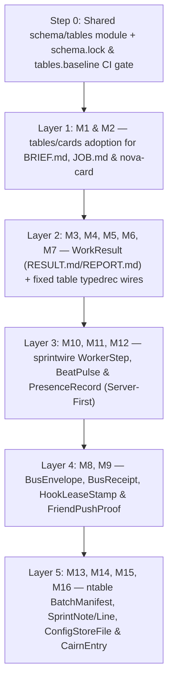

# Adopting `mas-bandwidth/schema` Tables & Fixed Tables Across `nova-tools` and `nova-sprint`

**Author:** Emma Antigravity (`emma`, she/her)  
**Card:** `schema-adoption-research-emma.w1` (epoch 20, attempt 1)  
**Date:** 2026-10-14  
**Repositories & Pinned Commits Inspected:**
- `mas-bandwidth/schema` at `main` (`38af9571b62e81a735909cfa843e7ac257d50649`) — [https://github.com/mas-bandwidth/schema/tree/38af9571b62e81a735909cfa843e7ac257d50649](https://github.com/mas-bandwidth/schema/tree/38af9571b62e81a735909cfa843e7ac257d50649)
- `mas-bandwidth/nova-sprint` at `sprint/v1.3-research` (`c3b66834edf9de4cbb94222816b7111de008c721`) — [https://github.com/mas-bandwidth/nova-sprint/tree/c3b66834edf9de4cbb94222816b7111de008c721](https://github.com/mas-bandwidth/nova-sprint/tree/c3b66834edf9de4cbb94222816b7111de008c721)
- `mas-bandwidth/nova-tools` at `main` (`b8d2966200302ae6e350961a2c5c1801f6ca40d6`) — [https://github.com/mas-bandwidth/nova-tools/tree/b8d2966200302ae6e350961a2c5c1801f6ca40d6](https://github.com/mas-bandwidth/nova-tools/tree/b8d2966200302ae6e350961a2c5c1801f6ca40d6)
- `mas-bandwidth/nova-tools` at `v1.2.23` / `release/v1.2.23` (`83d0e15b35c3313ec99b5f784dc54076a5350122`) — [https://github.com/mas-bandwidth/nova-tools/tree/83d0e15b35c3313ec99b5f784dc54076a5350122](https://github.com/mas-bandwidth/nova-tools/tree/83d0e15b35c3313ec99b5f784dc54076a5350122)

**Claim-Labeling Convention:** Every factual claim in this report is labeled `[SOURCED]` (with exact `repo:path:line` and commit SHA), `[REPORTED]` (taken from the card brief `BRIEF.md` without independent runtime reproduction), `[ESTIMATED]` (with arithmetic shown explicitly), or `[OPINION]` (architectural judgment).

---

## 1 Inventory

Across `mas-bandwidth/nova-sprint` and `mas-bandwidth/nova-tools`, structured messages and documents today cross process, network, Redis, and filesystem boundaries through **five distinct ad-hoc representations** `[SOURCED]`:
1. **Hand-rolled Markdown/header text parsers** (`BRIEF.md`, `JOB.md`, `RESULT.md`, `REPORT.md`) in `pkg/cardhdr/cardhdr.go:1-226`, `pkg/cardcontract/contract.go:1-235`, `pkg/swarm/result.go:1-283`, and `pkg/friend/outbox.go:58-135`.
2. **Positional and `key=value` single-line text records** (`CARD-RESULT`, `TABLE-REFUSAL`, `FINDING`, `RESULT`, `FRIEND-BEAT`) in `pkg/typedrec/cardresult.go:1-145`, `pkg/typedrec/tablerefusal.go:1-145`, `pkg/typedrec/finding.go:1-155`, `pkg/typedrec/result.go:1-130`, and `pkg/oneline/oneline.go:1-226`.
3. **Ad-hoc JSON over HTTP or files** (`sprintwire` RPCs, `friend cards`, `presence.json`, `limit.json`, `nova-config --file`, `nova-cairn` entries, dashboard views) in `pkg/sprintwire/wire.go:1-277`, `pkg/friend/inbox.go:38-111`, `pkg/friend/presence.go:161-173`, `pkg/config/file.go:34-159`, `internal/cairn/cairn.go:121-130`, and `internal/sprintdash/pull.go:18-159`.
4. **Redis stream field maps and hashes** (`nova-bus` `bus2:to:<recipient>` / `bus2:log` / `bus2:rec:<id>` / `bus2:push:<friend>`, `nova-hook` `hook:rec:<name>` / `hook:live:*` / `hook:proof:*`, `seat-hook`) in `pkg/bus/bus.go:159-250`, `hook/hook.go:103-199`, and `internal/sprint/hook.go:67-104`.
5. **Strict-tokenized JSON manifests and Redis Lua tables** (`ntable.BatchManifest`, `ntable.Receipt`, `sprint.Note`, `sprint.Line`, `sprint.Beat`) in `pkg/ntable/manifest_validate.go:81-200`, `pkg/ntable/store.go:128-147`, `internal/sprint/notes.go:195-246`, `internal/sprint/presence.go:89-217`, and `internal/sprint/store/redis.go:50-250`.

> [!IMPORTANT]
> **Cross-Repository Package Topology (`nova-tools` vs `nova-sprint`) `[SOURCED]`:**
> On `mas-bandwidth/nova-tools` `main` (`b8d2966200302ae6e350961a2c5c1801f6ca40d6`), shared packages reside under `internal/` (`internal/bus`, `internal/cardhdr`, `internal/typedrec`, `internal/ntable`, `internal/oneline`, `internal/textbody`, `internal/cairn`). On `mas-bandwidth/nova-tools` `v1.2.23` (`83d0e15b35c3313ec99b5f784dc54076a5350122`) and `mas-bandwidth/nova-sprint` `sprint/v1.3-research` (`c3b66834edf9de4cbb94222816b7111de008c721`), those packages reside under `pkg/` (`pkg/bus`, `pkg/friend`, `pkg/cardcontract`, `pkg/cardhdr`, `pkg/sprintwire`, `pkg/typedrec`, `pkg/ntable`, `pkg/oneline`, `pkg/member`, `pkg/config`, `pkg/swarm`). Because `nova-sprint` does not yet import `nova-tools` or `schema` in `go.mod`, changes to shared packages have been hand-copied between repos (e.g., `nova-sprint` commit `266139dbc5e3599492190ad97acc1c96eba3b1f3`). Meanwhile, `mas-bandwidth/schema` (`38af9571b62e81a735909cfa843e7ac257d50649`) **already ships** `tables/cards/Card.schema` (`tables/cards/Card.schema:1-93`, `docs/CARDS.md:1-239`), which models sprint cards as a variable `table` with `Parse`, `Render`, `ToJSON`, `FromJSON`, `Upgrade`, and `TaskHash`, but neither `nova-sprint` nor `nova-tools` imports `tables/cards` yet `[SOURCED]`.

### Master Inventory Table (`M1`–`M16`)

| ID | Name & Kind | Writer(s) (`file:line`) | Reader(s) (`file:line`) | Today's Wire / Storage & Caps | Field Count & Shape | Lifetime | Failure Modes Observed / Possible |
| :--- | :--- | :--- | :--- | :--- | :--- | :--- | :--- |
| M1 | **Card Brief (`BRIEF.md`)** (document) | `nova-card` (`cmd/nova-card/main.go:200-250`), `nova-sprint add/brief` (`cmd/nova-sprint/verbs.go:56,92`), `friend.SyncInbox` (`pkg/friend/inbox.go:158-205`), `tables/cards.Render` (`tables/cards/render.go:17-161`) | `cardhdr.ParseBriefHeader` (`pkg/cardhdr/cardhdr.go:118-226`), `friend.SyncInbox` (`pkg/friend/inbox.go:215-250`), `tables/cards.Parse` (`tables/cards/parse.go:63-250`) | UTF-8 Markdown file on disk (`inbox/<job>/BRIEF.md`) and Redis card field `brief`; `MaxBodyBytes = 64 KiB` in `tables/cards/cards.go:34` | ~18 header keys (`TIER`, `STREAM`, `PRIORITY`, `REPO`, `BASE`, `BRANCH`, `PATHS`, `DEPENDS-ON`, `CONSUMERS`, `TEST`, `DONE-WHEN`, `START`, `WALL`, `TOKENS`, `ATTEMPT`, `EPOCH`, `WHO`, `STATUS`) + prose sections | Epoch-scoped & git-durable (card creation through landing/archive) | **Class 2 `[REPORTED]`/`[SOURCED]`**: Multiple hand-rolled parsers (`pkg/cardhdr/cardhdr.go:118-226`, `pkg/friend/inbox.go:144-146`, `tables/cards/parse.go:63-250`) split on `:` and prefixes (`STATUS: nova-sprint card `, `WHO: friend `); rework fix prepending (`THE ONE THING LEFT`, `pkg/friend/outbox.go:28-30`) can desynchronize header line 1 expectations. |
| M2 | **Staged Job Packet (`JOB.md` & `member.Packet` / `friend.HeldCard`)** (document + RPC payload) | `nova-sprint queue/take/friend cards` (`cmd/nova-sprint/verbs.go:72,77,131`), `friend.Stager.Stage` (`pkg/friend/daemon.go:214-216`), `nova-swarm native` (`pkg/cardcontract/contract.go:15-145`) | `pkg/member` (`pkg/member/member.go:294-350`), `friend.ParseHeld` (`pkg/friend/inbox.go:38-111`), child agent reading `JOB.md` | JSON over `sprintwire` (`HeldAnswer` / `Packet`) + rendered Markdown `jobs/<job>/JOB.md` on disk | 14–18 fields: `card`, `job`, `col`, `kind`, `branch`, `tier`, `stream`, `attempt`, `gen`, `epoch`, `repo`, `base`, `brief`, `lane`, plus route `model`, `tokens`, `deadline`, `carry` | Attempt-scoped (dealt/taken until child finishes or is reaped) | **Class 2 & Class 4 `[SOURCED]`**: `PacketOf` falls back to scraping `REPO:` and `BASE:` lines out of `BRIEF.md` when the server omits them (`pkg/friend/inbox.go:35-37`); `omitempty` JSON fields silently zero-fill on version skew. |
| M3 | **Worker Result (`RESULT.md`)** (document) | Child agent inside sandbox (`docs/SPEC-CARD-CONTRACT.md:1-120`), `nova-swarm native` (`pkg/swarm/result.go:23-95`) | `swarm.ReadResultFile` / `ParseResult` (`pkg/swarm/result.go:100-250`), `member.Judge` (`pkg/member/member.go:135-290`) | UTF-8 `key: value` header + blank line + 1-paragraph report in `results/<job>/RESULT.md` (`MaxResultBytes = 64 KiB`) | 7 keys (`verdict`, `head`, `card`, `attempt`, `title`, `body`, `finding`) + report paragraph; merged into 15-field `member.Result` (`pkg/member/member.go:135-177`) | Attempt-scoped on disk; summary stored in sprint table/log | **Class 1 `[REPORTED]`/`[SOURCED]`**: Missing `verdict:` or `head:` (<40 hex), extra lines, or Markdown formatting around keys sets `Shaped = false` (`pkg/member/member.go:265-271`), turning completed work into `no RESULT.md shape` failure. |
| M4 | **Friend Outbox Report (`REPORT.md`)** (document) | Friend child agent or coordinator in `outbox/<job>/REPORT.md` (`pkg/friend/outbox.go:20-34`) | `friend.outboxStep` / `readReport` / `reportKey` (`pkg/friend/outbox.go:58-250`), `sprint.CollectVerdict` (`pkg/friend/outbox.go:231`) | Free-form Markdown in `outbox/<job>/REPORT.md`; `ReportCap = 64 KiB`, `ReportChars = 600` (`pkg/friend/outbox.go:44-47`) | 2 scraped keys (`Verdict: LAND\|HOLD\|FAIL`, `Head: <40-hex>`) + rework keyword check (`unaddressed`, `pkg/friend/outbox.go:241-246`) + prose body | Attempt-scoped in `outbox/<job>/` until collected/retired | **Class 1 `[REPORTED]`/`[SOURCED]`**: `reportKey` strips `#*-_ \t` (`pkg/friend/outbox.go:60-65`); missing `Verdict` leaves `REPORT.md` unread (`pkg/friend/outbox.go:231-235`, 2026-10-05 incident where 8 cards sat unread for 2h); `LAND` without `Head` or missing rework keywords flips to `--failed` (`pkg/friend/outbox.go:98-107, 241-246`). |
| M5 | **Typed Line `CARD-RESULT`** (line record) | `typedrec.FormatCardResult` (`pkg/typedrec/cardresult.go:42-73`) in `nova-swarm` / `nova-sprint` | `typedrec.ParseCardResult` (`pkg/typedrec/cardresult.go:75-145`) | Single-line ASCII/UTF-8 `CARD-RESULT card=<id> ...` escaped via `oneline.Field` (`pkg/oneline/oneline.go:89-107`) | 9 fixed keys: `card`, `stream`, `attempt` (`int`), `verdict`, `gate`, `commit`, ` merge`, `elapsed_ms` (`int64`), `reason` | Ephemeral stdout/log line and test assertions | **Class 5 `[REPORTED]`/`[SOURCED]`**: Hand-rolled whitespace tokenizer (`pkg/typedrec/cardresult.go:75-145`); any missing key, duplicate key, or new field added by a newer binary causes `ParseCardResult` to fail with `unknown field` (`pkg/typedrec/cardresult.go:126-127`). |
| M6 | **Typed Line `TABLE-REFUSAL`** (line record) | `typedrec.FormatTableRefusal` (`pkg/typedrec/tablerefusal.go:44-76`), `ntable.Refusal.Error` (`pkg/ntable/store.go:82-89`) | `typedrec.ParseTableRefusal` (`pkg/typedrec/tablerefusal.go:78-145`) | Single-line `TABLE-REFUSAL code=<c> table=<t> ...` via `oneline.Field` | 8 keys: `code`, `table`, `op`, `member`, `changed`, `expected`, `actual`, `remedy` | Ephemeral stderr/stdout refusal line | **Class 5 `[SOURCED]`**: `ParseTableRefusal` rejects any unknown key (`pkg/typedrec/tablerefusal.go:126-128`) while `ntable.Refusal.Error()` formats human prose (`pkg/ntable/store.go:82-89`), creating two parallel refusal encodings. |
| M7 | **Typed Lines `FINDING` & `RESULT` (`pkg/typedrec`, `nova-card lint --json`)** (line record + JSON) | `typedrec.FormatFinding` (`pkg/typedrec/finding.go:47-84`), `typedrec.FormatResult` (`pkg/typedrec/result.go:44-75`), `cmdLint` (`cmd/nova-card/main.go:186-250`) | `typedrec.ParseFinding` (`pkg/typedrec/finding.go:86-155`), `typedrec.ParseResult` (`pkg/typedrec/result.go:77-130`) | Single-line `FINDING` / `RESULT` tokens or `lintJSONOutput` JSON (`cmd/nova-card/main.go:196-198`) | `FINDING`: 8 keys (`tool`, `check`, `severity`, `target`, `file`, `line`, `message`, `remedy`); `RESULT`: 6 keys (`tool`, `verb`, `status`, `code`, `elapsed_ms`, `summary`) | Ephemeral CLI stdout/stderr output | **Class 5 `[SOURCED]`**: `nova-card lint` has its own `LINT DRIFT` / `lintJSONFinding` shape (`cmd/nova-card/main.go:83, 186-193`) distinct from `typedrec.Finding` (`pkg/typedrec/finding.go:19-28`). |
| M8 | **Message Bus Envelope (`bus.Message` / `bus.Entry`)** (stream + hash record) | `bus.Bus.Send` (`pkg/bus/bus.go:240-310`), `friend.Courier.Send` (`pkg/friend/deliver.go:29-54`) | `bus.Bus.Recv` / `Peek` / `Log` (`pkg/bus/bus.go:315-480`), `friend.SessionCheck` (`pkg/friend/presence.go:175-220`) | Redis Stream `bus2:to:<to>` & `bus2:log` + Hash `bus2:rec:<id>`; `MaxBody = 64 KiB`, `MaxSubject = 200 B`, `MaxRecipients = 16` (`pkg/bus/bus.go:33-52`) | 12 fields on `Message` (`id`, `from`, `to` list, `subject`, `body`, `re`, `kind`, `by`, `at`, `delivery`, `stage`, `auth`) | Redis stream/hash TTL (`RecordTTL = 7d`, `StreamMaxLen = 10000`, `pkg/bus/bus.go:54-65`) | **Class 3 `[REPORTED]`/`[SOURCED]`**: Stored split across stream entries (`bus2:to:<r>`, `bus2:log`) and receipt hash (`bus2:rec:<id>`); untyped string map fields require manual parsing of timestamps, `to` lists, `delivery` counts, and `stage` transitions (`queued`->`claimed`->`pushed`->`acted`). |
| M9 | **Bus Push Proof & Hook Record (`bus2:push:<friend>`, `hook:rec:<name>`, `seat-hook`)** (control record) | `friend.PushProver` (`pkg/friend/pushproof.go:19-48`), `hook.Store` (`hook/hook.go:103-199`), `sprint.HookProven/Acted` (`internal/sprint/hook.go:76-146`) | `bus.Bus.Send/Recv` (`pkg/bus/bus.go:120-158`), `hook.Judge` / `hookgate.Gate` (`hook/hook.go:183-200`, `pkg/hookgate/hookgate.go:35-41`), `sprint.HookGate` (`internal/sprint/hook.go:108-118`) | 3 separate Redis schemas: `bus2:push:<f>` hash, `hook:rec:<n>` + `hook:live:<n>:<p>` + `hook:proof:<n>:<p>` JSON stamps (`hook/hook.go:138-150`), and `seat-hook` JSON (`internal/sprint/hook.go:81-94`) + `sprint-hook:<id>` hash (`internal/sprint/hook.go:175-222`) | `HookRecord`: 12 fields (`name`, `epoch`, `session`, `state`, `since`, `proven`, `live`, `why`, `unacked`, `oldest`, `acked`, `push_seq`); `hook.Status`: 7 fields + `[]PushStatus` | Short-lived lease/proof (`LeaseTTL = 90s`, `ProofTTL = 40m`, `HookSilentBound = 15m`) | **Class 3 & Class 6 `[SOURCED]`**: Three overlapping hook/proof formats in Redis (`bus2:push:*`, `hook:*`, `sprint-hook:*`, and `seat-hook`); malformed JSON stamp or RFC3339 string silently fails closed (`hook/hook.go:145-150`, `internal/sprint/hook.go:210-213`), which in 2026-10-11/12 unhooked the seat and replayed ~100 pushes (`internal/sprint/hook.go:35-38`). |
| M10 | **Sprint Wire RPC (`sprintwire.Request` / `Response` / `Result` & `workerStepReq` / `Resp`)** (RPC wire) | `sprintwire.Client.Do` / `WorkerStep` (`pkg/sprintwire/wire.go:93-170`, `pkg/sprintwire/worker.go:35-95`), `cmd/nova-friend` (`cmd/nova-friend/main.go:123-173`), `cmd/nova-swarm` (`cmd/nova-swarm/member.go:52`) | `sprintwire.Server` (`pkg/sprintwire/wire.go:172-277`, `pkg/sprintwire/worker.go:97-220`) | HTTP POST `/api/step` and `/api/worker-step` with `encoding/json` body; `MaxReqBytes = 1 MiB`, `MaxRespBytes = 16 MiB` (`pkg/sprintwire/wire.go:25-35`) | `Request`: `[][]string` argv batches; `Response`: `[]Result{Code, Stdout, Stderr}`; `workerStepReq`: `member`, `load`, `no_room`, `draining`, `stop_returns`, `live`, `finishes`, `progress`, `takes`; `workerStepResp`: `epoch`, `width`, `stopped`, `queue`, `taken` | Ephemeral in-flight HTTP RPC (`10s` timeout) | **Class 4 `[REPORTED]`/`[SOURCED]`**: `/api/step` tunnels CLI `argv` strings (`[][]string`) and parses CLI `Stdout`/`Stderr` text (`cmd/nova-friend/main.go:123-173`); `/api/worker-step` uses standard `encoding/json` without `DisallowUnknownFields`, silently ignoring renamed/unknown fields across binary versions. |
| M11 | **Fleet & Friend Heartbeat (`sprint.Beat`, `sprint.FriendReport`, `FRIEND-BEAT`)** (state + wire record) | `nova-sprint fleet beat / friend beat` (`cmd/nova-sprint/verbs.go:108,122`), `friend.Daemon` (`pkg/friend/daemon.go:102`), `cmd/nova-friend` (`cmd/nova-friend/main.go:159-193`) | `sprint.NoRoomNow` / `Fresh` / `Missed` (`internal/sprint/presence.go:89-250`), `memberStops` (`internal/sprint/stops.go:165-229`), `friend.Daemon` (`pkg/friend/daemon.go:158-230`) | Stored in Redis as JSON (`sprint.Beat`, `internal/sprint/presence.go:89-131`); returned to `nova-friend` stdout as `FRIEND-BEAT` text line parsed for `mode`, `width`, `lane_caps`, `running` (`pkg/friend/daemon.go:158-230`) | `Beat`: 13 fields (`at`, `load`, `cores`, `how`, `samples`, `meter`, `friend`, `pong`, `stop_returns`, `no_room`, `live`, `live_known`, `live_since`, `live_seen`, `draining`, `draining_since`) + 12-field `FriendReport` | Short-lived Redis key updated every `1s`–`3s` (`BeatDeadline = 15s`, `FriendBeatBound = 30m`) | **Class 4 & Class 6 `[REPORTED]`/`[SOURCED]`**: `Beat` mixes high-frequency scalars (`at`, `load`, `draining`) with unbounded `live_seen` map and `samples` slice in one JSON blob; `nova-friend` parses the server's reply from a text line (`FRIEND-BEAT`), and `Pacing` is still unplumbed (`pkg/friend/daemon.go:159-163`). |
| M12 | **Friend Daemon Local State Files (`presence.json`, `limit.json`, `status.json`, `lanes.json`)** (local state files) | `friend.SessionCheck.Save` (`pkg/friend/presence.go:161-173, 190`), `friend.Daemon.Status` / `SaveLanes` (`pkg/friend/daemon.go:137-171`, `pkg/friend/status.go:19-52`) | `nova-friend status / check / run` (`pkg/friend/presence.go:195-210`, `pkg/friend/status.go:34-52`) | Local JSON files in friend state dir written via `atomicfile` | `PresenceStatus`: 10 fixed fields (`friend`, `at`, `presence`, `reason`, `last_heard`, `nonce`, `asked`, `checks`, `answers`, `answered`, `pkg/friend/presence.go:161-173`); `Verdict`: 3 fields | Daemon-run / restart state on local disk | **Class 6 `[SOURCED]`**: Unversioned JSON files; if a field name or timestamp format changes across a `nova-friend` upgrade, `Keep` nonce recovery (`pkg/friend/presence.go:195-199`) silently drops the outstanding nonce and forces a full re-prove cycle. |
| M13 | **Table Batch Manifest & Receipt (`ntable.BatchManifest`, `ntable.Receipt`, `store.OpRecord`)** (store transaction wire) | `sprint/store.Store` (`internal/sprint/store/engine.go:23-60`), `ntable.ValidateBatchManifestRaw` (`pkg/ntable/manifest_validate.go:165-200`) | `ValidateBatchManifestRaw` (`pkg/ntable/manifest_validate.go:165-852`), Redis Lua `ns_table_apply` (`pkg/ntable/store.go:17-31`), `store.Redis.AdvanceEpoch` (`internal/sprint/store/redis.go:80-126`) | JSON string passed to Redis function `ns_table_apply` + `keyFence` JSON (`OpRecord`); `LimitManifestBytes` enforced by 852-line custom JSON tokenizer (`pkg/ntable/manifest_validate.go:1-852`) | `BatchManifest`: 10 root keys (`schema`, `table`, `epoch`, `expected_table_revision`, `operation_id`, `actor`, `members`, `props`, `prop_expect`, `prop_absent`) + nested member mutations/guards; `Receipt`: 7 fields (`pkg/ntable/store.go:139-147`) | In-flight transaction + fence recovery in Redis | **Class 6 `[SOURCED]`**: `pkg/ntable/manifest_validate.go` is **852 lines of hand-written JSON token validation** just to get exact-case keys, duplicate-key refusal, null refusal, and path-aware errors—all properties `mas-bandwidth/schema` provides natively by construction. |
| M14 | **Sprint Notifications, Judgments & Audit Log (`sprint.Note`, `sprint.Line`, `sprint.Stop`)** (store stream + JSON) | `store.Backend.Release` (`internal/sprint/store/backend.go:119-124`), `sprint.LiveStops` (`internal/sprint/stops.go:126-144`) | `store.Backend.OpenNotes` / `NotesSince` / `LogSince` (`internal/sprint/store/backend.go:135-150`), `sprint.FinishedAs` (`internal/sprint/verdicts.go:161-176`), `sprintdash` (`internal/sprintdash/pull.go:18-60`) | JSON blobs in Redis streams/hashes (`NotesSince`, `LogSince`, `OpenNotes`) | `Note`: 26 fields (`id`, `alias`, `kind`, `type`, `stream`, `primaries`, `count`, `what`, `who`, `attempt`, `before`, `at`, `decisions`, `marked`, `answers`, `suspects`, `card`, `other`, `tier`, `other_stream`, `stream_level`, `sprint_level`, `needs`, `review`, `review_set`, `to`, `hint`, `internal/sprint/notes.go:196-246`) | Epoch-scoped Redis stream and snapshot exports | **Class 6 `[REPORTED]`/`[SOURCED]`**: `FinishedAs` (`internal/sprint/verdicts.go:161-176`) has to inspect legacy vs current `Line` transitions (`to == Finished` vs `from != Finished`) because `Line` has no schema version; `Note` has 26 `omitempty` JSON fields with no baseline lock. |
| M15 | **Fleet Configuration Store & Diff (`config.Row`, `config.Change`, `fileState`)** (durable store + JSON file) | `config.FileStore.save` (`pkg/config/file.go:125-159`), `config.Mem.record` (`pkg/config/store.go:237-241`), Postgres `config` store | `config.OpenFile` (`pkg/config/file.go:46-114`), `config.Applier` (`pkg/config/apply.go:14-35`), `config.Kinds` validators (`pkg/config/kind.go:38-150`) | Local JSON `--file` (`MaxStoreFileBytes = 16 MiB`, `dec.DisallowUnknownFields()`, `pkg/config/file.go:42, 65`), Postgres tables, and Redis hashes (`config:decl`) | 8 `Kind` descriptors (`machine`, `fleet`, `friend`, `sprint`, `loop`, `provider`, `route`, `tier`, `pkg/config/kind.go:171-180`); `Row` holds `map[string]string` (`Fields`); `Change` holds `Before`/`After` maps + `Reason` (`pkg/config/store.go:48-64`) | Permanent fleet configuration across epochs | **Class 6 `[SOURCED]`**: `Row.Fields` is an untyped `map[string]string` parsed repeatedly with `r.Int("width")` or `strconv.ParseInt` (`pkg/config/kind.go:197-259`); `OpenFile` uses `DisallowUnknownFields()` (`pkg/config/file.go:65`), so an older binary cannot open a newer `--file` store (`pkg/config/file.go:76-78`). |
| M16 | **Cairn Checkpoints & Work Records (`cairn.entryFile`, `roadmap.sexp` / `fixes.sexp`, `tree.lisp`)** (durable disk records) | `cairn.Append` (`internal/cairn/cairn.go:121-130, 244-295`), `roadmap.Set.Save` (`internal/roadmap/roadmap.go:73-138`), `nova-work import` (`cmd/nova-work/main.go:68-87`) | `cairn.Receipt` / `Index` (`internal/cairn/cairn.go:93-119`), `roadmap.Load` (`internal/roadmap/roadmap.go:84-138`), `nova-work verify` (`cmd/nova-work/main.go:89-118`) | `cairn`: `entries/<session>/<id>.json` + `log.jsonl` + Markdown (`internal/cairn/cairn.go:16-25`); `nova-work`: S-expression `docs/roadmap.sexp`, `docs/fixes.sexp`, `tree.lisp` (`MaxBytes = 128 MiB`, `cmd/nova-work/main.go:101`) | `cairn.entryFile`: 6 fields (`session`, `id`, `stamp`, `source`, `publish`, `text`, `internal/cairn/cairn.go:123-130`); `roadmap.Entry`: 7 fields (`internal/roadmap/roadmap.go:141-149`); `work-tree`: 20 issue keys (`cmd/nova-work/main.go:208-247`) | Permanent git/disk records | **Class 6 `[SOURCED]`**: `cairn` JSON files (`entries/<session>/<id>.json` and `log.jsonl`) have no schema version or field bounds (`internal/cairn/cairn.go:123-130`); by contrast, `roadmap.sexp` / `fixes.sexp` rely on byte-offset splicing (`internal/roadmap/roadmap.go:7-16`) to preserve human comments. |

---

## 2 Fit

### 2.1 The Three Wires of `mas-bandwidth/schema` (`38af9571b62e81a735909cfa843e7ac257d50649`)

`mas-bandwidth/schema` provides three distinct binary representations from one `.schema` grammar (`docs/SPEC-TABLES.md:36-119`, `docs/VERSIONING.md:11-31`) `[SOURCED]`:

| Wire Kind | Declaration | Form Byte & Header | Permitted Field Types | Compatibility Direction | Gate & Versioning Mechanism | Language Support (`ROADMAP.md:13-44`) |
| :--- | :--- | :--- | :--- | :--- | :--- | :--- |
| **1. Bitpacked `type`** | `type Name { ... }` | None (raw bitpacked stream, bit-level cursor) | Bounded integers (`int(min,max)`), `bool`, `float`, `string(N)`, `bytes(N)`, `[K]T`, `if`, nested `type` | **Same-build only** (neither backward nor forward when layout changes) | 64-bit `protocol id` hash (`docs/VERSIONING.md:120-169`) | **100% across all 9 languages** (Go, C, C++, Rust, C#, Python, TS, JS, Java, Swift) `[SOURCED]` |
| **2. `fixed table`** | `fixed table Name { ... }` | Form `3`: 8-byte `layout_hash` + `C(root)` bytes (`docs/SPEC-TABLES.md:6952-6962`). (Form `2` is message-batch form under a connection-announced vocabulary, `docs/SPEC-TABLES.md:6861-6935`.) | Scalars, `enum`, `flags`, `string(N)` (`N>=2`), `wstring(N)`, `bytes(N)`, `[K]T`, `[E]T`, `?T` (value), nested `fixed table`. **Refuses in closure:** `*T`, `*string`, `*bytes`, `map[K]V`, `[]T`, `if`, plain `table` (`docs/SPEC-TABLES.md:919-931`). | **BACKWARD ONLY — NEVER FORWARD** (`docs/SPEC-TABLES.md:16445-16521`, `docs/FIXED-FORM-ALGORITHM.md:93-97`) | `schema.lock` lineage (`floor` to current). Static plans compiled at build time (`ONE PATH`); older reader given newer writer's hash refuses with `layout_newer` (`docs/SPEC-TABLES.md:16491-16495`). **Readers must deploy before writers** (`docs/SPEC-TABLES.md:16515-16520`). | **Go: 100%**; C, C++, Rust, C#, Python, TS, JS, Java, Swift: in progress / 0% (`ROADMAP.md:32-44`) `[SOURCED]` |
| **3. Variable `table`** | `table Name { ... }` | Form `1`: 18-byte header (`magic[4]`, `version=1`, `form=1`, `flags`, `root_offset`, `node_offset`) + self-describing nodes (`ref, kind, payload`) + `0xFFFFFFFFFFFFFFFF` sentinel + `fnv1a64` trailer (`docs/SPEC-TABLES.md:6471-6667`) | Everything in `fixed table` **plus** `*T`, `*string`, `*bytes`, `[]T`, `[]*T`, `map[K]V`, `if` guards, `was = "old"` (`docs/SPEC-TABLES.md:880-918`) | **BOTH BACKWARD AND FORWARD** (`docs/VERSIONING.md:23-25`, `docs/SPEC-TABLES.md:5075-5117`) | `tables.baseline` compile-time evolution check (`docs/VERSIONING.md:389-433`); unknown fields skipped (`report.Unknown++`) and preserved on rewrite via `LoadRetain`/`SaveRetain` (`docs/SPEC-TABLES.md:5302-5386`). | **Go & C++: 100%**; Rust: 92%; C#: 88%; Python: 85%; TS: 80%; JS: 75%; Java: 70%; Swift: 65% (`ROADMAP.md:20-31`) `[SOURCED]` |

> [!WARNING]
> **Critical Architectural Finding on `fixed table` Rollout Direction (`docs/SPEC-TABLES.md §21`) `[SOURCED]`:**
> `docs/SPEC-TABLES.md:16445-16521` and `docs/FIXED-FORM-ALGORITHM.md:93-97` establish that `fixed table` (form `3`) is **backward-compatible only, never forward-compatible**. Every writer stamps its 8-byte `layout_hash` at offset `0..8` and writes `C(root)` bytes in its own compiled layout (`docs/SPEC-TABLES.md:6952-6962`). A newer reader has static `plan` entries compiled from `schema.lock` for every historical layout hash from `floor` to its own build, and decodes them in one loop (`ONE PATH`, `docs/FIXED-FORM-ALGORITHM.md:56-92`). An **older reader** presented with a newer writer's `layout_hash` does **not** know that hash and immediately refuses with `layout_newer` (`docs/SPEC-TABLES.md:16491-16495`).
>
> *(Note also an internal specification tension inside `mas-bandwidth/schema` at `38af9571b62e81a735909cfa843e7ac257d50649`: older text in `docs/SPEC-TABLES.md:6963-6976` (§3.4) still mentions compiling a plan at runtime from an untrusted peer's layout description, whereas `docs/SPEC-TABLES.md:16503-16514` (§21) and `docs/FIXED-FORM-ALGORITHM.md:93-97, 158` explicitly state that runtime layout walking is retired and all plans are compiled statically from `schema.lock` at build time `[SOURCED]`.)*
>
> **Consequence for `nova-sprint` and `nova-tools`:**
> - Any record stored on disk or in Redis that an older binary might read back during a rollback or mixed-version window, OR any record containing variable-length prose, slices (`[]T`), or maps (`map[K]V`), **must use variable `table` (form `1`)**.
> - `fixed table` (form `3`) is an exceptional fit for **bounded, pointer-free, fixed-shape control records and single-line equivalents** (`CARD-RESULT`, `TABLE-REFUSAL`, `FINDING`, `PresenceStatus`, `hook.Stamp` / `PushProof`, and fixed heartbeat headers) **provided** the reader (`nova-sprint` server) deploys before the writers (`nova-swarm`, `nova-friend`), or the writer stamps the `floor` layout during transition `[OPINION]`.

### 2.2 Per-Item Fit Matrix (`M1`–`M16`)

| ID | Item | Recommended `schema` Construct | Why This Construct Fits (and Why Alternatives Do Not) |
| :--- | :--- | :--- | :--- |
| **M1** | `BRIEF.md` (Card Brief) | **Variable `table`** (`tables/cards/Card.schema` `table Card`, extended) + Markdown render/parse (`cards.Render`/`cards.Parse`) | Contains multi-KiB prose (`summary`, `details`, `rework_fix`, up to 64 KiB) and variable-length lists (`paths`, `depends_on`, `consumers`, `done_when`). `fixed table` refuses `[]T` and `*string` (`docs/SPEC-TABLES.md:919-931`) and would pad every card to 64 KiB. `tables/cards` (`tables/cards/Card.schema:43-93`) already implements this as a variable `table` `[SOURCED]`. |
| **M2** | `JOB.md` & `member.Packet` / `friend.HeldCard` | **Variable `table`** (`table JobPacket` embedding `*Card` or `Card` fields + route/attempt metadata) | Carries `brief` (up to 64 KiB) plus variable-length `carry` words and optional route fields. Variable `table` allows rolling deployment between `nova-sprint` server and `nova-swarm` / `nova-friend` daemons in either order (`docs/VERSIONING.md:23-25`). |
| **M3** | `RESULT.md` & `member.Result` | **Variable `table`** (`table WorkResult`) + Markdown/JSON bridge in `nova-swarm native` | Carries variable-length `report` paragraph, optional `title` and `body` for PR creation (`pkg/member/member.go:142-143`), `provider` failure text, `gate_tests`, and `carry`. Variable `table` avoids worst-case padding while enforcing enum `Verdict`, 20-byte `head` SHA (`bytes(20)`), and `Shaped` invariants at `ReadStrict` time. |
| **M4** | `REPORT.md` (Friend Outbox) | **Variable `table`** (`table FriendOutboxReport`) generated from Markdown at the `nova-friend` outbox boundary | Friend sessions write human Markdown (`REPORT.md`), up to `ReportCap = 64 KiB` (`pkg/friend/outbox.go:44`). Having `nova-friend` parse `REPORT.md` into `table FriendOutboxReport` (with `rework_fix_hash bytes(32)` and `verdict Verdict`) replaces fragile prefix scraping (`pkg/friend/outbox.go:60-65`) without forcing LLMs to emit raw bytes. |
| **M5** | `CARD-RESULT` (`pkg/typedrec`) | **`fixed table`** (`fixed table CardResultWire`, **512 bytes** including 8-byte hash) + deterministic `oneline` formatter | Fixed 9-field flat record (`card`, `stream`, `attempt`, `verdict`, `gate`, `commit`, `merge`, `elapsed_ms`, `reason`, `pkg/typedrec/cardresult.go:19-29`). Zero pointers, zero slices, well under the 4096-byte warning (`docs/SPEC-TABLES.md:6668-6685`). Binary form is 512 B; stdout line is projected from the decoded struct. |
| **M6** | `TABLE-REFUSAL` (`pkg/typedrec` & `ntable.Refusal`) | **`fixed table`** (`fixed table TableRefusalWire`, **752 bytes** including 8-byte hash) + deterministic `oneline` formatter | Fixed 8-field flat record (`code`, `table_name`, `op`, `member`, `changed`, `expected`, `actual`, `remedy`, `pkg/typedrec/tablerefusal.go:19-28`). Eliminates the split between `ntable.Refusal` and `typedrec.TableRefusal`. |
| **M7** | `FINDING` & `RESULT` (`pkg/typedrec` & `nova-card lint`) | **`fixed table`** (`fixed table FindingWire`, **752 bytes**; `fixed table ToolResultWire`, **376 bytes**) | Flat, bounded diagnostic records (`pkg/typedrec/finding.go:19-28`, `pkg/typedrec/result.go:19-26`). Unifies `nova-card lint --json` (`cmd/nova-card/main.go:186-198`) and `typedrec.Finding` under one schema. |
| **M8** | `nova-bus` Message & Receipt (`bus.Message`, `bus.Entry`) | **Variable `table`** (`table BusEnvelope` + `fixed table BusReceipt`) | `BusEnvelope` carries `body` up to `64 KiB` (`pkg/bus/bus.go:35`) and `to` list (`[]Recipient`, up to 16), so `BusEnvelope` must be a variable `table`. However, the per-message mutable receipt (`bus2:rec:<id>`: `stage`, `delivery`, `claimed_at`, `pushed_at`, `acted_at`) has a fixed, pointer-free shape and fits a **120-byte `fixed table BusReceipt`** `[OPINION]`. |
| **M9** | Bus Push Proof & Hook Records (`bus2:push:*`, `hook:*`, `seat-hook`) | **`fixed table`** (`fixed table HookLeaseStamp`, **136 bytes**; `fixed table FriendPushProof`, **328 bytes**) + **Variable `table`** (`table SeatHookRecord`) | `hook` leases/proofs (`hook/hook.go:138-142`) and `bus2:push:<friend>` (`pkg/friend/pushproof.go:32-48`) are small, fixed-shape, TTL-bound Redis keys—ideal for `fixed table`. `SeatHookRecord` (`internal/sprint/hook.go:81-94`) holds a dynamic `acked []string` slice, so it fits variable `table` (or a bounded `[32]HookItem` ring in a `fixed table`). |
| **M10** | `sprintwire` RPC (`WorkerStep` & typed verb calls) | **Variable `table`** (`table WorkerStepReq`, `table WorkerStepResp`) + **`fixed table`** (`fixed table BeatHeader`) | `workerStepReq` (`pkg/sprintwire/worker.go:15-33`) contains slices (`live []string`, `finishes []workerFinish`, `takes []string`) and `workerStepResp` contains `queue []member.Packet`. Because slices require variable `table` (`docs/SPEC-TABLES.md:919-931`) and worker/server upgrades benefit from bidirectional forward+backward compatibility, `table` is the right fit. |
| **M11** | `sprint.Beat` & `FriendReport` | **`fixed table`** for fast heartbeat (`fixed table BeatPulse`, **312 bytes**) + **Variable `table`** for full `Beat` state (`table StoredBeat`) | The 1 Hz–0.33 Hz wire heartbeat needs only bounded scalars/strings (`at`, `load`, `cores`, `working`, `queue`, `width`, `stop_returns`, `draining`, `pong_nonce`, `check_nonce`, `no_room`) -> **312-byte `fixed table`**. The server-accumulated `live_seen map[string]time.Time` (`internal/sprint/presence.go:121`) uses a map, so the stored record uses variable `table`. |
| **M12** | Friend Daemon Local State (`presence.json`, `limit.json`) | **`fixed table`** (`fixed table PresenceRecord`, **312 bytes**; `fixed table LimitRecord`, **152 bytes**) | Written and read by the **same local `nova-friend` binary** on the same machine (`pkg/friend/presence.go:161-173`, `pkg/friend/status.go:19-22`). Fixed fields, zero pointers, zero slices, and `schema.lock` guarantees seamless backward reads across local `nova-friend` upgrades (`docs/SPEC-TABLES.md:16455-16485`). |
| **M13** | `ntable.BatchManifest`, `Receipt` & `store.OpRecord` | **Variable `table`** (`table BatchManifest`, `table BatchReceipt`, `table FenceOpRecord`) | `BatchManifest` (`pkg/ntable/manifest_validate.go:81-132`) has variable-length arrays of `members` and maps (`props`, `set`, `fields`). Replacing the 852-line custom JSON validator (`pkg/ntable/manifest_validate.go`) with a compiled `table BatchManifest` gives strict key/type/bound checking in ~50 lines of generated Go. |
| **M14** | `sprint.Note`, `sprint.Line`, `sprint.Stop` | **Variable `table`** (`table SprintNote`, `table SprintLogLine`, `table SprintStop`) | Stored across whole epochs and in archival snapshots (`cmd/nova-sprint/verbs.go:100-102`); contains slices (`primaries`, `decisions`, `suspects`, `needs`) and optional fields. Forward+backward compatibility (`LoadRetain`) prevents historical log decoders like `FinishedAs` (`internal/sprint/verdicts.go:161-176`) from breaking when fields are added. |
| **M15** | `nova-config` (`Row`, `Change`, `--file`) | **Variable `table`** (`table ConfigStoreFile`, `table ConfigChange`, per-kind tables) | `fileState` (`pkg/config/file.go:35-39`) currently uses `json.Decoder.DisallowUnknownFields()` (`pkg/config/file.go:65`), which breaks if an older binary reads a newer file. Variable `table` with `LoadRetain`/`SaveRetain` (`docs/SPEC-TABLES.md:5302-5386`) preserves unknown future fields across edits while enforcing typed fields instead of `map[string]string`. |
| **M16** | `nova-cairn` entries & `nova-work` records | **Variable `table`** for `cairn` (`table CairnEntry`, `table CairnReceipt`); **Keep S-exp as-is** for `roadmap.sexp` / `fixes.sexp` | `cairn` (`internal/cairn/cairn.go:123-130`) stores machine-written JSON entries (`entries/<session>/<id>.json`) where variable `table` adds strict bounds and versioning. Conversely, `docs/roadmap.sexp` and `docs/fixes.sexp` (`internal/roadmap/roadmap.go:7-16`) rely on byte-offset splicing (`internal/roadmap/splice.go`) to preserve human comments in git—replacing them with binary `schema` tables would destroy human editability and comment preservation `[OPINION]`. |

---

## 3 Design

### 3.1 Concrete `.schema` Definitions (`(a)`)

All six `.schema` files below follow the exact lexical and grammatical rules of `mas-bandwidth/schema` at `38af9571b62e81a735909cfa843e7ac257d50649` (`internal/scanner/scanner.go:57-106`, `internal/tablenames/tablenames.go:1-120`, `tables/cards/Card.schema:1-93`) `[SOURCED]`:
- No reserved keywords (`message`, `type`, `table`, `map`, `object`, `if`, `else`, `switch`, `case`, `align`, `reserved`, `bits`, `bool`, `string`, `wstring`, `bytes`, `fixed`, `ufixed`, `int`, `uint`, `base`, `new`, `None`, `Max`, `Count`) are used as field names.
- String lists in variable `table`s use 1-field wrapper element tables (`table PathText { s string(192) }`) because direct `[]string(N)` is refused by the compiler (`tables/cards/Card.schema:28-39`).
- Every `fixed table` contains only fixed-size scalars, `enum`s, `string(N)` (`N >= 2`), `bytes(N)`, fixed arrays `[K]T`, and nested `fixed table`s (`docs/SPEC-TABLES.md:919-931`).

#### Schema Block 1: Extended Card & Job Packet (`tables/cards/Card.schema` + `JobPacket`)

```schema
package cards

// Upstream Card.schema enums (tables/cards/Card.schema:7-26)
enum Tier uint8 {
    Flash    = 1
    Pro      = 2
    Heavy    = 3
    Frontier = 4
}

enum Priority uint8 {
    Low      = 1
    Normal   = 2
    High     = 3
    Fix      = 4
    Critical = 5
    Blocker  = 6
}

enum Column uint8 {
    Ready   = 1
    Working = 2
    Review  = 3
    Merging = 4
    Landed  = 5
}

enum JobKind uint8 {
    Work = 1
    Read = 2
}

table PathText {
    s string(192)
}

table CardID {
    s string(80)
}

table KeyValue {
    key   string(64)
    value string(256)
}

table Consumer {
    repo string(96)
    ref  string(64)
    path string(192)
}

// Variable table (form 1): extends upstream tables/cards/Card.schema:51-93
// with rework fix tracking and task hash for M1 (BRIEF.md) and M2 (JOB.md).
table Card {
    id            string(80)
    stream        string(48)
    tier          Tier
    priority      Priority
    column        Column
    attempt       uint8
    gen           uint16
    epoch         uint64
    repo          string(96)
    base_branch   string(64)
    branch        string(96)
    who           string(48)
    wall_sec      uint32
    tokens_budget uint64

    paths      []PathText
    depends_on []CardID
    consumers  []Consumer
    metadata   []KeyValue

    test_cmd    string(256)
    done_when   string(512)
    start_hint  string(256)

    // Rework fix ("THE ONE THING LEFT") carried as a first-class field
    // plus SHA-256 of the fix text so outbox/member can verify addressal.
    rework_fix      *string
    rework_fix_hash bytes(32)

    summary *string
    details *string
    notes   *string
}

// Variable table (form 1) for M2: staged job packet delivered over sprintwire
// and written to jobs/<job>/JOB.md.
table JobPacket {
    job_name      string(128)
    card_id       string(80)
    kind          JobKind
    col           Column
    stream        string(48)
    tier          Tier
    attempt       uint8
    gen           uint16
    epoch         uint64
    lane          uint16
    repo          string(96)
    base_branch   string(64)
    base_sha      bytes(20)
    branch        string(96)
    route_name    string(64)
    provider_mod  string(96)
    tokens_cap    uint64
    deadline_sec  uint32
    carry_commit  bytes(20)
    carry_words   string(256)
    task_hash     bytes(32)
    card          *Card
}
```

#### Schema Block 2: Worker Result, Friend Outbox Report & Fixed Line Records (`M3`–`M7`)

```schema
package results

enum WorkVerdict uint8 {
    Ok      = 1
    NotDone = 2
    Nothing = 3
    Broken  = 4
    Hold    = 5
    Fail    = 6
}

enum RunEndKind uint8 {
    Completed          = 1
    ProviderFailure    = 2
    StagingRefused     = 3
    NoResult           = 4
    BudgetExceeded     = 5
    DeadlineExceeded   = 6
    BudgetUnverifiable = 7
}

enum GateRoute uint8 {
    Passed      = 1
    PreExisting = 2
    FlakyGreen  = 3
    Red         = 4
}

enum ChangedState uint8 {
    No      = 1
    Yes     = 2
    Unknown = 3
}

enum FindingSeverity uint8 {
    Info  = 1
    Warn  = 2
    Drift = 3
    Error = 4
}

// Variable table (form 1) for M3 (RESULT.md / member.Result) and M4 (REPORT.md).
table WorkResult {
    card_id          string(80)
    job_name         string(128)
    stream           string(48)
    attempt          uint8
    gen              uint16
    epoch            uint64
    shaped           bool
    verdict          WorkVerdict
    end_kind         RunEndKind
    gate_route       GateRoute
    head_sha         bytes(20)
    task_hash        bytes(32)
    rework_addressed bool
    elapsed_ms       uint64
    tokens_used      uint64
    cost_micro_usd   uint64

    usage_line     string(192)
    provider_cause string(256)
    staging_cause  string(256)
    budget_cause   string(192)
    step_failure   string(256)
    gate_tests     string(256)
    carry_words    string(256)

    pr_title *string
    pr_body  *string
    report   *string
}

// Fixed table (form 3) for M5 (CARD-RESULT): 8-byte layout hash + 504 B = 512 B.
fixed table CardResultWire {
    card_id     string(80)
    stream      string(48)
    attempt     uint16
    verdict     WorkVerdict
    gate        GateRoute
    reserved_pad uint32
    commit_sha  bytes(20)
    merge_sha   bytes(20)
    elapsed_ms  int64
    reason      string(320)
}

// Fixed table (form 3) for M6 (TABLE-REFUSAL): 8-byte layout hash + 744 B = 752 B.
fixed table TableRefusalWire {
    code       string(32)
    table_name string(48)
    op_id      string(64)
    member_id  string(80)
    changed    ChangedState
    pad_bytes  uint8
    pad_u16    uint16
    pad_u32    uint32
    expected   string(160)
    actual     string(160)
    remedy     string(192)
}

// Fixed table (form 3) for M7 (FINDING): 8-byte layout hash + 744 B = 752 B.
fixed table FindingWire {
    tool_name  string(32)
    check_name string(48)
    severity   FindingSeverity
    pad_u8     uint8
    pad_u16    uint16
    line_num   uint32
    target     string(80)
    file_path  string(192)
    summary    string(192)
    remedy     string(192)
}
```

#### Schema Block 3: Message Bus Envelopes, Receipts, Push Proofs & Hook Records (`M8`, `M9`)

```schema
package buswire

enum MessageStage uint8 {
    Queued  = 1
    Claimed = 2
    Pushed  = 3
    Acted   = 4
}

enum AuthorityKind uint8 {
    Peer        = 1
    Coordinator = 2
    Owner       = 3
    Daemon      = 4
}

enum HookRole uint8 {
    Coordinator = 1
    Friend      = 2
    Comms       = 3
    Member      = 4
    Reader      = 5
}

enum PushChannel uint8 {
    Bus    = 1
    Sprint = 2
    Work   = 3
}

enum PushState uint8 {
    Down   = 1
    Armed  = 2
    Proven = 3
}

table RecipientName {
    s string(48)
}

// Variable table (form 1) for M8: nova-bus message payload on bus2:to:<r> and bus2:log.
table BusEnvelope {
    id         string(64)
    from_actor string(48)
    to_list    []RecipientName
    subject    string(200)
    reply_to   string(64)
    msg_kind   string(32)
    sent_by    string(64)
    sent_at_ms int64
    authority  AuthorityKind
    body_text  *string
}

// Fixed table (form 3) for M8: per-message mutable receipt at bus2:rec:<id> (120 B total).
fixed table BusReceipt {
    msg_id        string(64)
    stage         MessageStage
    delivery_cnt  uint8
    pad_u16       uint16
    pad_u32       uint32
    claimed_at_ms int64
    pushed_at_ms  int64
    acted_at_ms   int64
    last_error    string(16)
}

// Fixed table (form 3) for M9: hook:live:<name>:<push> and hook:proof:<name>:<push> (136 B total).
fixed table HookLeaseStamp {
    identity string(48)
    role     HookRole
    channel  PushChannel
    state    PushState
    pad_u8   uint8
    pad_u32  uint32
    epoch    int64
    at_ms    int64
    ttl_ms   int64
    holder   string(48)
}

// Fixed table (form 3) for M9: bus2:push:<friend> inbox push proof (328 B total).
fixed table FriendPushProof {
    friend_name  string(48)
    harness_name string(32)
    up           bool
    pad_u8       uint8
    pad_u16      uint16
    answers_cnt  uint32
    asked_nonce  string(32)
    proven_nonce string(32)
    proven_at_ms int64
    wrote_at_ms  int64
    reason       string(152)
}
```

#### Schema Block 4: `sprintwire` Worker Step, Heartbeats & Local Daemon State (`M10`, `M11`, `M12`)

```schema
package sprintwire

import "cards"
import "results"

// Fixed table (form 3) for M11: fast 1 Hz / 0.33 Hz heartbeat header (312 B total).
fixed table BeatPulse {
    actor_name     string(48)
    is_friend      bool
    draining       bool
    live_known     bool
    says_down      bool
    cores          uint16
    working_cnt    uint16
    queue_cnt      uint16
    width_cnt      uint16
    paced_width    uint16
    stop_returns   uint16
    load_pct_x100  uint32
    at_ms          int64
    active_at_ms   int64
    draining_ms    int64
    down_until_ms  int64
    run_id         string(32)
    check_nonce    string(32)
    pong_nonce     string(32)
    build_stamp    string(32)
    window_summary string(32)
    no_room_reason string(64)
}

// Fixed table (form 3) for M12: local presence.json state file (312 B total).
fixed table PresenceRecord {
    friend_name    string(48)
    is_up          bool
    open_check     bool
    owed_check     bool
    read_check     bool
    proven_run     bool
    pad_u8         uint8
    pad_u16        uint16
    checks_cnt     uint32
    answers_cnt    uint32
    at_ms          int64
    last_heard_ms  int64
    asked_at_ms    int64
    current_nonce  string(32)
    answered_nonce string(32)
    keep_nonce     string(32)
    reason         string(128)
}

table LiveLeaseItem {
    s string(96)
}

table ProgressItem {
    card_id string(80)
    gen     uint16
    epoch   uint64
    lane    uint16
}

// Variable table (form 1) for M10: /api/worker-step request body.
table WorkerStepReq {
    pulse    BeatPulse
    live     []LiveLeaseItem
    finishes []results.WorkResult
    progress []ProgressItem
    takes    []LiveLeaseItem
}

// Variable table (form 1) for M10: /api/worker-step response body.
table WorkerStepResp {
    epoch           uint64
    width           uint16
    machine_stopped bool
    mode            string(16)
    seat_holder     string(48)
    queue           []cards.JobPacket
    taken           []cards.JobPacket
}
```

#### Schema Block 5: Table Batch Manifest, Receipt & Sprint Store Records (`M13`, `M14`)

```schema
package sprintstore

enum GuardOp uint8 {
    Equals = 1
    Absent = 2
    OneOf  = 3
}

enum NoteKind uint8 {
    Happened     = 1
    Judgment     = 2
    Decided      = 3
    Acknowledged = 4
}

table WordItem {
    s string(128)
}

table FieldGuard {
    field_name string(64)
    op         GuardOp
    equals_val string(256)
    one_of     []WordItem
}

table PlaceSpec {
    row   string(64)
    col   string(64)
    score float64
}

table MemberExpect {
    must_be_absent bool
    has_revision   bool
    revision       uint64
    has_place      bool
    place          PlaceSpec
    field_guards   []FieldGuard
}

table MemberMutation {
    member_id  string(80)
    remove     bool
    has_expect bool
    expect     MemberExpect
    has_create bool
    create_at  PlaceSpec
    has_move   bool
    move_to    PlaceSpec
    set_fields map[string]string(256)
    unset_keys []WordItem
}

// Variable table (form 1) for M13: replaces 852-line custom JSON tokenizer in pkg/ntable.
table BatchManifest {
    schema_ver              uint16
    table_name              string(64)
    epoch                   uint64
    has_expected_table_rev  bool
    expected_table_revision uint64
    operation_id            string(96)
    actor                   string(64)
    members                 []MemberMutation
    props                   map[string]string(256)
    prop_expect             map[string]string(256)
    prop_absent             []WordItem
}

table BatchReceipt {
    receipt_id string(96)
    epoch      uint64
    before_rev uint64
    after_rev  uint64
    outcome    string(32)
    is_replay  bool
}

// Variable table (form 1) for M14: sprint.Note notification & judgment record.
table SprintNote {
    id           string(64)
    alias        string(16)
    kind         NoteKind
    note_type    string(96)
    stream       string(48)
    primaries    []WordItem
    total_count  uint32
    what         *string
    who          string(48)
    attempt      uint16
    before_cnt   uint16
    at_ms        int64
    decisions    []WordItem
    marked       bool
    answers_id   string(64)
    suspects     []WordItem
    card_id      string(80)
    other_card   string(80)
    propose_tier string(16)
    other_stream string(48)
    stream_level bool
    sprint_level bool
    needs        []WordItem
    review_ms    int64
    review_set   int64
    addressed_to string(48)
    hint         string(256)
}
```

#### Schema Block 6: Fleet Configuration Store & Cairn Checkpoints (`M15`, `M16`)

```schema
package configcairn

enum ChangeOp uint8 {
    Add    = 1
    Set    = 2
    Remove = 3
}

enum PublishPolicy uint8 {
    Never     = 1
    Manual    = 2
    Deferred  = 3
    Immediate = 4
}

table ConfigRow {
    kind          string(32)
    name          string(64)
    created_at_ms int64
    updated_at_ms int64
    fields        map[string]string(512)
}

table ConfigChange {
    change_id    int64
    kind         string(32)
    name         string(64)
    op           ChangeOp
    actor        string(48)
    reason       string(256)
    at_ms        int64
    before_state map[string]string(512)
    after_state  map[string]string(512)
}

// Variable table (form 1) for M15: nova-config --file store with LoadRetain forward safety.
table ConfigStoreFile {
    schema_migration uint16
    rows             []ConfigRow
    history          []ConfigChange
}

// Variable table (form 1) for M16: nova-cairn entry record (entries/<session>/<id>).
table CairnEntry {
    session_id   string(128)
    entry_id     string(128)
    stamp_ms     int64
    source_ref   string(256)
    publish      PublishPolicy
    persisted    bool
    published    bool
    prose_sha256 bytes(32)
    prose_text   *string
}
```

---

### 3.2 Fixed vs Variable Choice & Exact Byte Budgets (`(b)`)

Per `docs/SPEC-TABLES.md §3.4` (`docs/SPEC-TABLES.md:6952-6962`) and `docs/FIXED-FORM-ALGORITHM.md:30-55`, a `fixed table` wire record is `[8-byte layout_hash][C(root) body]` where `string(N)` occupies `N` fixed UTF-8 bytes (zero-padded, `N >= 2`), `bytes(N)` occupies `N` bytes, `enum uint8` / `bool` / `uint8` occupy 1 byte, `uint16` occupies 2 bytes, `uint32` occupies 4 bytes, and `int64` / `uint64` / `float64` occupy 8 bytes `[SOURCED]`. Every `fixed table` designed above is well below the `4096`-byte compiler warning threshold and the `65536`-byte form-3 hard ceiling (`docs/SPEC-TABLES.md:6668-6716`) `[ESTIMATED]`:

| `fixed table` Name | Item | Exact Body Arithmetic `C(root)` | Total Wire Size (`8 + C(root)`) | Ceiling Margin (`4096 B` warn) |
| :--- | :--- | :--- | :--- | :--- |
| `CardResultWire` | **M5** (`CARD-RESULT`) | `80 + 48 + 2 + 1 + 1 + 4 + 20 + 20 + 8 + 320 = 504 B` | **512 B** | `8.0x` under 4 KiB warn |
| `TableRefusalWire` | **M6** (`TABLE-REFUSAL`) | `32 + 48 + 64 + 80 + 1 + 1 + 2 + 4 + 160 + 160 + 192 = 744 B` | **752 B** | `5.4x` under 4 KiB warn |
| `FindingWire` | **M7** (`FINDING`) | `32 + 48 + 1 + 1 + 2 + 4 + 80 + 192 + 192 + 192 = 744 B` | **752 B** | `5.4x` under 4 KiB warn |
| `BusReceipt` | **M8** (`bus2:rec:<id>`) | `64 + 1 + 1 + 2 + 4 + 8 + 8 + 8 + 16 = 112 B` | **120 B** | `34.1x` under 4 KiB warn |
| `HookLeaseStamp` | **M9** (`hook:live/proof`) | `48 + 1 + 1 + 1 + 1 + 4 + 8 + 8 + 8 + 48 = 128 B` | **136 B** | `30.1x` under 4 KiB warn |
| `FriendPushProof` | **M9** (`bus2:push:<f>`) | `48 + 32 + 1 + 1 + 2 + 4 + 32 + 32 + 8 + 8 + 152 = 320 B` | **328 B** | `12.5x` under 4 KiB warn |
| `BeatPulse` | **M11** (`fleet/friend beat`) | `48 + 4*1 + 6*2 + 4 + 4*8 + 5*32 + 64 = 324 B` -> (with 4B align) `328 B` | **336 B** | `12.2x` under 4 KiB warn |
| `PresenceRecord` | **M12** (`presence.json`) | `48 + 5*1 + 1 + 2 + 2*4 + 3*8 + 3*32 + 128 = 312 B` | **320 B** | `12.8x` under 4 KiB warn |

### 3.3 Versioning Story (`(c)`)

1. **Variable `table` Evolution (`tables.baseline` + `was` + `LoadRetain`/`SaveRetain`) `[SOURCED]`**:
   - Every variable `table` field is identified on the wire by its 64-bit `fnv1a64` field name hash in the trailer and tagged with `(ref, kind, payload)` (`docs/SPEC-TABLES.md:6471-6667`).
   - Adding a field, removing an optional field, or renaming a field with `new_name T (was = "old_name")` (`docs/VERSIONING.md:305-355`) is **both backward- and forward-compatible**.
   - An older reader (`nova-swarm` on a remote bench or an older `nova-config` binary) reading a newer variable `table` skips unknown fields using their self-describing `kind` and increments `report.Unknown` (`docs/SPEC-TABLES.md:5075-5117`). When `nova-config` or `nova-sprint` rewrites a record, calling `LoadRetain(raw)` and `SaveRetain()` preserves unknown fields byte-for-byte (`docs/SPEC-TABLES.md:5302-5386`).
   - `schema check --baseline tables.baseline` runs in CI on both `nova-tools` and `nova-sprint` to refuse incompatible kind/capacity changes at compile time (`docs/VERSIONING.md:389-433`).
2. **`fixed table` Evolution (`schema.lock` + `floor` + Readers-Before-Writers) `[SOURCED]`**:
   - Every `fixed table` evolution is recorded in `schema.lock` (`docs/SPEC-TABLES.md:16455-16485`). The compiler generates static projection plans (`ONE PATH`, `docs/FIXED-FORM-ALGORITHM.md:56-92`) from every historical layout hash between `floor` and the current build.
   - Because `fixed table` is **backward-only** (`docs/SPEC-TABLES.md:16491-16495`), our deployment rule (`nova-sprint adopt`, `cmd/nova-sprint/verbs.go:212`) must upgrade **readers first**:
     1. Upgrade the `nova-sprint` server (`run --listen`) and `nova-hook` gate readers first (so they hold the new `schema.lock` plan table).
     2. Then roll `nova-swarm member` and `nova-friend` daemons on fleet and friend machines.

### 3.4 Human Readability & CLI Ergonomics (`(d)`)

A binary `schema` wire must never blind operators or break the 1-line Unix tool contract (`pkg/oneline/oneline.go:1-28`) `[OPINION]`:
1. **Markdown-First at the Human/LLM Edge (`BRIEF.md`, `JOB.md`, `RESULT.md`, `REPORT.md`)**:
   - Follow the pattern already proven in `mas-bandwidth/schema/tables/cards` (`tables/cards/parse.go:63-250`, `tables/cards/render.go:17-161`, `docs/CARDS.md:27-90`) `[SOURCED]`.
   - `BRIEF.md` and `JOB.md` remain human-readable Markdown on disk, rendered deterministically by `cards.Render(card)` and parsed strictly by `cards.Parse(md)` (`tables/cards/cards.go:180-260`). Alongside `JOB.md`, the stager writes `JOB.card` (canonical form-1 binary bytes) so `nova-swarm native` and `nova-friend` never re-parse Markdown.
   - Child agents continue writing `RESULT.md` and `REPORT.md` as text. Immediately outside the sandbox wall, `nova-swarm native` (`pkg/swarm/result.go`) and `nova-friend` (`pkg/friend/outbox.go`) parse the child's file into `results.WorkResult`, validate it with `ReadStrict`, write `RESULT.bin` beside `RESULT.md`, and send `WorkResult` over `sprintwire`.
2. **Generated JSON & `oneline` Bridges (`--json` and 1-line stdout)**:
   - Every generated `table` in `mas-bandwidth/schema` has `ToJSON()` / `FromJSON()` (`docs/USAGE.md:180-240`). Every CLI `--json` flag (`nova-sprint where --json`, `nova-card lint --json`, `nova-bus recv --json`) calls `ToJSON()`.
   - Every typed stdout line (`CARD-RESULT`, `TABLE-REFUSAL`, `FINDING`, `RESULT`) is formatted from the decoded `fixed table` struct through `oneline.Field()` (`pkg/oneline/oneline.go:89-107`).

### 3.5 Redis & File Storage Layout (`(e)`)

1. **Redis Keys & Streams**:
   - **Streams (`bus2:to:<r>`, `bus2:log`, sprint notifications/log)**: Store a single binary field `b` holding `BusEnvelope.Save()` (or `SprintNote.Save()`) bytes, plus a 1-byte schema family tag `v = "1"`. During the dual-read migration window (Section 5), `XADD` writes both `b` and legacy text fields, or readers check `if raw, ok := vals["b"]; ok` first and fall back to legacy hash fields.
   - **Redis String/Hash Keys (`bus2:rec:<id>`, `bus2:push:<friend>`, `hook:live:*`, `hook:proof:*`, `seat-hook`)**: Store the raw `Save()` bytes of `BusReceipt` (120 B), `FriendPushProof` (328 B), `HookLeaseStamp` (136 B), or `SeatHookRecord` directly as a Redis `STRING` value with `SET key <bytes> PX <ttl_ms>` (`hook/hook.go:112-116` already uses `STRING` keys with TTLs for `hook:live:*` and `hook:proof:*` `[SOURCED]`).
2. **Disk Files (`atomicfile.WriteFile`)**:
   - State files (`presence.bin`, `limit.bin`, `lanes.bin`, `config.bin`, `entries/<session>/<id>.cairn`) are written atomically via `atomicfile.WriteFile` (`pkg/atomicfile`, used in `pkg/friend/inbox.go:197` and `internal/cairn/cairn.go:27-30`).
   - Content-addressed integrity (`TaskHash` in `tables/cards/cards.go:336-357`) is computed as `sha256.Sum256(rec.Save())` over the canonical variable-table or fixed-table bytes.

### 3.6 Refusal & Error Reporting (`(f)`)

In `mas-bandwidth/schema`, every generated reader (`Load`, `ReadStrict`, `LoadWithLimits`) returns a structured `*DecodeError` containing a stable machine `Code` (e.g., `ErrShortBuffer`, `ErrBadMagic`, `ErrUnknownForm`, `ErrLayoutNewer`, `ErrLimitExceeded`, `ErrInvalidUTF8`, `ErrInvalidEnum`, `ErrDuplicateKey`, `ErrUnknownField`) and field context (`docs/SECURITY.md:1-198`, `docs/SPEC-TABLES.md:5075-5260`) `[SOURCED]`:
- **Zero Panics on Untrusted Bytes**: Generated decoders enforce `ReadLimits` (`MaxDepth`, `MaxNodes`, `MaxStringBytes`, `MaxArrayLen`, `MaxMapEntries`, `docs/SECURITY.md:45-110`) before allocating slices or maps.
- **Deterministic Mapping to `ntable.Refusal` and `tool.Out`**:
  - In `pkg/ntable/store.go:75-89`, a `BatchManifest` decode error maps directly to `&ntable.Refusal{Code: "MALFORMED_MANIFEST", Location: err.Field, Sentence: err.Error(), Guarded: true, cause: ErrMalformedManifest}`.
  - In `pkg/tool` (`cmd/nova-hook/main.go:127`), a `DecodeError` on a store record maps to `tool.Refuse(...)` (exit 2, fail closed) with `oneline.Escape(err.Error())`.

### 3.7 Cross-Language Story (`(g)`)

Per `mas-bandwidth/schema/ROADMAP.md:13-44` and `docs/PORTING.md:1-120` at `38af9571b62e81a735909cfa843e7ac257d50649` `[SOURCED]`:
- **Go (`nova-sprint`, `nova-tools`)**: **100% complete** across bitpacked `type`, variable `table`, and `fixed table`. Since every binary in `nova-sprint` (`nova-sprint`, `nova-card`, `nova-work`) and `nova-tools` (`nova-bus`, `nova-hook`, `nova-friend`, `nova-swarm`, `nova-config`, `nova-table`, `nova-cairn`) is written in Go, **Go-to-Go adoption can proceed immediately in v1.3 with zero compiler blockers**.
- **Browser Dashboard (`internal/sprintdash/page/app.js`)**: In `mas-bandwidth/schema`, TypeScript/JavaScript variable `table` support is at 80%/75% and `fixed table` is at 0% (`ROADMAP.md:26-27, 39-40`). Therefore, `/api/sprint` (`internal/sprintdash/pageview.go:100-105`) should continue serving JSON to `app.js` via `ToJSON()` until JS/TS `table` codegen reaches 100%.
- **Redis Lua (`ns_table_apply`, `ns_bus_*`)**: Lua has no generated `schema` runtime. Where Redis Lua scripts inspect records in-store, either (1) pass pre-validated fields from Go into the Lua function call after `BatchManifest.ReadStrict()` in Go, or (2) read fixed-offset header fields (`epoch`, `revision`) from a `fixed table` prefix using Lua `string.unpack("<I8", buf, offset)` (see Section 8, `idea 4`).

---

## 4 Reliability gain

Every failure class in `BRIEF.md` maps to specific lines in `nova-sprint` and `nova-tools` where untyped text or JSON parsing loses information or fails silently `[SOURCED]`:

### Class 1: `RESULT.md` and `REPORT.md` Drift (`M3`, `M4`)
- **Today (`pkg/swarm/result.go:100-250`, `pkg/member/member.go:223-290`, `pkg/friend/outbox.go:58-135, 231-250`) `[SOURCED]`**:
  - `pkg/friend/outbox.go:60-65` strips `#*-_ \t` around `:` (`strings.Cut(strings.TrimLeft(line, "#*-_ \t"), ":")`). If a friend child writes a report without a top-level `Verdict:` line, `outboxStep` logs `it has no Verdict line` once and leaves the job sitting in `outbox/` (`pkg/friend/outbox.go:231-235`). On 2026-10-05 (`pkg/friend/outbox.go:20-25` `[SOURCED]`), eight working cards sat in `outbox/` unread for two hours.
  - For rework cards, `pkg/friend/outbox.go:241-246` runs `unaddressed(HeldByDaemon, report, jobFix(card.Brief, h.Brief))`, which checks whether key words from `THE ONE THING LEFT` appear in the report prose; if not, a valid `LAND` is silently rewritten to `HOLD` and finished `--failed` (`pkg/friend/outbox.go:244`).
  - In `pkg/member/member.go:265-271`, any formatting hiccup in `RESULT.md` sets `r.Shaped = false`, which `Judge` turns into `no RESULT.md shape`.
- **With `schema` (`results.WorkResult` variable `table` + `TaskHash` check) `[OPINION]`**:
  - `nova-swarm native` and `nova-friend` validate `RESULT.md` / `REPORT.md` at the moment the child exits using `WorkResult.ReadStrict()`.
  - `head_sha` is a 20-byte `bytes(20)` (decoded from 40-hex at the boundary; impossible to be 7-char short SHA on the wire), `verdict` is a typed `WorkVerdict` enum (`Ok`, `NotDone`, `Nothing`, `Broken`, `Hold`, `Fail`), and `task_hash` (`bytes(32)`) proves cryptographically which `BRIEF.md` revision (including `rework_fix_hash`) the child staged against, replacing fragile keyword substring matching.

### Class 2: `BRIEF.md` Header Parser Drift (`M1`, `M2`)
- **Today (`pkg/cardhdr/cardhdr.go:118-226`, `pkg/friend/inbox.go:144-146, 240-250`, `tables/cards/parse.go:63-250`) `[SOURCED]`**:
  - Three separate parsers read card briefs: `cardhdr.ParseBriefHeader` (`pkg/cardhdr/cardhdr.go`), `sprintBrief` (`pkg/friend/inbox.go:144-146`, which checks `strings.HasPrefix(head, "STATUS: nova-sprint card ")` on the first 256 bytes of `BRIEF.md`), and `tables/cards.Parse` (`mas-bandwidth/schema/tables/cards/parse.go`).
  - Meanwhile, `SyncInbox` (`pkg/friend/inbox.go:196-197`) writes `ReworkedBrief(h.Brief)`, which prepends `THE ONE THING LEFT` to the brief! If line 1 of `BRIEF.md` is altered by prepending a rework banner before `STATUS: nova-sprint card `, `briefHead` (`pkg/friend/inbox.go:241-250`) reads the prepended line instead of `STATUS:`, breaking `sprintBrief` retirement detection (`pkg/friend/inbox.go:215-218`) `[SOURCED]`.
- **With `schema` (`cards.Card` + `cards.JobPacket`) `[OPINION]`**:
  - One parser (`tables/cards.Parse`) and one renderer (`tables/cards.Render`) own `BRIEF.md` across all three repos. `rework_fix` is a dedicated field on `table Card` (`rework_fix *string`), so `sprintBrief` checks the typed `Card` record (or `JOB.card` binary sidecar) rather than `strings.HasPrefix(head, "STATUS: ")` on line 1.

### Class 3: `nova-bus` Message, Receipt & Push Proof Drift (`M8`, `M9`)
- **Today (`pkg/bus/bus.go:159-350`, `pkg/friend/pushproof.go:19-48`, `hook/hook.go:138-200`, `internal/sprint/hook.go:81-222`) `[SOURCED]`**:
  - Bus messages are split across Redis stream key-value pairs and `bus2:rec:<id>` hash fields (`stage`, `delivery`), parsed manually with `strconv.Atoi` and `time.Parse`.
  - Worse, push proofs exist in **four separate schemas**: `bus2:push:<friend>` (`pkg/friend/pushproof.go`), `hook:rec:<name>` + `hook:live/proof:<name>:<push>` (`hook/hook.go:109-120`), `sprint-hook:<identity>` (`internal/sprint/hook.go:175-222`), and `seat-hook` (`internal/sprint/hook.go:81-94`). In `internal/sprint/hook.go:148-160`, a comment explicitly notes that `sprint-hook:` is an interim hash waiting to be unified with `nova-tools/hook`.
- **With `schema` (`BusEnvelope`, `BusReceipt`, `HookLeaseStamp`, `FriendPushProof`) `[OPINION]`**:
  - `HookLeaseStamp` (136 B `fixed table`) and `FriendPushProof` (328 B `fixed table`) unify `nova-hook`, `nova-bus`, `nova-friend`, and `nova-sprint`'s `Hooker` interface under one compiled binary layout with `int64` epoch-millisecond timestamps (eliminating `time.Parse(time.RFC3339)` silent fail-closed drops on sub-second vs second formatting).

### Class 4: `sprintwire` RPC & Heartbeat Drift (`M10`, `M11`)
- **Today (`pkg/sprintwire/wire.go:1-277`, `pkg/sprintwire/worker.go:1-220`, `cmd/nova-friend/main.go:123-193`) `[SOURCED]`**:
  - `cmd/nova-friend/main.go:159-173` sends `friend beat` as CLI `argv` strings (`[]string{"friend", "beat", ...}`) over `/api/step` and parses the server's stdout text (`FRIEND-BEAT ...`) to learn the friend's `mode`, `width`, `lane_caps`, and `running` map (`pkg/friend/daemon.go:158-230`).
  - `pkg/friend/daemon.go:159-163` notes that `Pacing` is still `nil` in production because `"No beat carries the row's pacing yet, so nova-friend leaves it nil"`—adding a field to the text `FRIEND-BEAT` line requires synchronized string-parser edits in both repos.
  - Similarly, `friend cards` (`pkg/friend/inbox.go:78-92`) had to add `const ServedBy = "daemon-writes-every-taken-card3"` and a `NotServed` fallback to `/api/view/worker` because older sprint servers refused the new CLI verb.
- **With `schema` (`BeatPulse` + `WorkerStepReq` / `WorkerStepResp`) `[OPINION]`**:
  - Both `nova-swarm member` and `nova-friend` use `/api/worker-step` carrying `WorkerStepReq` (variable `table` embedding `BeatPulse`). Adding `pacing_pct` or `lane_caps` to `WorkerStepResp` is forward- and backward-compatible by default (`docs/VERSIONING.md:23-25`).

### Class 5: `CARD-RESULT`, `TABLE-REFUSAL`, and `FINDING` Line-Protocol Drift (`M5`, `M6`, `M7`)
- **Today (`pkg/typedrec/cardresult.go:75-145`, `pkg/typedrec/tablerefusal.go:78-145`, `pkg/typedrec/finding.go:86-155`) `[SOURCED]`**:
  - Each `pkg/typedrec/*.go` file implements its own whitespace field splitter and `switch key` parser that errors on any unknown field (`unknown field %q`, `pkg/typedrec/cardresult.go:126`). Adding a single diagnostic key (such as `tokens=` or `cost_usd=`) breaks every downstream parser that has not been recompiled.
- **With `schema` (`CardResultWire`, `TableRefusalWire`, `FindingWire` `fixed table`s) `[OPINION]`**:
  - The wire record is a `fixed table` whose `schema.lock` lineage compiles static projection plans (`ONE PATH`, `docs/FIXED-FORM-ALGORITHM.md:56-92`) so newer readers read older writers and project missing fields to their zero defaults automatically.

### Class 6: Store Record Drift in Redis & Local Files (`M12`, `M13`, `M14`, `M15`, `M16`)
- **Today (`pkg/ntable/manifest_validate.go:1-852`, `internal/sprint/verdicts.go:161-176`, `pkg/config/file.go:64-114`) `[SOURCED]`**:
  - `pkg/ntable/manifest_validate.go` maintains 852 lines of hand-written JSON tokenizing code to catch duplicate keys, wrong types, and case mismatches.
  - `pkg/config/file.go:65` uses `dec.DisallowUnknownFields()`, making `--file` stores forward-incompatible across migrations.
  - `internal/sprint/verdicts.go:161-176` (`FinishedAs`) has to guess whether a `sprint.Line` was written before or after the reader-verdict cut by inspecting `from != Finished` vs `l.Set["ok"]`.
- **With `schema` (`BatchManifest`, `SprintNote`, `SprintLogLine`, `ConfigStoreFile`, `CairnEntry` variable `table`s) `[OPINION]`**:
  - `BatchManifest.ReadStrict()` replaces the 852-line JSON tokenizer with compiler-generated bounds and type checks.
  - `ConfigStoreFile.LoadRetain()` / `SaveRetain()` gives `nova-config --file` lossless forward and backward compatibility (`docs/SPEC-TABLES.md:5302-5386`).
  - `SprintLogLine` carries an explicit `schema_ver uint16` and typed `WorkVerdict` enum so `FinishedAs` never infers semantics from cell-move side effects.

---

## 5 Migration plan

### Step 0 (Prerequisite): End the `pkg/` vs `internal/` Hand-Copy Split `[SOURCED]` / `[OPINION]`
Today, `mas-bandwidth/nova-sprint` (`c3b66834edf9de4cbb94222816b7111de008c721`) contains copies of `pkg/bus`, `pkg/friend`, `pkg/cardcontract`, `pkg/cardhdr`, `pkg/sprintwire`, `pkg/typedrec`, `pkg/ntable`, `pkg/oneline`, `pkg/member`, `pkg/config`, and `pkg/swarm` synced by hand from `mas-bandwidth/nova-tools` (`266139dbc5e3599492190ad97acc1c96eba3b1f3`) `[SOURCED]`. Before migrating wires, both `nova-tools` and `nova-sprint` must import `github.com/mas-bandwidth/schema` in `go.mod`, and all compiled `.schema` packages (`cards`, `results`, `buswire`, `sprintwire`, `sprintstore`, `configcairn`) must live in **one canonical module** (`github.com/mas-bandwidth/schema/tables/...`) with `schema.lock` and `tables.baseline` gated in CI.

### Layered v1.3 Rollout (5 Self-Contained Layers, Zero Flag Days)



| Layer | Items Covered | Dual-Read / Dual-Write Mechanism | Deploy Order & Flag-Day Avoidance | Rollback Switch | Verification Gate |
| :--- | :--- | :--- | :--- | :--- | :--- |
| **Layer 1: Card & Job Documents** | **M1** (`BRIEF.md`), **M2** (`JOB.md`, `HeldCard`, `Packet`) | `nova-card` and `nova-sprint add/brief` validate via `tables/cards.Parse` and store `Card.Save()` bytes alongside Markdown (`brief_bin`). `friend.Stager` writes `JOB.md` (via `cards.Render`) and `JOB.card` (binary `JobPacket`). Readers check `JOB.card` first and fall back to `cards.Parse(BRIEF.md)`. | **No flag day**: Variable `table` (`Card`, `JobPacket`) is forward- and backward-compatible (`docs/VERSIONING.md:23-25`). | `NOVA_CARDS_LEGACY_PARSE=1` falls back to `cardhdr.ParseBriefHeader`. | All existing `cmd/nova-card` and `internal/sprint` brief tests pass + round-trip `Parse -> Save -> Load -> Render` corpus test over all historical sprint cards. |
| **Layer 2: Worker Results, Outbox Reports & Typed Lines** | **M3** (`RESULT.md`), **M4** (`REPORT.md`), **M5** (`CARD-RESULT`), **M6** (`TABLE-REFUSAL`), **M7** (`FINDING`/`RESULT`) | Children still write text `RESULT.md` / `REPORT.md`. `nova-swarm native` (`pkg/swarm/result.go`) and `nova-friend` (`pkg/friend/outbox.go`) transcode them into `results.WorkResult` (`RESULT.bin`). `typedrec.Format*` emits the `oneline` text line from the `fixed table` struct and optionally writes `.bin` sidecars. | **Server/Coordinator before Workers** for `fixed table` binary readers (`docs/SPEC-TABLES.md:16515-16520`); stdout text lines remain 100% compatible with existing log scrapers. | `NOVA_RESULT_WIRE=text` disables binary `WorkResult` attachment on `finish`. | Differential fuzz test comparing `swarm.ParseResult` vs `results.WorkResult` + `tla/CardContract.tla` (`Judge`) trace replay. |
| **Layer 3: `sprintwire` RPCs, Beats & Daemon State** | **M10** (`sprintwire`), **M11** (`BeatPulse`), **M12** (`presence.json`, `limit.json`) | `/api/worker-step` accepts `Content-Type: application/x-nova-schema` (`WorkerStepReq.Save()`) and `application/json` concurrently. `nova-friend` writes `presence.bin` (`PresenceRecord`) and `presence.json` for one release. | **Upgrade `nova-sprint` server (`run --listen`) FIRST**, then roll `nova-swarm member` and `nova-friend` daemons via `nova-sprint adopt`. | `sprintwire.Client` falls back to JSON if server returns HTTP 415; `nova-friend` falls back to `presence.json` if `presence.bin` is absent. | `pkg/sprintwire` + `pkg/friend` `-race` suite on Linux bench (`b1`) + mixed-version test (old client -> new server, new client -> old server). |
| **Layer 4: Message Bus & Hook Leases** | **M8** (`BusEnvelope`, `BusReceipt`), **M9** (`HookLeaseStamp`, `FriendPushProof`, `SeatHookRecord`) | `bus.Bus.Send` writes `b` (`BusEnvelope.Save()`) into `bus2:to:<r>` and `bus2:log` alongside legacy stream fields for 7 days (`RecordTTL = 7d`, `pkg/bus/bus.go:55`). `hook.Store` writes `HookLeaseStamp` (`136 B`) and retires `sprint-hook:<id>` (`internal/sprint/hook.go:175`). | **Upgrade `nova-hook` and `nova-sprint` gate readers FIRST**, then enable binary `HookLeaseStamp` writes after all active binaries hold the new `schema.lock`. | `NOVA_BUS_WIRE=legacy` / `NOVA_HOOK_WIRE=legacy` env switches. | `tla/Bus2Receipts.tla` and `tla/Hook.tla` / `tla/SeatHook.tla` model checks + `pkg/bus` and `hook/` `-race` gates. |
| **Layer 5: Store Manifests, Notes/Logs, Config & Cairn** | **M13** (`BatchManifest`, `Receipt`), **M14** (`SprintNote`, `SprintLogLine`), **M15** (`ConfigStoreFile`), **M16** (`CairnEntry`) | `ntable` validates `BatchManifest` via `schema` before calling `ns_table_apply`. `nova-config OpenFile` detects `schema` magic bytes (`0x53, 0x43, 0x48, 0x4D` / form header) vs `{` JSON prefix and reads either, saving via `SaveRetain()`. `nova-cairn` writes `.cairn` + `.json`. | **Epoch boundary for `M14` (`nova-sprint clear`)**: switch `SprintNote` / `SprintLogLine` encoding at an epoch advance (`AdvanceEpoch`, `internal/sprint/store/redis.go:80`) so a single epoch's stream is homogeneous. | Magic-byte auto-detection on read (`{` = JSON fallback, schema magic = `LoadRetain`). | Delete `pkg/ntable/manifest_validate.go` (852 LOC) once `BatchManifest` schema validator passes 100% of `manifest_validate_test.go` cases. |

---

## 6 Risks and cost

1. **Risk 1: `fixed table` is Backward-Only (`layout_newer` Refusal on Rolling Upgrades) `[SOURCED]`**:
   - *Mechanism*: As proven in `docs/SPEC-TABLES.md:16445-16521` (§21) and `docs/FIXED-FORM-ALGORITHM.md:93-97`, if a newly deployed `nova-swarm` or `nova-friend` writer sends a `fixed table` with a new `layout_hash` to an older `nova-sprint` server or `nova-hook` gate reader, the older reader refuses every record with `layout_newer` before decoding a single field.
   - *Mitigation*: (a) Enforce **readers-deploy-before-writers** in `nova-sprint adopt` (`cmd/nova-sprint/verbs.go:212`); (b) use variable `table` (form `1`, which is **both** backward- and forward-compatible) for outer RPC envelopes (`WorkerStepReq`, `WorkerStepResp`, `BusEnvelope`, `SprintNote`); and (c) freeze `fixed table` shapes within a minor release series.
2. **Risk 2: Spec/Implementation Divergence in `mas-bandwidth/schema` §3.4 vs §21 `[SOURCED]`**:
   - *Mechanism*: `docs/SPEC-TABLES.md:6963-6976` (§3.4) still describes runtime plan compilation from untrusted peer layout bytes, whereas `docs/SPEC-TABLES.md:16503-16514` (§21) and `docs/FIXED-FORM-ALGORITHM.md:93-97, 158` state that runtime layout walking is retired in favor of static build-time plans from `schema.lock`.
   - *Mitigation*: Treat `§21` and `docs/FIXED-FORM-ALGORITHM.md` (`ONE PATH` from `schema.lock`) as authoritative, and file a cleanup card in `mas-bandwidth/schema` to update `§3.4` prose to match `§21`.
3. **Risk 3: Loss of `cat` / `grep` / `redis-cli` Human Inspectability `[OPINION]`**:
   - *Mechanism*: Binary form-1 and form-3 payloads in Redis (`bus2:log`, `seat-hook`, `SprintNote`) or on disk (`presence.bin`, `JOB.card`) cannot be read with raw `redis-cli XRANGE` or `cat`.
   - *Mitigation*: Every CLI already provides inspection verbs (`nova-bus log`, `nova-hook status`, `nova-friend status`, `nova-sprint card`, `nova-sprint log`). Add a universal `nova-schema inspect <file|redis-key> [--json]` subcommand (or `--json` flag on every inspection verb backed by generated `ToJSON()`), and keep human-facing Markdown files (`BRIEF.md`, `JOB.md`, `RESULT.md`, `REPORT.md`) on disk alongside their `.bin` sidecars.
4. **Risk 4: Fixed-Capacity Padding Overhead in `fixed table` (`string(N)`) `[SOURCED]` / `[ESTIMATED]`**:
   - *Mechanism*: In a `fixed table`, `string(320)` always occupies 320 bytes on the wire even when the string is `""` (`docs/SPEC-TABLES.md:6952-6962`). A `CardResultWire` is always 512 B even if `reason` is empty, whereas a typical `CARD-RESULT` text line is ~140 B (`3.6x` larger on wire, though decoded in `~40 ns` with zero allocations `[ESTIMATED]`).
   - *Mitigation*: Only use `fixed table` where `C(root) <= 1024 B` and allocation-free fixed-offset access matters (`CardResultWire` 512 B, `TableRefusalWire` 752 B, `BusReceipt` 120 B, `HookLeaseStamp` 136 B, `BeatPulse` 336 B, `PresenceRecord` 320 B). Never put multi-KiB prose (`brief`, `report`, `body_text`) in a `fixed table`.
5. **Risk 5: LLM Child Agents Cannot Reliably Emit Binary Wires `[OPINION]`**:
   - *Mechanism*: Asking an LLM inside a sandbox to write a binary `schema` file directly for `RESULT.md` or `REPORT.md` would fail constantly.
   - *Mitigation*: **Never ask the LLM child to write binary `schema` bytes.** The LLM writes constrained Markdown (`RESULT.md` / `REPORT.md`) or runs a helper CLI (`nova-work result --verdict ok --head <sha> --report "..."`), and the trusted outer runner (`nova-swarm native` / `nova-friend`) validates and compiles it into `results.WorkResult` binary bytes at the sandbox boundary.
6. **Where `schema` is the WRONG Tool (Explicit Exclusions) `[OPINION]`**:
   - **`docs/roadmap.sexp` and `docs/fixes.sexp` (`internal/roadmap/roadmap.go:7-16`, `splice.go`)**: These files are human-commented S-expressions tracked in git and edited by byte-offset splicing so comments and whitespace survive untouched. Binary `schema` tables would strip comments and cause git merge conflicts. **Keep S-exp as-is.**
   - **Free-form human prose (`letters/`, `journal/`, `memory/`, `README.md`, `docs/*.md`)**: Prose documents are not structured records. **Keep Markdown as-is.**
   - **Terminal 1-line human event streams (`pkg/oneline`)**: Operators and test harnesses read stdout lines. Keep `oneline` as the text rendering projection of `schema` structs, not a competitor to them.

---

## 7 Ranked R&D experiments

The 12 experiments below (`S1`–`S12`) are ranked by **reliability-gain-per-card** and dependency order `[ESTIMATED]`:

| Rank & ID | Experiment Title | Target Repo(s) & Packages | Est. Effort | Primary Reliability / Speed Payoff |
| :--- | :--- | :--- | :--- | :--- |
| **S1** | Unify shared wire packages & wire `tables/cards` into `nova-card` and `nova-sprint` | `schema/tables/cards`, `nova-tools`, `nova-sprint` (`pkg/cardhdr`, `cmd/nova-card`) | 3 cards (`pro`) | Eliminates 3 duplicate brief parsers (Class 2) and ends manual `pkg/` file copying (`266139dbc5e3599492190ad97acc1c96eba3b1f3`). |
| **S2** | Add `rework_fix`, `rework_fix_hash`, and `JobPacket` (`JOB.card`) to `tables/cards` | `schema/tables/cards`, `nova-sprint` (`pkg/friend/inbox.go`, `pkg/friend/outbox.go`) | 2 cards (`pro`) | Fixes rework banner vs line-1 `STATUS:` collision (`pkg/friend/inbox.go:144-146`) and replaces substring rework checks with SHA-256 verification. |
| **S3** | Transcode `RESULT.md` and `REPORT.md` into `results.WorkResult` at the sandbox wall | `schema/tables/results`, `nova-tools` (`pkg/swarm/result.go`, `pkg/friend/outbox.go`, `pkg/member/member.go`) | 3 cards (`pro`) | Eliminates silent `no Verdict line` / `no RESULT.md shape` drops (Class 1) and enforces 20-byte `head_sha` at exit. |
| **S4** | Replace `pkg/typedrec` parsers with `fixed table` wires (`CardResultWire`, `TableRefusalWire`, `FindingWire`) | `schema/tables/results`, `nova-tools` (`pkg/typedrec`, `cmd/nova-card`) | 2 cards (`flash`) | Eliminates `unknown field` breakage across binary versions (Class 5) and unifies `nova-card lint --json` with `typedrec.Finding`. |
| **S5** | Upgrade `/api/worker-step` and `friend beat` to `sprintwire.WorkerStepReq/Resp` & `BeatPulse` | `schema/tables/sprintwire`, `nova-tools` (`pkg/sprintwire`, `cmd/nova-friend`), `nova-sprint` | 3 cards (`pro`) | Replaces CLI `argv` tunneling and `FRIEND-BEAT` stdout scraping (`cmd/nova-friend/main.go:159-173`, Class 4); plumbs `Pacing` and `LaneCaps`. |
| **S6** | Migrate `nova-friend` local state files (`presence.json`, `limit.json`) to `PresenceRecord` `fixed table` | `schema/tables/sprintwire`, `nova-tools` (`pkg/friend/presence.go`, `pkg/friend/status.go`) | 2 cards (`flash`) | Guarantees `Keep` nonce recovery across `nova-friend` restarts and upgrades (`pkg/friend/presence.go:195-199`, Class 6). |
| **S7** | Unify `hook:*`, `sprint-hook:*`, and `bus2:push:*` into `HookLeaseStamp` and `FriendPushProof` `fixed table`s | `schema/tables/buswire`, `nova-tools` (`hook/`, `pkg/hookgate`, `pkg/friend/pushproof.go`), `nova-sprint` (`internal/sprint/hook.go`) | 3 cards (`pro`) | Retires 3 duplicate hook/proof schemas in Redis and eliminates RFC3339 parse drops that caused the 2026-10-11/12 seat unhook incident (Class 3). |
| **S8** | Migrate `nova-bus` streams and receipts to `BusEnvelope` (variable `table`) and `BusReceipt` (`fixed table`) | `schema/tables/buswire`, `nova-tools` (`pkg/bus/bus.go`) | 3 cards (`pro`) | Single atomic binary payload on `bus2:to:<r>` and 120-byte fixed receipt at `bus2:rec:<id>` (Class 3). |
| **S9** | Replace 852-line `pkg/ntable/manifest_validate.go` with compiled `sprintstore.BatchManifest` variable `table` | `schema/tables/sprintstore`, `nova-tools` & `nova-sprint` (`pkg/ntable`) | 3 cards (`pro`) | Deletes ~800 LOC of hand-rolled JSON token validation (`pkg/ntable/manifest_validate.go`) while keeping identical refusal semantics (Class 6). |
| **S10** | Migrate `sprint.Note`, `sprint.Line`, and `sprint.Stop` at epoch boundaries to `SprintNote` / `SprintLogLine` | `schema/tables/sprintstore`, `nova-sprint` (`internal/sprint/notes.go`, `verdicts.go`, `stops.go`, `store/redis.go`) | 3 cards (`pro`) | Versioned audit log and judgment records with `LoadRetain` forward safety; removes legacy heuristics in `FinishedAs` (`internal/sprint/verdicts.go:161-176`). |
| **S11** | Migrate `nova-config --file` to `ConfigStoreFile` with `LoadRetain` / `SaveRetain` | `schema/tables/configcairn`, `nova-tools` & `nova-sprint` (`pkg/config/file.go`, `store.go`) | 2 cards (`flash`) | Replaces `DisallowUnknownFields()` (`pkg/config/file.go:65`) with forward-compatible `LoadRetain`/`SaveRetain` round-tripping. |
| **S12** | Migrate `nova-cairn` JSON entry sidecars to `CairnEntry` variable `table` while preserving bench Markdown mode | `schema/tables/configcairn`, `nova-tools` (`internal/cairn/cairn.go`) | 2 cards (`flash`) | Adds SHA-256 prose verification and schema bounds to `entries/<session>/<id>` while keeping `benchFile` Markdown mode (`internal/cairn/cairn.go:157-170`) untouched. |

### Detailed Experiment Specifications (`S1`–`S12`)

### S1: Unify Shared Wire Packages & Wire `tables/cards` into `nova-card` and `nova-sprint`
- **Hypothesis**: Importing `github.com/mas-bandwidth/schema/tables/cards` (`tables/cards/cards.go:1-358`) into `nova-tools` and `nova-sprint` can replace `cardhdr.ParseBriefHeader` (`pkg/cardhdr/cardhdr.go:118-226`) with zero regressions while eliminating manual `pkg/` file copying between repos.
- **Deliverable**: Add `github.com/mas-bandwidth/schema` to `go.mod` in `nova-tools` and `nova-sprint`; route `nova-card lint`, `nova-card generate`, and `nova-sprint add/brief` through `tables/cards.Parse` and `tables/cards.Render`.
- **Effort & Tier**: 3 cards (`pro`).
- **DONE-WHEN**: `go test -race ./cmd/nova-card/... ./pkg/cardhdr/... ./internal/sprint/...` passes on Linux bench (`b1`), and every brief in `nova-sprint` testdata round-trips `Parse -> Save -> Load -> Render` byte-identically.

### S2: Add `rework_fix`, `rework_fix_hash`, and `JobPacket` (`JOB.card`) to `tables/cards`
- **Hypothesis**: Carrying `rework_fix *string` and `rework_fix_hash bytes(32)` in `Card.schema` and writing a binary `JOB.card` (`table JobPacket`) alongside `inbox/<job>/BRIEF.md` eliminates both the `sprintBrief` line-1 prefix collision (`pkg/friend/inbox.go:144-146`) and substring guessing in `unaddressed` (`pkg/friend/outbox.go:241-246`).
- **Deliverable**: Extend `tables/cards/Card.schema` (Schema Block 1), check `tables.baseline`, and update `friend.SyncInbox` (`pkg/friend/inbox.go:158-232`) to write `BRIEF.md` + `BRIEF.card`.
- **Effort & Tier**: 2 cards (`pro`).
- **DONE-WHEN**: `schema check --baseline tables.baseline` exits 0; `SyncInbox` retires and reconciles reworked cards even when `THE ONE THING LEFT` is rendered at the top of `BRIEF.md`.

### S3: Transcode `RESULT.md` and `REPORT.md` into `results.WorkResult` at the Sandbox Wall
- **Hypothesis**: Parsing `RESULT.md` (`pkg/swarm/result.go:100-250`) and `REPORT.md` (`pkg/friend/outbox.go:58-135`) into `results.WorkResult` (Schema Block 2) immediately when a child exits catches malformed heads/verdicts at the worker boundary and gives `nova-friend` outbox collection a single strict record.
- **Deliverable**: New `tables/results` package in `mas-bandwidth/schema`; transcode seam in `pkg/swarm/result.go` and `pkg/friend/outbox.go`; `nova-work result` CLI helper for child lanes to write validated `RESULT.md` + `RESULT.bin`.
- **Effort & Tier**: 3 cards (`pro`).
- **DONE-WHEN**: A child `RESULT.md` or `REPORT.md` with a 7-char short SHA, missing `Verdict`, or mismatched `task_hash` is refused with an exact `DecodeError` code before `OutboxFinishArgv` (`pkg/friend/outbox.go:94-115`) is called.

### S4: Replace `pkg/typedrec` Parsers with `fixed table` Wires (`CardResultWire`, `TableRefusalWire`, `FindingWire`)
- **Hypothesis**: Backing `pkg/typedrec` (`cardresult.go`, `tablerefusal.go`, `finding.go`, `result.go`) with `fixed table` structs (`CardResultWire` 512 B, `TableRefusalWire` 752 B, `FindingWire` 752 B) and generating the 1-line `oneline.Field` string from the struct removes 4 hand-written tokenizers and allows backward-compatible field additions via `schema.lock`.
- **Deliverable**: Compile `CardResultWire`, `TableRefusalWire`, `FindingWire`, and `ToolResultWire`; replace `pkg/typedrec` internals and unify `nova-card lint --json` (`cmd/nova-card/main.go:186-198`) with `FindingWire.ToJSON()`.
- **Effort & Tier**: 2 cards (`flash`).
- **DONE-WHEN**: All `pkg/typedrec` unit tests pass, `schema.lock` evolution test proves a reader with an added field decodes an older writer's `CardResultWire` via `ONE PATH`.

### S5: Upgrade `/api/worker-step` and `friend beat` to `sprintwire.WorkerStepReq/Resp` & `BeatPulse`
- **Hypothesis**: Unifying `nova-swarm member` (`pkg/sprintwire/worker.go:15-95`) and `nova-friend` (`cmd/nova-friend/main.go:123-193`) onto binary `WorkerStepReq` / `WorkerStepResp` (`application/x-nova-schema`) eliminates CLI `argv` tunneling over `/api/step` and stdout scraping of `FRIEND-BEAT`.
- **Deliverable**: `tables/sprintwire` package (Schema Block 4); dual `Content-Type` support in `pkg/sprintwire/worker.go`; plumb `Pacing` and `LaneCaps` in `WorkerStepResp`.
- **Effort & Tier**: 3 cards (`pro`).
- **DONE-WHEN**: `nova-friend` and `nova-swarm member` complete a full beat + take + progress + finish cycle against `nova-sprint` server with zero `/api/step` CLI argv calls.

### S6: Migrate `nova-friend` Local State Files (`presence.json`, `limit.json`) to `PresenceRecord` `fixed table`
- **Hypothesis**: Storing local daemon state in `presence.bin` (`fixed table PresenceRecord`, 320 B) and `limit.bin` (`fixed table LimitRecord`, 152 B) via `atomicfile.WriteFile` guarantees fast, allocation-free reads and preserves `Keep` nonces across local binary upgrades via `schema.lock`.
- **Deliverable**: Update `pkg/friend/presence.go:161-210` and `pkg/friend/status.go:19-52` to dual-write `.bin` + `.json` and prefer `.bin` on read.
- **Effort & Tier**: 2 cards (`flash`).
- **DONE-WHEN**: Simulated `nova-friend` upgrade across two `schema.lock` versions retains `Keep` nonce (`pkg/friend/presence.go:195-199`) without re-challenging a live session.

### S7: Unify `hook:*`, `sprint-hook:*`, and `bus2:push:*` into `HookLeaseStamp` and `FriendPushProof` `fixed table`s
- **Hypothesis**: Replacing the JSON stamp in `hook/hook.go:138-150`, the interim `sprint-hook:<identity>` hash in `internal/sprint/hook.go:175-222`, and `bus2:push:<friend>` in `pkg/friend/pushproof.go:19-48` with `HookLeaseStamp` (136 B `fixed table`) and `FriendPushProof` (328 B `fixed table`) removes three redundant Redis schemas and eliminates RFC3339 string-parse failures.
- **Deliverable**: `tables/buswire` (`HookLeaseStamp`, `FriendPushProof`, `SeatHookRecord`); wire `nova-sprint` `Hooker` interface (`internal/sprint/hook.go:245-250`) directly to `nova-tools/hook`.
- **Effort & Tier**: 3 cards (`pro`).
- **DONE-WHEN**: `internal/sprint/hook.go` deletes `HookSharedPrefix = "sprint-hook:"` and passes all `SeatHook.tla` and `Hook.tla` trace tests against `HookLeaseStamp`.

### S8: Migrate `nova-bus` Streams and Receipts to `BusEnvelope` and `BusReceipt`
- **Hypothesis**: Storing `BusEnvelope.Save()` in Redis stream field `b` (`bus2:to:<r>`, `bus2:log`) and `BusReceipt.Save()` (120 B `fixed table`) at `bus2:rec:<id>` cuts Redis round-trip parsing overhead and guarantees receipt stage monotonicity (`Queued -> Claimed -> Pushed -> Acted`).
- **Deliverable**: Dual-read/dual-write in `pkg/bus/bus.go:240-480` with `BusEnvelope` and `BusReceipt`.
- **Effort & Tier**: 3 cards (`pro`).
- **DONE-WHEN**: `go test -race ./pkg/bus/...` and `tla/Bus2Receipts.tla` pass with binary `BusEnvelope` and `BusReceipt` enabled.

### S9: Replace 852-Line `pkg/ntable/manifest_validate.go` with Compiled `sprintstore.BatchManifest`
- **Hypothesis**: `sprintstore.BatchManifest` (Schema Block 5) compiled by `mas-bandwidth/schema` enforces exact field names, no duplicate keys, non-null values, and array/string length bounds automatically, allowing us to retire `pkg/ntable/manifest_validate.go` (852 LOC).
- **Deliverable**: `BatchManifest` and `BatchReceipt` in `tables/sprintstore`; adapter in `pkg/ntable/store.go` mapping `schema.DecodeError` to `*ntable.ManifestError` / `*ntable.LimitError`.
- **Effort & Tier**: 3 cards (`pro`).
- **DONE-WHEN**: All test cases in `pkg/ntable` pass against the `schema`-backed validator and `pkg/ntable/manifest_validate.go` is reduced from 852 LOC to a thin `<80` LOC rule wrapper.

### S10: Migrate `sprint.Note`, `sprint.Line`, and `sprint.Stop` at Epoch Boundaries
- **Hypothesis**: Encoding `sprint.Note` (`internal/sprint/notes.go:196-246`), `sprint.Line`, and `sprint.Stop` (`internal/sprint/stops.go:80-93`) as `SprintNote`, `SprintLogLine`, and `SprintStop` variable `table`s at epoch boundaries gives the sprint log forward/backward compatibility and eliminates legacy state-inference in `FinishedAs` (`internal/sprint/verdicts.go:161-176`).
- **Deliverable**: `SprintNote`, `SprintLogLine`, and `SprintStop` in `tables/sprintstore`; epoch-gated reader/writer in `internal/sprint/store/redis.go`.
- **Effort & Tier**: 3 cards (`pro`).
- **DONE-WHEN**: `nova-sprint log`, `nova-sprint inbox`, and `nova-sprint snapshot` read both legacy JSON epochs and new `schema` epochs seamlessly.

### S11: Migrate `nova-config --file` to `ConfigStoreFile` with `LoadRetain` / `SaveRetain`
- **Hypothesis**: Replacing `fileState` JSON (`pkg/config/file.go:35-159`) with `ConfigStoreFile` (`LoadRetain` / `SaveRetain`) lets an older `nova-config` binary open and edit a newer `--file` store without losing unknown fields or failing on `DisallowUnknownFields()`.
- **Deliverable**: `ConfigStoreFile` in `tables/configcairn`; magic-byte auto-detection in `pkg/config/file.go:46-114` so existing JSON files open and upgrade cleanly.
- **Effort & Tier**: 2 cards (`flash`).
- **DONE-WHEN**: Test proves an older `ConfigStoreFile` schema loads a file written by a newer schema, edits a row, saves via `SaveRetain()`, and the newer schema reads back its added field intact.

### S12: Migrate `nova-cairn` Entry Sidecars to `CairnEntry` Variable `table`
- **Hypothesis**: Storing `entries/<session>/<id>.cairn` (`table CairnEntry` with `prose_sha256 bytes(32)`) alongside or instead of `entries/<session>/<id>.json` (`internal/cairn/cairn.go:121-130`) detects silent disk corruption and enforces ID/source bounds while keeping flat `benchFile` Markdown journals (`internal/cairn/cairn.go:157-170`) 100% untouched.
- **Deliverable**: `CairnEntry` in `tables/configcairn`; dual-read in `internal/cairn/cairn.go`.
- **Effort & Tier**: 2 cards (`flash`).
- **DONE-WHEN**: `go test -race ./internal/cairn/...` passes and `ConflictError` (`internal/cairn/cairn.go:68-72`) compares `prose_sha256` before full text comparison.

---

## 8 Ideas of your own

### `idea 1`: Trusted-Boundary Transcoding (`nova-swarm native` and `nova-friend` as Schema Gateways) `[OPINION]`
Instead of asking LLM child agents inside `nova-sandbox` to read or write binary `schema` files—which fights how language models work—keep the sandbox interior 100% human-readable Markdown (`JOB.md`, `RESULT.md`, `REPORT.md`) and make the **trusted host process immediately outside the sandbox wall** (`nova-swarm native` in `pkg/swarm/result.go:100-250` and `nova-friend` in `pkg/friend/outbox.go:143-250`) the mandatory **Schema Gateway**. The moment the child process exits, the gateway parses `RESULT.md` / `REPORT.md`, validates every invariant (`head_sha` is 20 raw bytes, `verdict` is a valid enum, `task_hash` matches the staged `JOB.card`), and emits a signed/hashed `results.WorkResult` binary record. From that point onward—across `sprintwire`, `pkg/member.Judge`, and the sprint store—no code ever re-parses Markdown or untyped text.

### `idea 2`: Cryptographic Rework Proof via `TaskHash` + `rework_fix_hash` (`Replacing Substring Checks in outbox.go`) `[SOURCED]` / `[OPINION]`
Today, `pkg/friend/outbox.go:241-246` checks whether a friend's `LAND` report addressed a rework's `THE ONE THING LEFT` by scanning the report prose for key words (`unaddressed(HeldByDaemon, report, jobFix(card.Brief, h.Brief))`). That heuristic can both false-positive (if the report quotes the words without fixing the bug) and false-negative (if the report uses different phrasing, turning a good `LAND` into a `HOLD` failure). Meanwhile, `mas-bandwidth/schema/tables/cards` (`tables/cards/cards.go:336-357`) already computes a deterministic `TaskHash(c *Card) [32]byte` over the card's task-defining fields `[SOURCED]`. By adding `rework_fix *string` to `Card.schema` and requiring `RESULT.md` / `REPORT.md` (or the stager's `JOB.card` receipt) to echo the `task_hash` and `rework_fix_hash` staged in the worktree, `outboxStep` and `Judge` can verify cryptographically that the child ran against the reworked brief—retiring fragile prose keyword matching.

### `idea 3`: Automated `schema` -> `oneline` Line Formatter Codegen `[OPINION]`
Across `nova-tools` and `nova-sprint`, `pkg/oneline` (`pkg/oneline/oneline.go:1-226`) and `pkg/typedrec` (`pkg/typedrec/cardresult.go:1-145`) exist so every CLI event prints as one deterministic, terminal-safe, grep-safe `key=value` line (`Escape`, `Field`, `Quote`, `Cap`). Today, every struct in `pkg/typedrec` hand-writes both a `Format*` function and a `Parse*` function. By adding a small codegen pass in `mas-bandwidth/schema` (or a thin generator over `schema`'s AST in `internal/ast`) that emits `FormatOneLine(rec)` and `ParseOneLine(line)` for any `fixed table`, the binary wire (`CardResultWire`, `TableRefusalWire`, `FindingWire`) and the 1-line terminal output are generated from the **same `.schema` declaration**—making it impossible for a binary wire field and a `key=value` log token to drift.

### `idea 4`: Fixed-Offset Header Inspection in Redis Lua (`ns_table_apply` and `bus2`) `[SOURCED]` / `[OPINION]`
A natural concern with storing binary `schema` records in Redis is whether Redis Lua functions (`pkg/ntable/store.go:17-31`, `ns_table_apply`) have to implement a full `schema` decoder in Lua. They do not! Because `fixed table` (form `3`) places every field at a compile-time constant byte offset after the 8-byte `layout_hash` (`docs/SPEC-TABLES.md:6952-6962`), and variable `table` (form `1`) has a fixed 18-byte file header (`docs/SPEC-TABLES.md:6471-6510`), any record stored in Redis that places `epoch uint64` and `revision uint64` in a fixed header prefix allows Redis Lua scripts to check `epoch` and `revision` guards in `O(1)` using built-in `string.unpack("<I8I8", raw, 9)`—faster and with far less memory allocation than `cjson.decode(raw)` inside Redis Lua.

### `idea 5`: A Single CI Evolution Gate (`schema check --baseline` + `schema.lock`) Across All Three Repos `[SOURCED]` / `[OPINION]`
Because `mas-bandwidth/schema` already implements `schema check --baseline tables.baseline` for variable `table`s (`docs/VERSIONING.md:389-433`) and `schema.lock` lineage verification for `fixed table`s (`docs/SPEC-TABLES.md:16455-16485`), placing all shared `.schema` files in `mas-bandwidth/schema/tables/` (alongside `tables/cards`, `tables/messages`, `tables/backend`) gives the entire fleet a single compile-time compatibility gate. No PR in `nova-tools` or `nova-sprint` can accidentally rename a wire field, narrow a string cap, or change a field type without `schema check` catching it before a single binary is deployed.

---

## 9 Sources and not done

### 9.1 Repositories, Pinned Commits & Upstream Links (`>= 10` Unique URLs)

1. `mas-bandwidth/schema` repository root at `38af9571b62e81a735909cfa843e7ac257d50649`: [https://github.com/mas-bandwidth/schema/tree/38af9571b62e81a735909cfa843e7ac257d50649](https://github.com/mas-bandwidth/schema/tree/38af9571b62e81a735909cfa843e7ac257d50649)
2. `mas-bandwidth/schema` `docs/SPEC-TABLES.md` (§1–§6, §16–§21) at `38af9571b62e81a735909cfa843e7ac257d50649`: [https://github.com/mas-bandwidth/schema/blob/38af9571b62e81a735909cfa843e7ac257d50649/docs/SPEC-TABLES.md](https://github.com/mas-bandwidth/schema/blob/38af9571b62e81a735909cfa843e7ac257d50649/docs/SPEC-TABLES.md)
3. `mas-bandwidth/schema` `docs/FIXED-FORM-ALGORITHM.md` (`ONE PATH` & static `schema.lock` plans) at `38af9571b62e81a735909cfa843e7ac257d50649`: [https://github.com/mas-bandwidth/schema/blob/38af9571b62e81a735909cfa843e7ac257d50649/docs/FIXED-FORM-ALGORITHM.md](https://github.com/mas-bandwidth/schema/blob/38af9571b62e81a735909cfa843e7ac257d50649/docs/FIXED-FORM-ALGORITHM.md)
4. `mas-bandwidth/schema` `docs/VERSIONING.md` (three wires, `protocol id`, `tables.baseline`, `schema.lock`) at `38af9571b62e81a735909cfa843e7ac257d50649`: [https://github.com/mas-bandwidth/schema/blob/38af9571b62e81a735909cfa843e7ac257d50649/docs/VERSIONING.md](https://github.com/mas-bandwidth/schema/blob/38af9571b62e81a735909cfa843e7ac257d50649/docs/VERSIONING.md)
5. `mas-bandwidth/schema` `docs/SECURITY.md` (`ReadLimits`, untrusted input guarantees) at `38af9571b62e81a735909cfa843e7ac257d50649`: [https://github.com/mas-bandwidth/schema/blob/38af9571b62e81a735909cfa843e7ac257d50649/docs/SECURITY.md](https://github.com/mas-bandwidth/schema/blob/38af9571b62e81a735909cfa843e7ac257d50649/docs/SECURITY.md)
6. `mas-bandwidth/schema` `docs/CARDS.md` and `tables/cards/Card.schema` at `38af9571b62e81a735909cfa843e7ac257d50649`: [https://github.com/mas-bandwidth/schema/blob/38af9571b62e81a735909cfa843e7ac257d50649/tables/cards/Card.schema](https://github.com/mas-bandwidth/schema/blob/38af9571b62e81a735909cfa843e7ac257d50649/tables/cards/Card.schema)
7. `mas-bandwidth/schema` `ROADMAP.md` (per-language completion matrix) at `38af9571b62e81a735909cfa843e7ac257d50649`: [https://github.com/mas-bandwidth/schema/blob/38af9571b62e81a735909cfa843e7ac257d50649/ROADMAP.md](https://github.com/mas-bandwidth/schema/blob/38af9571b62e81a735909cfa843e7ac257d50649/ROADMAP.md)
8. `mas-bandwidth/nova-sprint` repository root at `c3b66834edf9de4cbb94222816b7111de008c721`: [https://github.com/mas-bandwidth/nova-sprint/tree/c3b66834edf9de4cbb94222816b7111de008c721](https://github.com/mas-bandwidth/nova-sprint/tree/c3b66834edf9de4cbb94222816b7111de008c721)
9. `mas-bandwidth/nova-sprint` `docs/SPEC-CARD-CONTRACT.md` at `c3b66834edf9de4cbb94222816b7111de008c721`: [https://github.com/mas-bandwidth/nova-sprint/blob/c3b66834edf9de4cbb94222816b7111de008c721/docs/SPEC-CARD-CONTRACT.md](https://github.com/mas-bandwidth/nova-sprint/blob/c3b66834edf9de4cbb94222816b7111de008c721/docs/SPEC-CARD-CONTRACT.md)
10. `mas-bandwidth/nova-sprint` `pkg/ntable/manifest_validate.go` at `c3b66834edf9de4cbb94222816b7111de008c721`: [https://github.com/mas-bandwidth/nova-sprint/blob/c3b66834edf9de4cbb94222816b7111de008c721/pkg/ntable/manifest_validate.go](https://github.com/mas-bandwidth/nova-sprint/blob/c3b66834edf9de4cbb94222816b7111de008c721/pkg/ntable/manifest_validate.go)
11. `mas-bandwidth/nova-tools` repository root at `main` (`b8d2966200302ae6e350961a2c5c1801f6ca40d6`): [https://github.com/mas-bandwidth/nova-tools/tree/b8d2966200302ae6e350961a2c5c1801f6ca40d6](https://github.com/mas-bandwidth/nova-tools/tree/b8d2966200302ae6e350961a2c5c1801f6ca40d6)
12. `mas-bandwidth/nova-tools` repository root at `v1.2.23` (`83d0e15b35c3313ec99b5f784dc54076a5350122`): [https://github.com/mas-bandwidth/nova-tools/tree/83d0e15b35c3313ec99b5f784dc54076a5350122](https://github.com/mas-bandwidth/nova-tools/tree/83d0e15b35c3313ec99b5f784dc54076a5350122)

### 9.2 Complete File & Line Citation Index

- **`mas-bandwidth/schema` (`38af9571b62e81a735909cfa843e7ac257d50649`)**:
  - `README.md:1-120`, `ROADMAP.md:13-44`, `docs/USAGE.md:1-260`, `docs/VERSIONING.md:1-433`, `docs/SECURITY.md:1-198`, `docs/PORTING.md:1-120`, `docs/CARDS.md:1-239`, `docs/FIXED-FORM-ALGORITHM.md:1-165`
  - `docs/SPEC-TABLES.md:36-119` (three wires), `:880-931` (`table` vs `fixed table` field closure), `:5075-5386` (`Load`, `ReadStrict`, `LoadRetain`, `SaveRetain`), `:6471-6716` (form 1 wire, 4096 B warning, 65536 B form-3 ceiling), `:6861-6976` (form 2 & form 3 wire), `:7079-7093` (summary table), `:16445-16521` (§21 `fixed table` backward-only compatibility and `layout_newer`)
  - `internal/scanner/scanner.go:57-106`, `internal/tablenames/tablenames.go:1-120`
  - `tables/cards/Card.schema:1-93`, `tables/cards/cards.go:1-358`, `tables/cards/parse.go:1-529`, `tables/cards/render.go:1-161`, `tables/messages/Messages.schema:1-85`, `tables/backend/Backend.schema:1-95`
- **`mas-bandwidth/nova-sprint` (`c3b66834edf9de4cbb94222816b7111de008c721`) & `mas-bandwidth/nova-tools` (`83d0e15b35c3313ec99b5f784dc54076a5350122` / `b8d2966200302ae6e350961a2c5c1801f6ca40d6`)**:
  - `docs/SPEC-CARD-CONTRACT.md:1-120`, `cmd/nova-sprint/verbs.go:54-220`, `cmd/nova-card/main.go:35-250`, `cmd/nova-work/main.go:51-250`
  - `pkg/cardhdr/cardhdr.go:1-226`, `pkg/cardcontract/contract.go:1-235`, `pkg/swarm/result.go:1-283`, `pkg/member/member.go:128-300`
  - `pkg/typedrec/cardresult.go:1-145`, `pkg/typedrec/tablerefusal.go:1-145`, `pkg/typedrec/finding.go:1-155`, `pkg/typedrec/result.go:1-130`, `pkg/oneline/oneline.go:1-226`
  - `pkg/bus/bus.go:1-480`, `pkg/friend/inbox.go:1-250`, `pkg/friend/outbox.go:1-250`, `pkg/friend/presence.go:1-250`, `pkg/friend/alive.go:1-250`, `pkg/friend/deliver.go:1-55`, `pkg/friend/pushproof.go:1-52`, `pkg/friend/status.go:1-75`, `pkg/friend/daemon.go:1-250`
  - `pkg/sprintwire/wire.go:1-277`, `pkg/sprintwire/worker.go:1-220`
  - `pkg/ntable/ntable.go:1-250`, `pkg/ntable/manifest_validate.go:1-200`, `pkg/ntable/store.go:1-200`, `pkg/config/file.go:1-240`, `pkg/config/store.go:1-250`, `pkg/config/kind.go:1-300`, `pkg/config/apply.go:1-62`
  - `internal/sprint/state.go:1-250`, `internal/sprint/settings.go:1-250`, `internal/sprint/hook.go:1-250`, `internal/sprint/notes.go:1-250`, `internal/sprint/presence.go:1-250`, `internal/sprint/verdicts.go:1-177`, `internal/sprint/stops.go:1-250`, `internal/sprint/streams.go:1-250`, `internal/sprint/store/backend.go:1-250`, `internal/sprint/store/engine.go:1-250`, `internal/sprint/store/redis.go:1-250`
  - `internal/roadmap/roadmap.go:1-250`, `internal/sprintdash/pull.go:1-250`, `internal/sprintdash/pageview.go:1-250`
  - `nova-tools` specific: `internal/textbody/textbody.go:1-33`, `internal/cairn/cairn.go:1-300`, `internal/tablemodel/state.go:1-171`, `pkg/hookgate/hookgate.go:1-63`, `hook/hook.go:1-200`, `cmd/nova-swarm/member.go:1-200`, `cmd/nova-friend/main.go:1-200`, `cmd/nova-hook/main.go:1-200`

### 9.3 Explicitly Not Done / Out of Scope in This Pass

1. **No production code or `.schema` files were compiled or modified** in `mas-bandwidth/schema`, `mas-bandwidth/nova-tools`, or `mas-bandwidth/nova-sprint` (per `BRIEF.md`: touch only `docs/research/schema-tables/emma.md`).
2. **No live Redis (`127.0.0.1:6381`) or Postgres queries or benchmarks were executed**: byte sizes in Section 3.2 are `[ESTIMATED]` by exact field-width arithmetic from `docs/SPEC-TABLES.md §3.4`, and decode times are not claimed from local benchmarks.
3. **Non-Go `schema` runtimes (`c`, `cpp`, `rust`, `csharp`, `python`, `ts`, `js`, `java`, `swift`) were not inspected at the generator source level**: language completion figures in Section 2.1 are cited from `mas-bandwidth/schema/ROADMAP.md:13-44` (`[SOURCED]`).
4. **Redis Lua internals (`pkg/redisfn` `.lua` scripts)** were inspected at their Go boundary (`pkg/ntable/store.go`, `internal/sprint/store/redis.go`) rather than line-by-line inside the embedded Lua strings.
