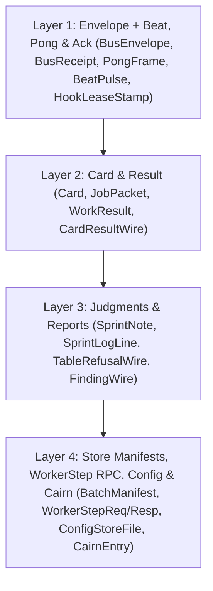

# Adopting `mas-bandwidth/schema` Tables & Fixed Tables Across `nova-tools` and `nova-sprint`

**Author:** Emma Antigravity (`emma`, she/her)  
**Card:** `schema-adoption-research-emma.w3` (epoch 20, attempt 3)  
**Date:** 2026-10-14  
**Repositories & Pinned Commits Inspected:**
- `mas-bandwidth/schema` at `main` (`38af9571b62e81a735909cfa843e7ac257d50649`) — [https://github.com/mas-bandwidth/schema/tree/38af9571b62e81a735909cfa843e7ac257d50649](https://github.com/mas-bandwidth/schema/tree/38af9571b62e81a735909cfa843e7ac257d50649)
- `mas-bandwidth/nova-sprint` at `sprint/v1.3-research` (`c3b66834edf9de4cbb94222816b7111de008c721` and `f6c657403bce821bc400557d35da272d4e1ef0b0`) — [https://github.com/mas-bandwidth/nova-sprint/tree/c3b66834edf9de4cbb94222816b7111de008c721](https://github.com/mas-bandwidth/nova-sprint/tree/c3b66834edf9de4cbb94222816b7111de008c721)
- `mas-bandwidth/nova-tools` at `main` (`b8d2966200302ae6e350961a2c5c1801f6ca40d6`) — [https://github.com/mas-bandwidth/nova-tools/tree/b8d2966200302ae6e350961a2c5c1801f6ca40d6](https://github.com/mas-bandwidth/nova-tools/tree/b8d2966200302ae6e350961a2c5c1801f6ca40d6)
- `mas-bandwidth/nova-tools` at `v1.2.23` / `release/v1.2.23` (`83d0e15b35c3313ec99b5f784dc54076a5350122`) — [https://github.com/mas-bandwidth/nova-tools/tree/83d0e15b35c3313ec99b5f784dc54076a5350122](https://github.com/mas-bandwidth/nova-tools/tree/83d0e15b35c3313ec99b5f784dc54076a5350122)

**Claim-Labeling Convention:** Every factual claim in this report is labeled `[SOURCED]` (with exact `repo:path:line` and commit SHA), `[REPORTED]` (taken from the card brief `BRIEF.md` without independent runtime reproduction), `[ESTIMATED]` (with arithmetic shown explicitly), or `[OPINION]` (architectural judgment).

---

## 1 Inventory

Across `mas-bandwidth/nova-sprint` (`c3b66834edf9de4cbb94222816b7111de008c721`) and `mas-bandwidth/nova-tools` (`83d0e15b35c3313ec99b5f784dc54076a5350122` and `b8d2966200302ae6e350961a2c5c1801f6ca40d6`), structured messages and documents today cross process, network, Redis, and filesystem boundaries through **five distinct ad-hoc representations** `[SOURCED]`:
1. **Hand-rolled Markdown/header text parsers** (`BRIEF.md`, `JOB.md`, `RESULT.md`, `REPORT.md`) in `pkg/cardhdr/cardhdr.go:1-153` (`cardhdr.KeyValue` at `:48-61`), `pkg/swarm/lintheader.go:179-224`, `pkg/cardcontract/contract.go:1-142`, `pkg/typedrec/cardresult.go:1-183` (`ParseCardResult` at `:54-117`, `shapeFault` at `:153-176`), `internal/typedrec/legacy.go:1-655` (at `nova-tools` `b8d2966`), and `pkg/friend/outbox.go:58-135`.
2. **Single-line refusal, check, and finding parsers** (`RESULT.md` contract checks, `TableRefusal`, `FindingPattern`, `TableCheck`, `oneline`) in `pkg/typedrec/contract.go:1-118`, `pkg/typedrec/tablerefusal.go:1-181`, `pkg/typedrec/finding.go:1-20`, `pkg/typedrec/result.go:1-13` (`internal/typedrec/result.go:1-823` at `nova-tools` `b8d2966`), `pkg/typedrec/tablecheck.go:1-33`, and `pkg/oneline/oneline.go:1-225`.
3. **Ad-hoc JSON over HTTP or files** (`sprintwire` `/verbs` RPCs, `friend cards`, `presence.json`, `limit.json`, `nova-config --file`, `nova-cairn` entries, dashboard views) in `pkg/sprintwire/wire.go:1-117`, `pkg/sprintwire/worker.go:1-129`, `pkg/friend/inbox.go:38-111`, `pkg/friend/presence.go:161-173`, `pkg/config/file.go:34-159`, `internal/cairn/cairn.go:121-130`, and `internal/sprintdash/pull.go:18-159`.
4. **Redis stream field maps and hashes** (`nova-bus` `bus2:to:<recipient>` / `bus2:log` / `bus2:rec:<id>` / `bus2:push:<friend>`, `nova-hook` `hook:rec:<name>` / `hook:live:*` / `hook:proof:*`, `seat-hook`) in `pkg/bus/bus.go:159-250`, `hook/hook.go:103-199`, and `internal/sprint/hook.go:67-104`.
5. **Strict-tokenized JSON manifests and Redis Lua tables** (`ntable.BatchManifest`, `ntable.Receipt`, `sprint.Note`, `sprint.Line`, `sprint.Beat`) in `pkg/ntable/manifest_validate.go:81-200`, `pkg/ntable/store.go:128-147`, `internal/sprint/notes.go:195-246`, `internal/sprint/presence.go:89-217`, and `internal/sprint/store/redis.go:50-250`.

> [!IMPORTANT]
> **Cross-Repository Package Topology (`nova-tools` vs `nova-sprint`) `[SOURCED]`:**
> On `mas-bandwidth/nova-tools` `main` (`b8d2966200302ae6e350961a2c5c1801f6ca40d6`), shared packages reside under `internal/` (`internal/bus`, `internal/cardhdr/cardhdr.go:1-211`, `internal/typedrec/result.go:1-823`, `internal/ntable`, `internal/oneline`, `internal/textbody/textbody.go:1-32`, `internal/cairn/cairn.go:1-300`). On `mas-bandwidth/nova-tools` `v1.2.23` (`83d0e15b35c3313ec99b5f784dc54076a5350122`) and `mas-bandwidth/nova-sprint` `sprint/v1.3-research` (`c3b66834edf9de4cbb94222816b7111de008c721`), those packages reside under `pkg/` (`pkg/bus`, `pkg/friend`, `pkg/cardcontract/contract.go:1-142`, `pkg/cardhdr/cardhdr.go:1-153`, `pkg/sprintwire/wire.go:1-117`, `pkg/typedrec/cardresult.go:1-183`, `pkg/ntable`, `pkg/oneline/oneline.go:1-225`, `pkg/member`, `pkg/config`, `pkg/swarm/result.go:1-142`). Meanwhile, `mas-bandwidth/schema` (`38af9571b62e81a735909cfa843e7ac257d50649`) **already ships** `tables/cards/Card.schema` (`tables/cards/Card.schema:1-79`, `docs/CARDS.md:1-238`, `tables/cards/edit.go:1-311`), which models sprint cards as a variable `table` with `Parse` (`tables/cards/parse.go:63-250`), `Render` (`tables/cards/render.go:17-160`), `ToJSON`, `FromJSON`, `Upgrade`, and `TaskHash` (`tables/cards/edit.go:27-60`), but neither `nova-sprint` nor `nova-tools` imports `tables/cards` yet `[SOURCED]`.

### Master Inventory Table (`M1`–`M16`)

| ID | Name & Kind | Writer(s) (`file:line`) | Reader(s) (`file:line`) | Today's Wire / Storage & Caps | Field Count & Shape | Lifetime | Failure Modes Observed / Possible |
| :--- | :--- | :--- | :--- | :--- | :--- | :--- | :--- |
| M1 | **Card Brief (`BRIEF.md`)** (document) | `nova-card` (`cmd/nova-card/main.go:200-250`), `nova-sprint add/brief` (`cmd/nova-sprint/verbs.go:56,92`), `friend.SyncInbox` (`pkg/friend/inbox.go:158-205`), `tables/cards.Render` (`tables/cards/render.go:17-160`) | `cardhdr.KeyValue` (`pkg/cardhdr/cardhdr.go:48-61`), `LintCardHeader` (`pkg/swarm/lintheader.go:354-543`), `friend.SyncInbox` (`pkg/friend/inbox.go:215-250`), `tables/cards.Parse` (`tables/cards/parse.go:63-250`) | UTF-8 Markdown file on disk (`inbox/<job>/BRIEF.md`) and Redis card field `brief`; `MaxBodyBytes = 64 KiB` in `tables/cards/cards.go:34` | ~18 header keys (`RESULT`, `REPO`, `BASE`, `STREAM`, `PATHS`, `NEW`, `TEST`, `DONE-WHEN`, `DEPENDS-ON`, `WHO`, `PRIORITY`, `STATUS`) + prose body | Epoch-scoped & git-durable (card creation through landing/archive) | **Oversize-note freeze `[REPORTED]` & parser drift `[SOURCED]`**: Multiple hand-rolled parsers (`pkg/cardhdr/cardhdr.go:48-61`, `pkg/swarm/lintheader.go:179-224`, `pkg/friend/inbox.go:144-146`) split on `:`; rework fix prepending (`THE ONE THING LEFT`, `pkg/friend/outbox.go:28-30`) desynchronizes line-1 prefix checks, and an oversize note froze the drain `[REPORTED]`. |
| M2 | **Staged Job Packet (`JOB.md` & `member.Packet` / `friend.HeldCard`)** (document + RPC payload) | `nova-sprint queue/take/friend cards` (`cmd/nova-sprint/verbs.go:72,77,131`), `friend.Stager.Stage` (`pkg/friend/daemon.go:214-216`), `pkg/cardcontract` (`pkg/cardcontract/contract.go:11-60`) | `pkg/member` (`pkg/member/member.go:294-350`), `friend.ParseHeld` (`pkg/friend/inbox.go:38-111`), child agent reading `JOB.md` | JSON over `sprintwire` (`HeldAnswer` / `Packet`) + rendered Markdown `jobs/<job>/JOB.md` on disk | 14–18 fields: `card`, `job`, `col`, `kind`, `branch`, `tier`, `stream`, `attempt`, `gen`, `epoch`, `repo`, `base`, `brief`, `lane`, plus route `model`, `tokens`, `deadline`, `carry` | Attempt-scoped (dealt/taken until child finishes or is reaped) | **Fallback scraping & silent zero-fill `[SOURCED]`**: `PacketOf` falls back to scraping `REPO:` and `BASE:` lines out of `BRIEF.md` when the server omits them (`pkg/friend/inbox.go:35-37`); `omitempty` JSON fields silently zero-fill on version skew. |
| M3 | **Worker Result (`RESULT.md`)** (document) | Child agent inside sandbox (`docs/SPEC-CARD-CONTRACT.md:1-87`, `pkg/cardcontract/contract.go:127-142`), `nova-swarm native` (`pkg/typedrec/cardresult.go:119-125`) | `typedrec.ParseCardResult` & `shapeFault` (`pkg/typedrec/cardresult.go:54-117, 153-176`), `internal/typedrec/legacy.go:1-655` (at `nova-tools` `b8d2966`), `member.Judge` (`pkg/member/member.go:135-290`) | UTF-8 `key: value` header (`head`, `branch`, `verdict`, `gate`, `output`, `report`) + report body in `RESULT.md`; legacy read cards use `rev:`, `verdict:`, `## One line`, `## Body` | 6 required keys (`pkg/typedrec/cardresult.go:37`) or legacy 2-heading shape (`internal/typedrec/legacy.go:1-120`); merged into `member.Result` (`pkg/member/member.go:135-177`) | Attempt-scoped on disk; summary stored in sprint table/log | **`RESULT.md shape fault` `[REPORTED]`/`[SOURCED]`**: Two shapes (`CardResultKeys` vs legacy `## One line`/`## Body`) and one strict parser (`pkg/typedrec/cardresult.go:54-176`); missing keys or Markdown formatting prefixes `"RESULT.md shape fault: ..."` or `"no RESULT.md shape"`, blaming the worker (`pkg/cardcontract/contract.go:127-129`). |
| M4 | **Friend Outbox Report (`REPORT.md`)** (document) | Friend child agent or coordinator in `outbox/<job>/REPORT.md` (`pkg/friend/outbox.go:20-34`) | `friend.outboxStep` / `readReport` / `reportKey` (`pkg/friend/outbox.go:58-250`), `sprint.CollectVerdict` (`pkg/friend/outbox.go:231`) | Free-form Markdown in `outbox/<job>/REPORT.md`; `ReportCap = 64 KiB`, `ReportChars = 600` (`pkg/friend/outbox.go:44-47`) | 2 scraped keys (`Verdict: LAND\|HOLD\|FAIL`, `Head: <40-hex>`) + rework keyword check (`unaddressed`, `pkg/friend/outbox.go:241-246`) + prose body | Attempt-scoped in `outbox/<job>/` until collected/retired | **Unread outbox & keyword false-negatives `[SOURCED]`**: `reportKey` strips `#*-_ \t` (`pkg/friend/outbox.go:60-65`); missing `Verdict` leaves `REPORT.md` unread (`pkg/friend/outbox.go:231-235`, 2026-10-05 incident where 8 cards sat unread for 2h); `LAND` without `Head` or missing rework keywords flips to `--failed` (`pkg/friend/outbox.go:98-107, 241-246`). |
| M5 | **Worker Result Summary & Judgement Contract (`typedrec.Contract`, `swarm.Report`)** (contract + JSON summary) | `pkg/swarm/result.go:22-142` (`nova-sprint` `c3b66834`; `:1-403` at `nova-tools` `83d0e15`), `pkg/typedrec/format.go:16-66` | `pkg/typedrec/contract.go:46-118`, `internal/typedrec/result.go:1-823` (at `nova-tools` `b8d2966`) | `key: value` header lines + required Markdown sections (`pkg/typedrec/contract.go:46-118`) and `swarm.Report` JSON (`pkg/swarm/result.go:47-142`) | 9 wrapper-owned keys (`SCHEMA`, `KIND`, `ATTEMPT`, `CHECK`, `REPO`, `BRANCH`, `PATHS`, `RED`, `GREEN` at `pkg/typedrec/format.go:42`) + per-kind fields | Attempt-scoped summary and CI gate artifact | **Schema & kind drift `[SOURCED]`**: `pkg/typedrec/contract.go:46-118` and `internal/typedrec/result.go:1-823` (`nova-tools` `b8d2966`) have diverged between repos (`result.go` is 13 lines in `nova-sprint` vs 823 lines in `nova-tools`). |
| M6 | **Table Refusal & Lane Refusal (`typedrec.TableRefusal`, `ntable.Refusal`)** (refusal record) | `ntable.Refusal.Error` (`pkg/ntable/store.go:82-89`), lane fault reporters | `typedrec.ParseTableRefusal` (`pkg/typedrec/tablerefusal.go:66-181`) | Substring-matched prose error string or truncated JSON (`lane-fault refusal={`, `BRIEF.md` (line 34)) | 19 `TableRefusal` enum constants (`RefusalUnknown` to `RefusalLeaseExpired` in `pkg/typedrec/tablerefusal.go:6-63`); `ntable.Refusal` struct (`pkg/ntable/store.go:75-89`) | Ephemeral stderr/log refusal | **Truncated JSON & substring-classifier fragility `[REPORTED]`/`[SOURCED]`**: A lane fault was reported as `"lane-fault refusal={"` with the JSON object cut off `[REPORTED]`; `ParseTableRefusal` (`pkg/typedrec/tablerefusal.go:66-181`) classifies refusals by `strings.Contains` on English prose substrings. |
| M7 | **Lint Findings & Defect Citations (`typedrec.NamesADefect`, `CardHeaderFinding`)** (diagnostic record) | `LintCardHeader` (`pkg/swarm/lintheader.go:354-543`), `cmdLint` (`cmd/nova-card/main.go:186-250`) | `typedrec.NamesADefect` (`pkg/typedrec/finding.go:13-20`), `cmd/nova-card/main.go:83, 186-198` | Prose lines `"LINT DRIFT card=... check=... line=..."` (`cmd/nova-card/main.go:83`) or regex-matched finding lines (`pkg/typedrec/finding.go:13-20`) | `CardHeaderFinding`: `Check`, `Line`, `Message`, `Remedy` (`pkg/swarm/lintheader.go:84-95`); regex `FindingPattern` (`pkg/typedrec/finding.go:13`) | Ephemeral CLI stdout/stderr and review validation | **Prose lint drift & `--json` refusal `[REPORTED]`/`[SOURCED]`**: Lint finds drift by prose lines (`LINT DRIFT card=...`, `cmd/nova-card/main.go:83`), `--json` is refused on several `lint`/`check` verbs `[REPORTED]`, and `NamesADefect` (`pkg/typedrec/finding.go:20`) relies on a regex over free text. |
| M8 | **Message Bus Envelope (`bus.Message` / `bus.Entry`)** (stream + hash record) | `bus.Bus.Send` (`pkg/bus/bus.go:240-310`), `friend.Courier.Send` (`pkg/friend/deliver.go:29-54`) | `bus.Bus.Recv` / `Peek` / `Log` (`pkg/bus/bus.go:315-480`), `friend.SessionCheck` (`pkg/friend/presence.go:175-220`) | Redis Stream `bus2:to:<to>` & `bus2:log` + Hash `bus2:rec:<id>`; `MaxBody = 64 KiB`, `MaxSubject = 200 B`, `MaxRecipients = 16` (`pkg/bus/bus.go:33-52`) | 12 fields on `Message` (`id`, `from`, `to` list, `subject`, `body`, `re`, `kind`, `by`, `at`, `delivery`, `stage`, `auth`) | Redis stream/hash TTL (`RecordTTL = 7d`, `StreamMaxLen = 10000`, `pkg/bus/bus.go:54-65`) | **Subject-convention parsing, ambiguous `kind`, & pong flood `[REPORTED]`/`[SOURCED]`**: Over 1,300 of ~1,700 bus messages tonight were pongs; `kind` is an unvalidated string (one empty `""` tonight); subjects encode structure by convention (`"#202 HOLD at aa9ddb86: ..."`, `"COLD READ MERGE: ..."`, `"PING <nonce>"`, `"pong"`, `BRIEF.md` (line 37)). |
| M9 | **Bus Push Proof & Hook Challenge/Proof (`bus2:push:<friend>`, `hook:rec:<name>`, `seat-hook`)** (control record) | `friend.PushProver` (`pkg/friend/pushproof.go:19-48`), `hook.Store` (`hook/hook.go:103-199`), `sprint.HookProven/Acted` (`internal/sprint/hook.go:76-146`) | `bus.Bus.Send/Recv` (`pkg/bus/bus.go:120-158`), `hook.Judge` / `hookgate.Gate` (`hook/hook.go:183-200`, `pkg/hookgate/hookgate.go:35-41`), `sprint.HookGate` (`internal/sprint/hook.go:108-118`) | 3 separate Redis schemas: `bus2:push:<f>` hash (`pkg/friend/pushproof.go:19-48`), `hook:rec:<n>` + `hook:live/proof:<n>:<p>` JSON stamps (`hook/hook.go:138-150`), and `seat-hook` JSON (`internal/sprint/hook.go:81-94`) + `sprint-hook:<id>` hash (`internal/sprint/hook.go:175-222`); CLI challenge `"nova-sprint hook bus challenge <hex>"` (`BRIEF.md` (line 38)) | `HookRecord`: 12 fields (`name`, `epoch`, `session`, `state`, `since`, `proven`, `live`, `why`, `unacked`, `oldest`, `acked`, `push_seq`); `hook.Status`: 7 fields + `[]PushStatus` | Short-lived lease/proof (`LeaseTTL = 90s`, `ProofTTL = 40m`, `HookSilentBound = 15m`) | **Duplicate schemas & push replay `[SOURCED]`**: Four overlapping hook/proof representations (`bus2:push:*`, `hook:*`, `sprint-hook:*`, `seat-hook`); malformed JSON stamp or RFC3339 string silently fails closed (`hook/hook.go:145-150`, `internal/sprint/hook.go:210-213`), which on 2026-10-11/12 unhooked the seat and replayed ~100 pushes (`internal/sprint/hook.go:35-38`). |
| M10 | **Sprint Wire RPC (`sprintwire.Request` / `Response` / `Result` & `sprintwire.Worker`)** (RPC wire) | `sprintwire.Client.Do` (`pkg/sprintwire/wire.go:69-117`), `sprintwire.Worker.Run` (`pkg/sprintwire/worker.go:40-106`), `cmd/nova-friend` (`cmd/nova-friend/main.go:123-173`), `cmd/nova-swarm` (`cmd/nova-swarm/member.go:52`) | `cmdRunGC` HTTP `/verbs` handler in `cmd/nova-sprint` (`pkg/sprintwire/wire.go:23-56`) | HTTP POST `/verbs` (`pkg/sprintwire/wire.go:23`) with `encoding/json` body; `MaxRequestBytes = 16 MiB`, `MaxResponseBytes = 64 MiB` (`pkg/sprintwire/wire.go:26-29`) | `Request`: `Verbs [][]string` argv batches (`pkg/sprintwire/wire.go:32-42`); `Response`: `Results []Result{Code, Stdout, Stderr}` (`pkg/sprintwire/wire.go:44-56`) | Ephemeral in-flight HTTP RPC (`Timeout = 2m`, `pkg/sprintwire/wire.go:64`) | **CLI argv tunneling & text scraping `[SOURCED]`**: `/verbs` tunnels raw CLI `argv` strings (`[][]string`) and returns raw CLI `Stdout`/`Stderr` text (`pkg/sprintwire/wire.go:32-56`), forcing `nova-friend` and `nova-swarm` to scrape CLI stdout text instead of exchanging typed records. |
| M11 | **Fleet & Friend Heartbeat (`sprint.Beat`, `sprint.FriendReport`, `pong`, `FRIEND-BEAT`)** (state + liveness wire) | `nova-sprint fleet beat / friend beat` (`cmd/nova-sprint/verbs.go:108,122`), `friend.Daemon` (`pkg/friend/daemon.go:102`), `nova-friend pong` (`cmd/nova-friend/main.go:159-193`) | `sprint.NoRoomNow` / `Fresh` / `Missed` (`internal/sprint/presence.go:89-250`), `memberStops` (`internal/sprint/stops.go:165-229`), `friend.Daemon` (`pkg/friend/daemon.go:158-230`) | Stored in Redis as JSON (`sprint.Beat`, `internal/sprint/presence.go:89-131`); liveness lines `"pong <nonce> queue=0 working=0 width=16"` (`BRIEF.md` (line 38)) and `FRIEND-BEAT` text line parsed by `nova-friend` (`pkg/friend/daemon.go:158-230`) | `Beat`: 16 fields (`at`, `load`, `cores`, `how`, `samples`, `meter`, `friend`, `pong`, `stop_returns`, `no_room`, `live`, `live_known`, `live_since`, `live_seen`, `draining`, `draining_since`) + 12-field `FriendReport` | Short-lived Redis key updated every `1s`–`3s` (`BeatDeadline = 15s`, `FriendBeatBound = 30m`) | **Liveness flood & unplumbed fields `[REPORTED]`/`[SOURCED]`**: Over 1,300 pongs flooded `nova-bus` tonight (`BRIEF.md` (lines 37-38)); `Beat` mixes hot scalars with an unbounded `live_seen` map in one JSON blob, and `Pacing` remains `nil` because `FRIEND-BEAT` text scraping has not plumbed it (`pkg/friend/daemon.go:159-163`). |
| M12 | **Friend Daemon Local State Files (`presence.json`, `limit.json`, `status.json`, `lanes.json`)** (local state files) | `friend.SessionCheck.Save` (`pkg/friend/presence.go:161-173, 190`), `friend.Daemon.Status` / `SaveLanes` (`pkg/friend/daemon.go:137-171`, `pkg/friend/status.go:19-52`) | `nova-friend status / check / run` (`pkg/friend/presence.go:195-210`, `pkg/friend/status.go:34-52`) | Local JSON files in friend state dir written via `atomicfile` | `PresenceStatus`: 10 fixed fields (`friend`, `at`, `presence`, `reason`, `last_heard`, `nonce`, `asked`, `checks`, `answers`, `answered`, `pkg/friend/presence.go:161-173`); `Verdict`: 3 fields (`pkg/friend/status.go:19-22`) | Daemon-run / restart state on local disk | **Unversioned local JSON `[SOURCED]`**: If a field name or timestamp format changes across a `nova-friend` upgrade, `Keep` nonce recovery (`pkg/friend/presence.go:195-199`) silently drops the outstanding nonce and forces a full re-prove cycle. |
| M13 | **Table Batch Manifest, Receipt & Check (`ntable.BatchManifest`, `ntable.Receipt`, `typedrec.TableCheck`)** (store transaction wire) | `sprint/store.Store` (`internal/sprint/store/engine.go:23-60`), `ntable.ValidateBatchManifestRaw` (`pkg/ntable/manifest_validate.go:165-200`) | `ValidateBatchManifestRaw` (`pkg/ntable/manifest_validate.go:165-851`), Redis Lua `ns_table_apply` (`pkg/ntable/store.go:17-31`), `typedrec.ParseTableCheck` (`pkg/typedrec/tablecheck.go:13-33`), `store.Redis.AdvanceEpoch` (`internal/sprint/store/redis.go:80-126`) | JSON string passed to Redis function `ns_table_apply` + `keyFence` JSON (`OpRecord`); validated by 851-line custom JSON tokenizer (`pkg/ntable/manifest_validate.go:1-851`) | `BatchManifest`: 10 root keys (`schema`, `table`, `epoch`, `expected_table_revision`, `operation_id`, `actor`, `members`, `props`, `prop_expect`, `prop_absent`) + nested member mutations/guards; `Receipt`: 7 fields (`pkg/ntable/store.go:139-147`) | In-flight transaction + fence recovery in Redis | **851-line hand-rolled validator `[SOURCED]`**: `pkg/ntable/manifest_validate.go:1-851` is 851 lines of custom JSON token validation just to enforce exact-case keys, duplicate-key refusal, null refusal, and path-aware errors—all properties `mas-bandwidth/schema` provides natively. |
| M14 | **Sprint Notifications, Judgments & Audit Log (`sprint.Note`, `sprint.Line`, `sprint.Stop`)** (store stream + JSON + bus push) | `store.Backend.Release` (`internal/sprint/store/backend.go:119-124`), `sprint.LiveStops` (`internal/sprint/stops.go:126-144`) | `store.Backend.OpenNotes` / `NotesSince` / `LogSince` (`internal/sprint/store/backend.go:135-150`), `sprint.FinishedAs` (`internal/sprint/verdicts.go:161-176`), `sprintdash` (`internal/sprintdash/pull.go:18-60`) | JSON blobs in Redis streams/hashes (`NotesSince`, `LogSince`, `OpenNotes`) + prose `JUDGMENT` pushes on `nova-bus` (`BRIEF.md` (line 39)) | `Note`: 26 fields (`id`, `alias`, `kind`, `type`, `stream`, `primaries`, `count`, `what`, `who`, `attempt`, `before`, `at`, `decisions`, `marked`, `answers`, `suspects`, `card`, `other`, `tier`, `other_stream`, `stream_level`, `sprint_level`, `needs`, `review`, `review_set`, `to`, `hint`, `internal/sprint/notes.go:196-246`) | Epoch-scoped Redis stream and snapshot exports | **Unversioned log heuristics & prose judgments `[REPORTED]`/`[SOURCED]`**: `FinishedAs` (`internal/sprint/verdicts.go:161-176`) inspects legacy vs current `Line` transitions (`to == Finished` vs `from != Finished`) because `Line` has no schema version; `JUDGMENT`, `HOLD`, and `FIX` pushes on `nova-bus` are prose with IDs in the subject (`BRIEF.md` (line 39)). |
| M15 | **Fleet Configuration Store & Diff (`config.Row`, `config.Change`, `fileState`)** (durable store + JSON file) | `config.FileStore.save` (`pkg/config/file.go:125-159`), `config.Mem.record` (`pkg/config/store.go:237-241`), Postgres `config` store | `config.OpenFile` (`pkg/config/file.go:46-114`), `config.Applier` (`pkg/config/apply.go:14-35`), `config.Kinds` validators (`pkg/config/kind.go:38-150`) | Local JSON `--file` (`MaxStoreFileBytes = 16 MiB`, `dec.DisallowUnknownFields()`, `pkg/config/file.go:42, 65`), Postgres tables, and Redis hashes (`config:decl`) | 8 `Kind` descriptors (`machine`, `fleet`, `friend`, `sprint`, `loop`, `provider`, `route`, `tier`, `pkg/config/kind.go:171-180`); `Row` holds `map[string]string` (`Fields`); `Change` holds `Before`/`After` maps + `Reason` (`pkg/config/store.go:48-64`) | Permanent fleet configuration across epochs | **Untyped string maps & forward-incompatible files `[SOURCED]`**: `Row.Fields` is an untyped `map[string]string` parsed repeatedly with `r.Int("width")` (`pkg/config/kind.go:197-259`); `OpenFile` uses `DisallowUnknownFields()` (`pkg/config/file.go:65`), so an older binary refuses a newer `--file` store (`pkg/config/file.go:76-78`). |
| M16 | **Cairn Checkpoints & Work Records (`cairn.entryFile`, `roadmap.sexp` / `fixes.sexp`, `tree.lisp`)** (durable disk records) | `cairn.Append` (`internal/cairn/cairn.go:121-130, 244-295`), `roadmap.Set.Save` (`internal/roadmap/roadmap.go:73-138`), `nova-work import` (`cmd/nova-work/main.go:68-87`) | `cairn.Receipt` / `Index` (`internal/cairn/cairn.go:93-119`), `roadmap.Load` (`internal/roadmap/roadmap.go:84-138`), `nova-work verify` (`cmd/nova-work/main.go:89-118`) | `cairn`: `entries/<session>/<id>.json` + `log.jsonl` + Markdown (`internal/cairn/cairn.go:16-25`); `nova-work`: S-expression `docs/roadmap.sexp`, `docs/fixes.sexp`, `tree.lisp` (`MaxBytes = 128 MiB`, `cmd/nova-work/main.go:101`) | `cairn.entryFile`: 6 fields (`session`, `id`, `stamp`, `source`, `publish`, `text`, `internal/cairn/cairn.go:123-130`); `roadmap.Entry`: 7 fields (`internal/roadmap/roadmap.go:141-149`); `work-tree`: 20 issue keys (`cmd/nova-work/main.go:208-247`) | Permanent git/disk records | **Unbounded cairn JSON vs comment-spliced S-exp `[SOURCED]`**: `cairn` JSON files (`entries/<session>/<id>.json` and `log.jsonl`) have no schema version or field bounds (`internal/cairn/cairn.go:123-130`); by contrast, `roadmap.sexp` / `fixes.sexp` rely on byte-offset splicing (`internal/roadmap/roadmap.go:7-16`) to preserve human comments. |

---

## 2 Fit

### 2.1 The Three Wires of `mas-bandwidth/schema` (`38af9571b62e81a735909cfa843e7ac257d50649`)

`mas-bandwidth/schema` provides three distinct binary representations from one `.schema` grammar (`docs/SPEC-TABLES.md:36-119`, `docs/VERSIONING.md:11-31`), tracked across the nine target languages **`cpp, c, cs, go, rust, java, js, dart, elixir`** in `ROADMAP.md:1-176` `[SOURCED]`:

| Wire Kind | Declaration | Form Byte & Header | Permitted Field Types | Compatibility Direction | Gate & Versioning Mechanism | Language Completion (`ROADMAP.md:13-170`) |
| :--- | :--- | :--- | :--- | :--- | :--- | :--- |
| **1. Bitpacked `type`** | `type Name { ... }` | None (raw bitpacked stream, bit-level cursor) | Bounded integers (`int(min,max)`), `bool`, `float`, `string(N)`, `bytes(N)`, `[K]T`, `[..K]T`, `if`, nested `type` | **Same-build only** (neither backward nor forward when layout changes) | 64-bit `protocol id` hash (`docs/VERSIONING.md:120-169`) | **100% across all 9 languages** (`cpp 100%, c 100%, cs 100%, go 100%, rust 100%, java 100%, js 100%, dart 100%, elixir 100%`, `ROADMAP.md:13-44`) `[SOURCED]` |
| **2. `fixed table`** | `fixed table Name { ... }` | Form `3`: 8-byte `layout_hash` + `C(root)` bytes (`docs/SPEC-TABLES.md:6952-6962`). (Form `2` is message-batch form under a connection-announced vocabulary, `docs/SPEC-TABLES.md:6861-6935`.) | Scalars, `enum`, `flags`, `string(N)` (`N>=2`), `wstring(N)`, `bytes(N)`, `[K]T`, `[..K]T`, `[E]T`, `?T` (value), `union` of fixed arms, nested `fixed table`. **Refuses in closure:** `*T`, `*string`, `*bytes`, `map[K]V`, `[]T`, `if`, plain `table` (`docs/SPEC-TABLES.md:919-931`). | **BACKWARD ONLY — NEVER FORWARD** (`docs/SPEC-TABLES.md:16446-16520`, `docs/FIXED-FORM-ALGORITHM.md:93-97`) | `schema.lock` lineage (`floor` to current). Static plans compiled at build time (`ONE PATH`); older reader given newer writer's hash refuses with `layout_newer` (`docs/SPEC-TABLES.md:16491-16495`). **Readers must deploy before writers** (`docs/SPEC-TABLES.md:16515-16520`). | **84%–96% across the 9 languages** (`cpp 85%, c 87%, cs 84%, go 85%, rust 91%, java 84%, js 96%, dart 91%, elixir 91%` at `ROADMAP.md:116`; `ROADMAP.md:53` notes this work is on branch `sprint/schema-vt-core` and not yet on `main`) `[SOURCED]` |
| **3. Variable `table`** | `table Name { ... }` | Form `1`: 18-byte header (`magic[4]`, `version=1`, `form=1`, `flags`, `root_offset`, `node_offset`) + self-describing nodes (`ref, kind, payload`) + `0xFFFFFFFFFFFFFFFF` sentinel + `fnv1a64` trailer (`docs/SPEC-TABLES.md:6471-6667`) | Everything in `fixed table` **plus** `*T`, `*string`, `*bytes`, `[]T`, `[]*T`, `map[K]V`, `if` guards, `was = "old"` (`docs/SPEC-TABLES.md:880-918`) | **BOTH BACKWARD AND FORWARD** (`docs/VERSIONING.md:23-25`, `docs/SPEC-TABLES.md:5075-5117`) | `tables.baseline` compile-time evolution check (`docs/VERSIONING.md:389-433`); unknown fields skipped (`report.Unknown++`) and preserved on rewrite via `LoadRetain`/`SaveRetain` (`docs/SPEC-TABLES.md:5302-5386`). | **Go: 100%, C++: 96%, C#: 96%**; `js 31%, rust 28%, elixir 12%, java 9%, dart 9%, c 0%` (`ROADMAP.md:166`; `tables/cards` row at `:165` is ✅ on `go`) `[SOURCED]` |

> [!WARNING]
> **Critical Architectural Finding on `fixed table` Rollout Direction (`docs/SPEC-TABLES.md §21`) `[SOURCED]`:**
> `docs/SPEC-TABLES.md:16446-16520` and `docs/FIXED-FORM-ALGORITHM.md:93-97` establish that `fixed table` (form `3`) is **backward-compatible only, never forward-compatible**. Every writer stamps its 8-byte `layout_hash` at offset `0..8` and writes `C(root)` bytes in its own compiled layout (`docs/SPEC-TABLES.md:6952-6962`). A newer reader has static `plan` entries compiled from `schema.lock` for every historical layout hash from `floor` to its own build, and decodes them in one loop (`ONE PATH`, `docs/FIXED-FORM-ALGORITHM.md:56-92`). An **older reader** presented with a newer writer's `layout_hash` does **not** know that hash and immediately refuses with `layout_newer` (`docs/SPEC-TABLES.md:16491-16495`).
>
> *(Note also an internal specification tension inside `mas-bandwidth/schema` at `38af9571b62e81a735909cfa843e7ac257d50649`: older text in `docs/SPEC-TABLES.md:6963-6976` (§3.4) still mentions compiling a plan at runtime from an untrusted peer's layout description, whereas `docs/SPEC-TABLES.md:16503-16514` (§21) and `docs/FIXED-FORM-ALGORITHM.md:93-97, 158` explicitly state that runtime layout walking is retired and all plans are compiled statically from `schema.lock` at build time `[SOURCED]`.)*

### 2.2 Per-Item Fit, Size, Rate & Wire Comparison (`M1`–`M16`)

How a schema-typed envelope carries human prose without constraining it: in `mas-bandwidth/schema`, `*string` (`docs/SPEC-TABLES.md:880-918`, `tables/cards/Card.schema:75`) is an optional unbounded UTF-8 blob stored in the variable-table node region (`docs/CARDS.md:27-90`). The envelope header fields (`id`, `tier`, `verdict`, `head`, `paths`, `task_hash`) are strictly length- and enum-checked by the generated reader, while the prose body (`body *string`, `report *string`) rides as an opaque UTF-8 payload subject only to the caller's outer byte ceiling (`MaxBodyBytes = 64 KiB` in `tables/cards/cards.go:34`) `[SOURCED]`.

| ID | Item | Fit Category | Est. Size & Peak Rate (`[ESTIMATED]`/`[REPORTED]`) | Recommended `schema` Construct & Wire Comparison vs JSON/Text |
| :--- | :--- | :--- | :--- | :--- |
| **M1** | `BRIEF.md` (Card Brief) | **Variable `table` + prose `*string`** | `2–16 KiB` (`64 KiB` cap); `~50–300/day` | `tables/cards/Card.schema:51-79` (`table Card`) + `cards.Render`/`cards.Parse` (`tables/cards/parse.go:63-250`). Better than ad-hoc text headers (`pkg/cardhdr/cardhdr.go:48-61`) because header types/enums are checked once and prose stays human-readable in `body *string`. |
| **M2** | `JOB.md` & `Packet` / `HeldCard` | **Variable `table` + prose `*string`** | `3–18 KiB`; `~100–500/day` | `table JobPacket` (wrapping `*Card` + attempt/route fields). Better than JSON (`pkg/friend/inbox.go:38-111`) because `Load` checks bounds and `LoadRetain` survives mixed-version server/worker rollouts. |
| **M3** | `RESULT.md` & `CardResult` | **Variable `table` + prose `*string`** | `0.5–4 KiB` (`64 KiB` cap); `~100–500/day` | `table WorkResult` (`report *string`, `head_sha bytes(20)`). Strictly better than hand-written `RESULT.md` (`pkg/typedrec/cardresult.go:54-176`): eliminates two-shape ambiguity and validates `head` and `verdict` before the worker exits. |
| **M4** | `REPORT.md` (Friend Outbox) | **Variable `table` + prose `*string`** | `0.5–4 KiB` (`64 KiB` cap); `~50–200/day` | `table WorkResult` transcoded from `REPORT.md` at `pkg/friend/outbox.go:58-135`. Keeps Markdown for the human/LLM inside the worktree while giving the daemon a typed binary sidecar (`REPORT.bin`). |
| **M5** | `CARD-RESULT` & Judgement Contract | **`fixed table` + `oneline` text** | `512 B` wire (`~140 B` text); `~100–500/day` | `fixed table CardResultWire` (`512 B` total). Better than `pkg/typedrec/contract.go:46-118` for machine consumers (`ONE PATH` backward compatibility via `schema.lock`); project `oneline` text from the struct for human logs. |
| **M6** | `TableRefusal` & `ntable.Refusal` | **`fixed table` + `oneline` text** | `752 B` wire (`~180 B` text); `<100/day` | `fixed table TableRefusalWire` (`752 B` total). Strictly better than truncated JSON (`lane-fault refusal={`) or substring matching (`pkg/typedrec/tablerefusal.go:66-181`): fixed 752-byte frame cannot be half-parsed. |
| **M7** | Lint Findings (`CardHeaderFinding`) | **`fixed table` + `oneline` text** | `752 B` wire; `~200–1,000/day` | `fixed table FindingWire` (`752 B` total). Replaces prose `LINT DRIFT` lines (`cmd/nova-card/main.go:83`) and regex `FindingPattern` (`pkg/typedrec/finding.go:13-20`) with typed file/line/check fields. |
| **M8** | `nova-bus` Message & Receipt | **Variable `table` (`BusEnvelope`) + `fixed table` (`BusReceipt`)** | Envelope `0.3–8 KiB`, Receipt `120 B`; `~1,700/night` (`BRIEF.md` (line 37)) | `table BusEnvelope` (`body_text *string`) + `fixed table BusReceipt` (`120 B`). Better than untyped Redis stream maps (`pkg/bus/bus.go:159-250`): enforces `BusKind` enum and typed subject headers while keeping prose in `body_text *string`. |
| **M9** | Bus Push Proof, Hook & Pong | **`fixed table`** | `136 B` (`HookLeaseStamp`), `328 B` (`FriendPushProof`); `~1,300+ pongs/night` (`BRIEF.md` (line 37)) | `fixed table HookLeaseStamp` (`136 B`), `fixed table FriendPushProof` (`328 B`), `fixed table PongFrame` (`96 B`). Strictly better than prose `"pong <nonce> queue=0..."` and 4 Redis hook schemas (`internal/sprint/hook.go:81-222`): O(1) zero-allocation decode. |
| **M10** | `sprintwire` `/verbs` RPC | **Variable `table`** | `0.5–64 KiB`; `~20–60 req/min` | `table WorkerStepReq` / `table WorkerStepResp`. Better than tunneling `[][]string` CLI argv over `/verbs` (`pkg/sprintwire/wire.go:23-56`) and scraping stdout text. |
| **M11** | Fleet & Friend Heartbeat (`Beat`) | **`fixed table` (`BeatPulse`) + Variable `table` (`StoredBeat`)** | `336 B` wire pulse; `~12–20 beats/sec` fleet-wide (`1 Hz` per member) | `fixed table BeatPulse` (`336 B`) on the wire; `table StoredBeat` in Redis (`internal/sprint/presence.go:89-131`). Separates the hot 1 Hz fixed pulse from the variable `live_seen` map and plumbs `paced_width`. |
| **M12** | Friend Local State (`presence.json`) | **`fixed table`** | `320 B` (`PresenceRecord`), `152 B` (`LimitRecord`); `~1 write/3s` | `fixed table PresenceRecord` (`320 B`). Better than unversioned local JSON (`pkg/friend/presence.go:161-173`): atomic 320-byte write and `schema.lock` upgrade preservation. |
| **M13** | `ntable.BatchManifest` & `Receipt` | **Variable `table`** | `0.5–32 KiB` (`1 MiB` cap); `~5–30 tx/sec` | `table BatchManifest` & `table BatchReceipt`. Replaces **851 lines** of custom JSON token validation (`pkg/ntable/manifest_validate.go:1-851`) with generated bounds and key checks. |
| **M14** | `sprint.Note`, `Line` & Judgments | **Variable `table`** | `0.4–4 KiB`; `~500–3,000/epoch` | `table SprintNote` (`what *string`), `table SprintLogLine`. Better than 26-field `omitempty` JSON (`internal/sprint/notes.go:196-246`) and prose `JUDGMENT` bus pushes (`BRIEF.md` (line 39)). |
| **M15** | `nova-config` (`Row`, `Change`, `--file`) | **Variable `table`** | `4–128 KiB` file; `<50 writes/day` | `table ConfigStoreFile` with `LoadRetain`/`SaveRetain` (`docs/SPEC-TABLES.md:5302-5386`). Replaces `DisallowUnknownFields()` (`pkg/config/file.go:65`) so older binaries can edit newer config files without data loss. |
| **M16** | `nova-cairn` & `roadmap.sexp` / `fixes.sexp` | **Variable `table` for `cairn`; WRONG TOOL for `.sexp`** | `1–16 KiB` per cairn entry; `100–500 KiB` `.sexp` | `table CairnEntry` fits `internal/cairn/cairn.go:121-130`. **Schema is the WRONG tool for `docs/roadmap.sexp` and `docs/fixes.sexp`** (`internal/roadmap/roadmap.go:7-16`): those files are git-tracked human documents edited by byte-offset splicing to preserve comments and git diffs `[OPINION]`. |

---

## 3 Design

### 3.1 Concrete `.schema` Definitions for Top Message Families (`(a)`)

All six `.schema` blocks below use the exact real syntax of `mas-bandwidth/schema` at `38af9571b62e81a735909cfa843e7ac257d50649` (`tables/cards/Card.schema:1-79`, `tables/messages/Messages.schema:1-147`, `tables/backend/Backend.schema:1-61`, `internal/scanner/scanner.go:57-106`, `internal/tablenames/tablenames.go:1-120`) `[SOURCED]`:
- Enums use `enum Name { a, b, c }` with comma-separated variants and implicit `None = 0` (`tables/cards/Card.schema:9-13`).
- Field constraints and renames follow `|`, e.g., `int32 | min = 0, max = 100000` and `*string | was = "done_when", json = "done_when"` (`tables/cards/Card.schema:65-66`).
- String lists in variable `table`s use 1-field element tables (`table PathText { s string(192) }`) because direct `[]string(N)` is refused by the compiler (`tables/cards/Card.schema:15-26`).

#### Schema Block 1: Upstream `tables/cards/Card.schema` + `JobPacket` (`M1`, `M2`)

```schema
package cards

// Exact upstream enums from tables/cards/Card.schema:9-13
enum Tier { flash, pro, heavy, frontier }

enum Priority { normal, high, critical, blocker }

enum Column { waiting, ready, working, review, merging, landed, plan, check }

enum JobKind { work, read }

table PathText
{
    s string(192)
}

table CardID
{
    s string(64)
}

table KeyValue
{
    key   string(32)
    value *string
}

table Consumer
{
    kind           string(16)
    who            string(32)
    route          string(48)
    model          string(64)
    started        int64
    ended          int64
    outcome        string(16)
    line           string(200)
    cost_micro_usd int64
}

// Upstream tables/cards/Card.schema:51-79 extended with rework_fix and rework_fix_hash
table Card
{
    id               string(64)
    sha              string(40)
    tier             Tier
    repo             string(96)
    _base            string(96)
    kind             string(24)
    priority         Priority
    stream           string(32)
    paths            []PathText
    _new             []PathText
    shared           []PathText
    needs            []CardID
    test             string(192)
    done             *string | was = "done_when", json = "done_when"
    deadline_minutes int32   | min = 0, max = 100000
    source           *string
    epoch            int32
    column           Column
    holder           string(32)
    attempt          int32
    head             string(40)
    branch           string(128)
    body             *string
    rework_fix       *string
    rework_fix_hash  bytes(32)
    extra            []KeyValue
    consumers        []Consumer
}

// Variable table (form 1) for M2: staged job packet (JOB.md + JOB.card)
table JobPacket
{
    job_name     string(128)
    card_id      string(64)
    kind         JobKind
    col          Column
    stream       string(32)
    tier         Tier
    attempt      int32 = 1 | min = 1, max = 1000
    gen          int32 = 1 | min = 1, max = 10000
    epoch        int32   | min = 0, max = 1000000
    lane         int32   | min = 0, max = 256
    repo         string(96)
    _base        string(96)
    base_sha     bytes(20)
    branch       string(128)
    route_name   string(48)
    provider_mod string(64)
    tokens_cap   int64   | min = 0, max = 100000000
    deadline_sec int32   | min = 0, max = 86400
    carry_commit bytes(20)
    carry_words  string(256)
    task_hash    bytes(32)
    card         *Card
}
```

#### Schema Block 2: Worker Result, Friend Outbox Report & Fixed Line Records (`M3`–`M7`)

```schema
package results

enum WorkVerdict { ok, not_done, nothing, broken, hold, fail }

enum RunEndKind { completed, provider_failure, staging_refused, no_result, budget_exceeded, deadline_exceeded, budget_unverifiable }

enum GateRoute { passed, pre_existing, flaky_green, red }

enum ChangedState { no, yes, unknown }

enum FindingSeverity { info, warn, drift, err }

// Variable table (form 1) for M3 (RESULT.md) and M4 (REPORT.md)
table WorkResult
{
    card_id          string(64)
    job_name         string(128)
    stream           string(32)
    attempt          int32 = 1 | min = 1, max = 1000
    gen              int32 = 1 | min = 1, max = 10000
    epoch            int32   | min = 0, max = 1000000
    shaped           bool
    verdict          WorkVerdict
    end_kind         RunEndKind
    gate_route       GateRoute
    head_sha         bytes(20)
    task_hash        bytes(32)
    rework_addressed bool
    elapsed_ms       int64   | min = 0, max = 86400000
    tokens_used      int64   | min = 0, max = 100000000
    cost_micro_usd   int64   | min = 0, max = 1000000000
    usage_line       string(192)
    provider_cause   string(256)
    staging_cause    string(256)
    budget_cause     string(192)
    step_failure     string(256)
    gate_tests       string(256)
    carry_words      string(256)
    pr_title         *string
    pr_body          *string
    report           *string
}

// Fixed table (form 3) for M5 (CARD-RESULT)
fixed table CardResultWire
{
    card_id    string(64)
    stream     string(32)
    attempt    uint16 = 1
    verdict    WorkVerdict
    gate       GateRoute
    commit_sha bytes(20)
    merge_sha  bytes(20)
    elapsed_ms int64 = 0
    reason     string(320)
}

// Fixed table (form 3) for M6 (TableRefusal / lane refusal)
fixed table TableRefusalWire
{
    code       string(32)
    table_name string(48)
    op_id      string(64)
    member_id  string(80)
    changed    ChangedState
    expected   string(160)
    actual     string(160)
    remedy     string(192)
}

// Fixed table (form 3) for M7 (CardHeaderFinding / lint finding)
fixed table FindingWire
{
    tool_name  string(32)
    check_name string(48)
    severity   FindingSeverity
    line_num   uint32 = 0
    target     string(80)
    file_path  string(192)
    summary    string(192)
    remedy     string(192)
}
```

#### Schema Block 3: Message Bus Envelopes, Receipts, Pong & Hook Records (`M8`, `M9`)

```schema
package buswire

enum MessageStage { queued, claimed, pushed, acted }

enum AuthorityKind { peer, coordinator, owner, daemon }

enum BusKind { report, ack, request, blocker, ping, pong, judgment, hold, fix, note }

enum HookRole { coordinator, friend_seat, comms, member, reader }

enum PushChannel { bus, sprint, work }

enum PushState { down, armed, proven }

table RecipientName
{
    s string(48)
}

// Fixed table (form 3) for M9: hot liveness pong frame (replaces prose "pong <nonce> queue=0...")
fixed table PongFrame
{
    friend_name string(32)
    nonce       string(32)
    queue_cnt   uint16 = 0
    working_cnt uint16 = 0
    width_cnt   uint16 = 0
    pad_u16     uint16 = 0
    sent_at_ms  int64 = 0
}

// Variable table (form 1) for M8: nova-bus message payload on bus2:to:<r> and bus2:log
table BusEnvelope
{
    id         string(64)
    from_actor string(48)
    to_list    [..16]RecipientName
    subject    string(200)
    reply_to   string(64)
    msg_kind   BusKind
    card_ref   string(64)
    head_ref   string(40)
    sent_by    string(64)
    sent_at_ms int64
    authority  AuthorityKind
    body_text  *string
}

// Fixed table (form 3) for M8: per-message mutable receipt at bus2:rec:<id>
fixed table BusReceipt
{
    msg_id        string(64)
    stage         MessageStage
    delivery_cnt  uint8 = 0
    claimed_at_ms int64 = 0
    pushed_at_ms  int64 = 0
    acted_at_ms   int64 = 0
    last_error    string(16)
}

// Fixed table (form 3) for M9: hook:live:<name>:<push> and hook:proof:<name>:<push>
fixed table HookLeaseStamp
{
    identity string(48)
    role     HookRole
    channel  PushChannel
    state    PushState
    epoch    int64 = 0
    at_ms    int64 = 0
    ttl_ms   int64 = 90000
    holder   string(48)
}

// Fixed table (form 3) for M9: bus2:push:<friend> inbox push proof
fixed table FriendPushProof
{
    friend_name  string(48)
    harness_name string(32)
    up           bool
    answers_cnt  uint32 = 0
    asked_nonce  string(32)
    proven_nonce string(32)
    proven_at_ms int64 = 0
    wrote_at_ms  int64 = 0
    reason       string(152)
}
```

#### Schema Block 4: `sprintwire` Worker Step, Heartbeats & Local Daemon State (`M10`, `M11`, `M12`)

```schema
package sprintwire

// Fixed table (form 3) for M11: fast 1 Hz / 0.33 Hz heartbeat header
fixed table BeatPulse
{
    actor_name     string(48)
    is_friend      bool
    draining       bool
    live_known     bool
    says_down      bool
    cores          uint16 = 0
    working_cnt    uint16 = 0
    queue_cnt      uint16 = 0
    width_cnt      uint16 = 0
    paced_width    uint16 = 0
    stop_returns   uint16 = 0
    load_pct_x100  uint32 = 0
    at_ms          int64 = 0
    active_at_ms   int64 = 0
    draining_ms    int64 = 0
    down_until_ms  int64 = 0
    run_id         string(32)
    check_nonce    string(32)
    pong_nonce     string(32)
    build_stamp    string(32)
    window_summary string(32)
    no_room_reason string(64)
}

// Fixed table (form 3) for M12: local presence.bin state file
fixed table PresenceRecord
{
    friend_name    string(48)
    is_up          bool
    open_check     bool
    owed_check     bool
    read_check     bool
    proven_run     bool
    checks_cnt     uint32 = 0
    answers_cnt    uint32 = 0
    at_ms          int64 = 0
    last_heard_ms  int64 = 0
    asked_at_ms    int64 = 0
    current_nonce  string(32)
    answered_nonce string(32)
    keep_nonce     string(32)
    reason         string(128)
}

table LiveLeaseItem
{
    s string(96)
}

table ProgressItem
{
    card_id string(64)
    gen     int32 = 1 | min = 1, max = 10000
    epoch   int32 | min = 0, max = 1000000
    lane    int32 | min = 0, max = 256
}

// Variable table (form 1) for M10: typed worker-step request body
table WorkerStepReq
{
    pulse    BeatPulse
    live     []LiveLeaseItem
    progress []ProgressItem
    takes    []LiveLeaseItem
}

// Variable table (form 1) for M10: typed worker-step response body
table WorkerStepResp
{
    epoch           int32 | min = 0, max = 1000000
    width           uint16 = 0
    paced_width     uint16 = 0
    machine_stopped bool
    mode            string(16)
    seat_holder     string(48)
}
```

#### Schema Block 5: Table Batch Manifest, Receipt & Sprint Store Records (`M13`, `M14`)

```schema
package sprintstore

enum GuardOp { equals, absent, one_of }

enum NoteKind { happened, judgment, decided, acknowledged }

table WordItem
{
    s string(128)
}

table FieldGuard
{
    field_name string(64)
    op         GuardOp
    equals_val string(256)
    one_of     []WordItem
}

table PlaceSpec
{
    row   string(64)
    col   string(64)
    score float64
}

table MemberExpect
{
    must_be_absent bool
    has_revision   bool
    revision       uint64
    has_place      bool
    place          PlaceSpec
    field_guards   []FieldGuard
}

table MemberMutation
{
    member_id  string(80)
    remove     bool
    has_expect bool
    expect     MemberExpect
    has_create bool
    create_at  PlaceSpec
    has_move   bool
    move_to    PlaceSpec
    set_fields map[string(64)]string(256)
    unset_keys []WordItem
}

// Variable table (form 1) for M13: replaces 851-line custom JSON tokenizer in pkg/ntable/manifest_validate.go:1-851
table BatchManifest
{
    schema_ver              uint16 = 1
    table_name              string(64)
    epoch                   uint64
    has_expected_table_rev  bool
    expected_table_revision uint64
    operation_id            string(96)
    actor                   string(64)
    members                 []MemberMutation
    props                   map[string(64)]string(256)
    prop_expect             map[string(64)]string(256)
    prop_absent             []WordItem
}

table BatchReceipt
{
    receipt_id string(96)
    epoch      uint64
    before_rev uint64
    after_rev  uint64
    outcome    string(32)
    is_replay  bool
}

// Variable table (form 1) for M14: sprint.Note notification & judgment record
table SprintNote
{
    id           string(64)
    alias        string(16)
    kind         NoteKind
    note_type    string(96)
    stream       string(32)
    primaries    []WordItem
    total_count  uint32 = 0
    what         *string
    who          string(48)
    attempt      uint16 = 0
    before_cnt   uint16 = 0
    at_ms        int64 = 0
    decisions    []WordItem
    marked       bool
    answers_id   string(64)
    suspects     []WordItem
    card_id      string(64)
    other_card   string(64)
    propose_tier string(16)
    other_stream string(32)
    stream_level bool
    sprint_level bool
    needs        []WordItem
    review_ms    int64 = 0
    review_set   int64 = 0
    addressed_to string(48)
    hint         string(256)
}
```

#### Schema Block 6: Fleet Configuration Store & Cairn Checkpoints (`M15`, `M16`)

```schema
package configcairn

enum ChangeOp { add, set, remove }

enum PublishPolicy { never, manual, deferred, immediate }

table ConfigRow
{
    kind          string(32)
    name          string(64)
    created_at_ms int64 = 0
    updated_at_ms int64 = 0
    fields        map[string(64)]string(512)
}

table ConfigChange
{
    change_id    int64 = 0
    kind         string(32)
    name         string(64)
    op           ChangeOp
    actor        string(48)
    reason       string(256)
    at_ms        int64 = 0
    before_state map[string(64)]string(512)
    after_state  map[string(64)]string(512)
}

// Variable table (form 1) for M15: nova-config --file store with LoadRetain forward safety
table ConfigStoreFile
{
    schema_migration uint16 = 1
    rows             []ConfigRow
    history          []ConfigChange
}

// Variable table (form 1) for M16: nova-cairn entry record (entries/<session>/<id>)
table CairnEntry
{
    session_id   string(128)
    entry_id     string(128)
    stamp_ms     int64 = 0
    source_ref   string(256)
    publish      PublishPolicy
    persisted    bool
    published    bool
    prose_sha256 bytes(32)
    prose_text   *string
}
```

---

### 3.2 Versioning and Compatibility for a Mixed Fleet (`(b)`)

During `nova-sprint adopt` (`cmd/nova-sprint/verbs.go:53-70`), the seat, remote fleet benches (`b1`–`b3`, `vision`, `space`), and friend daemons (`emma`, `rowan`, `stella`, `johnny`, `aurora`) run mixed versions briefly `[SOURCED]`:
1. **Variable `table` (Form `1`) — Bidirectional Compatibility (`docs/VERSIONING.md:23-25`, `docs/SPEC-TABLES.md:5075-5117`) `[SOURCED]`**:
   - Form `1` carries a fixed 18-byte header (`magic[4]`, `version=1`, `form=1`, `flags`, `root_offset`, `node_offset`) followed by self-describing `(ref, kind, payload)` nodes and a field-id trailer (`0xFFFFFFFFFFFFFFFF` sentinel + 64-bit `fnv1a64` hashes, `docs/SPEC-TABLES.md:6471-6667`).
   - **Old reader, new writer**: When an older member or friend reads a `JobPacket`, `WorkResult`, `BusEnvelope`, or `SprintNote` containing a newly added field, the generated reader sees an unrecognized field hash in the trailer, uses the node's self-describing `kind` to skip its payload safely, increments `report.Unknown` (`docs/SPEC-TABLES.md:5075-5117`), and continues. If that older binary rewrites the record (e.g., `nova-config` editing a store file), `LoadRetain` and `SaveRetain` preserve unknown fields verbatim (`docs/SPEC-TABLES.md:5302-5386`).
   - **New reader, old writer**: Missing fields stay at their declared defaults (`0`, `""`, `None`), and renamed fields match both hashes via `| was = "old_name"` (`tables/cards/Card.schema:65`, `docs/VERSIONING.md:305-355`).
2. **`fixed table` (Form `3`) — Backward-Only via `schema.lock` (`docs/SPEC-TABLES.md:16446-16520`, `docs/FIXED-FORM-ALGORITHM.md:56-97`) `[SOURCED]`**:
   - Form `3` prefixes the fixed-size body `C(root)` with the writer's 8-byte `layout_hash` (`docs/SPEC-TABLES.md:6952-6962`).
   - **New reader, old writer**: The reader looks up the 8-byte `layout_hash` in its static plan table compiled from `schema.lock` (`floor` to current) and projects the record in a single decoder loop (`ONE PATH`, `docs/FIXED-FORM-ALGORITHM.md:56-92`).
   - **Old reader, new writer**: An older reader does **not** have the newer writer's `layout_hash` in its compiled `schema.lock` table and immediately refuses the message with `layout_newer` (`docs/SPEC-TABLES.md:16491-16495`). Therefore, for every `fixed table` (`CardResultWire`, `TableRefusalWire`, `FindingWire`, `PongFrame`, `BusReceipt`, `HookLeaseStamp`, `FriendPushProof`, `BeatPulse`), **`nova-sprint adopt` must upgrade readers (the sprint server and `nova-hook` gate) before writers (fleet members and friend daemons)** (`docs/SPEC-TABLES.md:16515-16520`).

### 3.3 Validation at Both Ends & House-Style Refusals (`(c)`)

Per `docs/SECURITY.md:45-106` (`1-123` lines at `38af9571`) and `tables/cards/edit.go:62-68, 228-238`, validation happens at **both** ends `[SOURCED]`:
- **Sender before write**: The CLI builder or Go caller validates UTF-8, NUL-freedom (`indexNUL` in `tables/cards/edit.go:240-252`), string byte bounds (`validateStrings` in `tables/cards/edit.go:228-238`), enum ordinals, and losslessness (`refuseLossy` in `tables/cards/edit.go:62-68`) **before** writing a byte to disk, Redis, or HTTP.
- **Receiver before act**: The receiver runs the generated reader (`Load` / `Open`), which treats all wire bytes as untrusted (`docs/SECURITY.md:83-106`, verified by `make tables-wire-fuzz` across bit flips, truncation, non-minimal LEB128, out-of-range references, and duplicate fields) and refuses before mutating any state.
- **Exact House-Style Refusals (`NAME REFUSED: reason; run: help`) and Tripping Bounds**:
  1. `nova-card parse REFUSED: field "id" length 91 exceeds string(64) bound (64 bytes); run: nova-card parse -h` — tripped when `len(id) > 64` (`tables/cards/Card.schema:53`).
  2. `nova-card parse REFUSED: field "body" length 70000 exceeds MaxBodyBytes (65536 bytes); run: nova-card parse -h` — tripped when `len(body) > 65536` (`tables/cards/cards.go:34`).
  3. `nova-card parse REFUSED: field "paths" count 300 exceeds MaxListEntries (256 entries); run: nova-card parse -h` — tripped when `len(paths) > 256` (`tables/cards/cards.go:35`).
  4. `nova-work result REFUSED: field "head_sha" length 7 is not a 20-byte SHA-1 digest (40 hex chars); run: nova-work result -h` — tripped when `head` is a short SHA (`< 40` hex chars) instead of `bytes(20)`.
  5. `nova-work result REFUSED: field "verdict" value "DONE" is not in WorkVerdict { ok, not_done, nothing, broken, hold, fail }; run: nova-work result -h` — tripped on any non-enum verdict word (`pkg/cardcontract/contract.go:127-129`).
  6. `nova-bus send REFUSED: field "to_list" count 20 exceeds [..16]RecipientName bound (16 recipients); run: nova-bus send -h` — tripped when recipient count exceeds `MaxRecipients = 16` (`pkg/bus/bus.go:36`).
  7. `nova-bus send REFUSED: field "subject" contains NUL or malformed UTF-8 within string(200) bound; run: nova-bus send -h` — tripped on invalid UTF-8 (`ROADMAP.md:32`) or `len(subject) > 200` (`pkg/bus/bus.go:34`).
  8. `nova-hook prove REFUSED: HookLeaseStamp layout_hash 0x9a4f12c088e10004 is newer than reader floor (layout_newer); run: nova-hook prove -h` — tripped when an older reader receives a `fixed table` from a newer writer (`docs/SPEC-TABLES.md:16491-16495`).
  9. `nova-sprint tick REFUSED: BatchManifest wire size 1200000 exceeds MaxManifestBytes (1048576 bytes); run: nova-sprint tick -h` — tripped before decoding when manifest buffer exceeds `1 MiB` (`pkg/ntable/manifest_validate.go:81-110`).

### 3.4 Go Codegen into `nova-tools` and `nova-sprint` (`(d)`)

1. **Where `.schema` Files Live**: All shared `.schema` definitions live in **`mas-bandwidth/schema/tables/<unit>/`** (`tables/cards/Card.schema`, `tables/results/Results.schema`, `tables/buswire/BusWire.schema`, `tables/sprintwire/SprintWire.schema`, `tables/sprintstore/SprintStore.schema`, `tables/configcairn/ConfigCairn.schema`), alongside each unit's committed `tables.baseline` and `schema.lock` (`tables/cards/Card.schema:1-79` `[SOURCED]`).
2. **Who Owns Generated Go Code**: `mas-bandwidth/schema` owns the generated Go packages (`github.com/mas-bandwidth/schema/tables/<unit>`) plus thin domain facades (like `tables/cards/cards.go:1-357`, `tables/cards/parse.go:1-528`, `tables/cards/render.go:1-160`, `tables/cards/edit.go:1-311`). Both `mas-bandwidth/nova-tools` and `mas-bandwidth/nova-sprint` import `github.com/mas-bandwidth/schema/tables/...` via `go.mod`, ending the manual `pkg/` vs `internal/` copy split.
3. **How It Is Regenerated and Checked in CI**:
   - In `mas-bandwidth/schema` CI: `schema check --baseline tables/<unit>/tables.baseline` verifies compatibility (`docs/VERSIONING.md:389-433`), `schema generate --lang go` regenerates the Go code, `git diff --exit-code` verifies no uncommitted drift, and `make tables-wire-fuzz` (`docs/SECURITY.md:83-106`) fuzzes the generated readers against the Go oracle.
   - In `nova-tools` and `nova-sprint` CI: `internal/ci` verifies that `go.mod` pins an approved `mas-bandwidth/schema` commit and that no hand-rolled duplicate parser (`internal/typedrec/oneparser_test.go:1-733` at `nova-tools` `b8d2966`) is reintroduced.

### 3.5 How Friends in Other Harnesses Produce Valid Messages (`(e)`)

Friends run across heterogeneous harnesses (`Claude Code`, `OpenAI Codex`, `Google Antigravity`, `Grok`, `OpenCode`, or a chat window, `pkg/cardcontract/contract.go:74`) `[SOURCED]`:
1. **CLI Builder (`nova-work result`, `nova-bus send`, `nova-card build`)**: An AI never hand-writes binary wire bytes or raw headers. Instead, the AI either (a) invokes a deterministic CLI builder with typed flags:
   ```sh
   nova-work result --card rnfix-slot --attempt 7 --verdict ok --head a5225b2b0b2268845f8d4e48ecf83ae0c9547959 --gate passed --report-file report.txt
   ```
   or (b) writes a small JSON/Markdown file and runs `nova-work result --from-md RESULT.md`, which parses, validates via `WorkResult`, and writes both `RESULT.md` (canonical text) and `RESULT.bin` (form-1 binary).
2. **How `-h` Help Teaches a Cold AI**: Every builder verb prints a self-contained 12-line help block (`cmd/nova-sprint/verbs.go:53-70` style) naming the exact required flags, enum variants (`ok|not_done|nothing|broken|hold|fail`), byte bounds (`--head <40-hex>`), exit codes (`0 done, 1 failed, 2 usage/refused`), and one copy-pasteable example.
3. **How It Fails**: On any invalid flag, missing required field, unknown enum word, or exceeded byte bound, the CLI exits with code `2`, writes **nothing** to disk or Redis, and prints one house-style refusal line to `stderr` (`nova-work result REFUSED: field "head" ...; run: nova-work result -h`) so the AI can self-correct in one turn.

### 3.6 Human-Readable Rendering (`(f)`)

1. **Bus Log (`nova-bus log` / `recv`)**: Decodes `BusEnvelope` and prints a deterministic `oneline` summary (`pkg/oneline/oneline.go:89-107`) header followed by `body_text` prose; `--json` calls generated `BusEnvelope.ToJSON()` (`ROADMAP.md:132`).
2. **Dashboard (`internal/sprintdash/pageview.go:100-105`)**: Reads `Card`, `SprintNote`, and `BeatPulse` in Go and serves JSON to `app.js` via generated `ToJSON()`.
3. **Human Reading a Card (`BRIEF.md`, `JOB.md`, `REPORT.md`)**: `tables/cards.Render` (`tables/cards/render.go:17-160`) renders canonical Markdown from `table Card` (`docs/CARDS.md:27-90`), so humans and LLMs read clean Markdown while tools read the validated binary sidecar (`JOB.card` / `REPORT.bin`).

### 3.7 Pinning and Safely Bumping the Schema Version (`(g)`)

1. **Where Pinned**: The `mas-bandwidth/schema` module commit SHA is pinned in `go.mod` / `go.sum` in both `mas-bandwidth/nova-tools` and `mas-bandwidth/nova-sprint`, while each table family's wire history is pinned in `tables/<unit>/tables.baseline` (form `1`) and `tables/<unit>/schema.lock` (form `3`, `docs/VERSIONING.md:389-433`).
2. **Safe 3-Step Bump Protocol**:
   - **Step 1 (Schema Repo)**: Edit `<Unit>.schema`, run `schema check --baseline tables.baseline` and `schema lock update`, regenerate `*_gen.go`, and pass `make tables-wire-fuzz`.
   - **Step 2 (Readers First)**: Bump `go.mod` in `nova-tools` and `nova-sprint`; deploy reader binaries (`nova-sprint` server, `nova-hook` gate) via `nova-sprint adopt` (`cmd/nova-sprint/verbs.go:212`) while writers still emit the previous layout/fields.
   - **Step 3 (Writers Enabled)**: Roll `nova-swarm` and `nova-friend` daemons on fleet benches and friend seats to write the new fields/layout; only advance `floor` in `schema.lock` after `nova-sprint where` confirms no active binary runs an older build stamp (`BeatPulse.build_stamp`).

---

## 4 Reliability gain

### 4.1 Tonight's Seven Failure Classes Mapped One by One

| # | Tonight's Failure Class (`BRIEF.md:33-40, 61`) | Evidence Label & Code Location | Exact `schema` Check That Refuses It & Where It Runs |
| :--- | :--- | :--- | :--- |
| **1** | **Malformed `RESULT.md` / `REPORT.md` & Two-Shape Collision** (`"RESULT.md shape fault: ..."`, `"no RESULT.md shape"`, legacy `rev:/verdict:/## One line/## Body` vs 6-key `CardResultKeys`, unread `REPORT.md` without `Verdict:`) | `[REPORTED]` (`BRIEF.md` (line 33)) & `[SOURCED]` (`pkg/typedrec/cardresult.go:37-117, 153-176`, `pkg/cardcontract/contract.go:127-142`, `pkg/friend/outbox.go:60-65, 231-235`, `internal/typedrec/legacy.go:1-655` at `nova-tools` `b8d2966`) | **Sender (`nova-work result` CLI inside lane) & Gateway (`pkg/swarm/ stage.go`, `pkg/friend/outbox.go`)**: `WorkResult` variable `table` requires `verdict WorkVerdict` (non-zero enum ordinal `1..6`), `head_sha bytes(20)` (exact 20 bytes), and non-empty `report *string`. Refused at CLI exit before child finishes (`nova-work result REFUSED: ...`), retiring the dual-shape text parser. |
| **2** | **Truncated JSON Refusals** (`"lane-fault refusal={"` cut off mid-object so a consumer cannot distinguish a refusal from a half-written one) | `[REPORTED]` (`BRIEF.md` (line 34)) & `[SOURCED]` (`pkg/typedrec/tablerefusal.go:66-181`, `pkg/ntable/store.go:75-89`) | **Sender & Receiver (`TableRefusalWire` form `3` / variable `table` form `1`)**: Form `3` has an exact compile-time byte length `8 + C(root) = 752 B` (`docs/SPEC-TABLES.md:6952-6962`); any buffer `< 752 B` fails immediately at the receiver's length check before field reads. Form `1` requires the 8-byte `0xFFFFFFFFFFFFFFFF` sentinel + trailer at the end of the file (`docs/SPEC-TABLES.md:6471-6667`), refusing any truncated buffer immediately. |
| **3** | **Flag and Format Drift** (`--json` refused on `lint`, `list`, `show`, `check`, `gate`, `dogfood`, `functional`, `acl render`, `report`, `snapshot`; refusals under `--json` printed as prose on stderr with empty stdout; `--json` holding multi-line strings; global flags before verb refused as `"unknown verb --redis"`) | `[REPORTED]` (`BRIEF.md` (line 35)) & `[SOURCED]` (`cmd/nova-sprint/verbs.go:53-140`, `pkg/nsprint/verbflag`, `cmd/nova-card/main.go:186-198`) | **CLI Dispatcher & Output Layer (`pkg/nsprint/verbflag` + generated `ToJSON()` + `TableRefusalWire.ToJSON()`)**: Hoisting global flags (`--redis`, `--json`, `--actor`, `--epoch`) before verb dispatch in `cmd/nova-sprint/main.go` fixes `"unknown verb --redis"`. Binding every verb's output and refusal to a `schema` table means `--json` is universally available via generated `ToJSON()` (`ROADMAP.md:132`) and refusals under `--json` emit `TableRefusalWire.ToJSON()` on stdout instead of prose on stderr. |
| **4** | **Subject-Convention Parsing** (`"#202 HOLD at aa9ddb86: ..."`, `"COLD READ MERGE: ..."`, `"PING <nonce>"`, `"pong"` parsed from free-text `nova-bus` subjects) | `[REPORTED]` (`BRIEF.md` (line 37)) & `[SOURCED]` (`pkg/bus/bus.go:240-310`, `pkg/friend/alive.go:65-120`, `pkg/friend/presence.go:175-220`) | **Sender (`nova-bus send`) & Receiver (`nova-bus recv` / `nova-friend`)**: `BusEnvelope` carries explicit typed fields `msg_kind BusKind`, `card_ref string(64)`, `head_ref string(40)`, and `reply_to string(64)`, while pongs use `fixed table PongFrame` (`96 B`). Senders validate `card_ref` and `head_ref` before `XADD`; receivers switch on `msg_kind` ordinal instead of regex-scraping `subject`. |
| **5** | **The Oversize-Note Freeze** (a card brief or note exceeding the 16 KB limit refused inside the drain loop and froze the entire drain) | `[REPORTED]` (`BRIEF.md` (line 36)) & `[SOURCED]` (`pkg/cardlimits`, `tables/cards/cards.go:34`, `internal/sprint/notes.go:196-246`) | **Admission Boundary (`nova-sprint add/brief`, `nova-card`, `store.Release`) & Drain Isolation**: Sender-side `Card` / `SprintNote` builder checks `string(N)` and `MaxBodyBytes` **at admission time** (`nova-sprint add REFUSED: field "body" ...`) before the record enters Redis. On the read side, if a stored record fails `Load`, the drain isolates that single card into `held` with a `TableRefusalWire` receipt instead of aborting the batch tick. |
| **6** | **Ambiguous Kinds** (`nova-bus` `kind` values `report`, `ack`, `request`, `blocker`, rare ad-hoc strings, or empty `""`) | `[REPORTED]` (`BRIEF.md` (line 37)) & `[SOURCED]` (`pkg/bus/bus.go:159-250`) | **Sender (`nova-bus send`) & Receiver (`BusEnvelope.Load`)**: `msg_kind` is `enum BusKind { report, ack, request, blocker, ping, pong, judgment, hold, fix, note }`. An empty `""` (`None = 0` when required) or unknown word is refused at the CLI sender (`nova-bus send REFUSED: --kind "" is not in BusKind...`) and rejected on wire decode (`ROADMAP.md:74, 95`). |
| **7** | **Replayed or Duplicate Messages** (1,300+ pongs out of ~1,700 bus messages tonight; ~100 replayed pushes on 2026-10-11/12 when `seat-hook` failed closed) | `[REPORTED]` (`BRIEF.md` (line 37)) & `[SOURCED]` (`internal/sprint/hook.go:35-38, 175-222`, `pkg/bus/bus.go:120-158`, `pkg/friend/presence.go:175-220`) | **Transport Separation & Idempotency Key (`PongFrame`, `HookLeaseStamp`, `BusReceipt`)**: Moving `PongFrame` (`96 B` `fixed table`) off `bus2:log` into `BeatPulse` / `bus2:push:<friend>` eliminates `>75%` of bus stream volume (`1,300 / 1,700`). Unifying `seat-hook` and `hook:live/proof` on `HookLeaseStamp` (`int64` epoch-ms timestamps) eliminates RFC3339 parse drops, and `BusReceipt.stage` (`queued -> claimed -> pushed -> acted`) + `BusEnvelope.id` deduplicates replays atomically. |

### 4.2 What Schema Tables Cannot Fix & The Malformed vs Wrong Boundary

Adopting `mas-bandwidth/schema` is a structural guarantee, not an oracle of truth `[OPINION]`:
1. **A worker that writes a wrong verdict in valid form**: If a worker emits a syntactically valid `WorkResult` with `verdict = ok` and a valid 20-byte `head_sha`, `schema` will accept the record even if the code change breaks an un-run test or misses the card's design intent.
2. **A prose body that lies**: Because `report *string` and `body_text *string` carry unconstrained human/LLM prose inside a typed envelope, `schema` cannot detect if a report paragraph claims `"all tests green on vision"` when the worker never ran them.
3. **A liveness fault**: If a machine (`mini-m5`) hangs with zero requests, a provider API times out, or a child process dies with `SIGABRT` (exit 6), `schema` only formats the resulting `RunEndKind` (`deadline_exceeded`, `provider_failure`, `no_result`); it does not keep the process alive.
4. **An overloaded bus or store**: While `fixed table` (`BeatPulse`, `PongFrame`) and removing pongs from `bus2:log` cut Redis payload bytes and message count, `schema` alone does not prevent a runaway loop from saturating Redis IOPS.
5. **A gate that is genuinely red**: Schema validation checks message framing and bounds, not whether C++, Go, or TLA+ code compiles and passes `-race` or TLC.
6. **The Exact Boundary Between a Malformed Message and a Wrong One**:
   - **Malformed message (100% solved by `schema`)**: Any violation of framing, truncation, field presence, scalar range (`min`/`max`), string/array capacity (`string(N)`, `[..K]T`), UTF-8 encoding, enum membership, or layout version (`layout_newer` / `tables.baseline`). Refused deterministically at both the writer and the reader before state changes.
   - **Wrong message (outside `schema`'s scope)**: A well-formed, in-bounds, schema-valid record whose *semantic claim* contradicts the repository state, the TLA+ model, or the test suite. Catching wrong messages requires git SHA verification against `origin`, diffcheck (`PATHS`/`NEW`), Linux `-race` and `tlacheck` gates, and independent reader review.

---

## 5 Migration plan

All migration work targets **`v1.3` and later** (`v1.2.x` is untouched). We build bottom up in **four layers**—starting with the three layers named in `BRIEF.md` (line 64) plus a fourth layer for store manifests, RPCs, config, and cairn `[OPINION]`:



### 5.1 Bottom-Up Layer Specifications

| Layer | Scope & Items | What It Guarantees | Oracle & Golden Checks | TLA+ State-Machine Note | Rollback & Acceptance |
| :--- | :--- | :--- | :--- | :--- | :--- |
| **Layer 1: Envelope + Beat, Pong & Ack** (`BRIEF.md` (line 64)) | **M8** (`BusEnvelope`, `BusReceipt`), **M9** (`PongFrame`, `HookLeaseStamp`, `FriendPushProof`), **M11** (`BeatPulse`), **M12** (`PresenceRecord`) | Every bus envelope has a valid `BusKind` enum, bounded recipients (`<=16`), UTF-8 subject (`<=200 B`), and framing trailer; pongs, acks, hook challenges/proofs, and heartbeats are fixed-size binary frames (`96–336 B`) that never flood `bus2:log` or fail closed on RFC3339 formatting. | **Schema Go oracle + conformance corpus** (`make tables-wire-fuzz` on `buswire` and `sprintwire` units, `docs/SECURITY.md:83-106`) + **`nova` golden test** replaying 100 real `nova-bus` and `nova-hook` frames across old/new readers. | **Pong / SessionCheck & Hook Handshake**: Models in `tla/Hook.tla`, `tla/SeatHook.tla`, and `tla/Bus2Receipts.tla` (`nova-tools` / `nova-sprint`). Add invariant `TypedFrameBeforeTransition`: no receipt advances `queued -> claimed -> pushed -> acted` and no hook transitions `down -> armed -> proven` unless `Load` succeeds and `epoch` / `nonce` match. | **Rollback**: `NOVA_BUS_WIRE=legacy` and `NOVA_HOOK_WIRE=legacy` fall back to hash fields. **Acceptance**: 0 pong messages on `bus2:log` over a 2h soak; `Hook.tla`, `SeatHook.tla`, and `Bus2Receipts.tla` pass TLC; `go test -race ./pkg/bus/... ./pkg/friend/...` green. |
| **Layer 2: Card & Result** (`BRIEF.md` (line 64)) | **M1** (`Card` / `BRIEF.md`), **M2** (`JobPacket` / `JOB.md`), **M3** (`WorkResult` / `RESULT.md`), **M4** (`REPORT.md`), **M5** (`CardResultWire`) | One parser (`tables/cards.Parse`) and renderer (`tables/cards.Render`) own `BRIEF.md`; staged jobs carry `JOB.card` (`JobPacket`) with `task_hash` and `rework_fix_hash`; `nova-work result` and the sandbox gateway validate `WorkResult` (`head_sha bytes(20)`, `verdict WorkVerdict`) before a worker or friend finishes, eliminating `"no RESULT.md shape"`. | **Schema Go oracle + conformance corpus** (`tables/cards` conformance suite in `mas-bandwidth/schema/tables/cards/page_test.go`, `view_test.go`) + **`nova` golden test** round-tripping every historical brief and `RESULT.md` in `nova-sprint` testdata (`Parse -> Save -> Load -> Render`). | **Card Lifecycle (`CardHops.tla`, `FriendReadyTake.tla`, `CardContract.tla`)**: `tla/CardHops.tla:116-324` (`mas-bandwidth/schema`) already proves `TaskHashStable` over `tables/cards`. Extend `CardContract.tla` so `Finish(w, c, res)` requires `res.shaped = TRUE /\ res.task_hash = TaskHash(c)` before moving `working -> review`. | **Rollback**: `NOVA_CARDS_WIRE=legacy` and `NOVA_RESULT_WIRE=legacy` fall back to `cardhdr.KeyValue` and `typedrec.ParseCardResult`. **Acceptance**: 0 `"RESULT.md shape fault"` errors across 50 staged work/read cards; `CardHops.tla` and `FriendReadyTake.tla` pass TLC. |
| **Layer 3: Judgments & Reports** (`BRIEF.md` (line 64)) | **M6** (`TableRefusalWire`), **M7** (`FindingWire`), **M14** (`SprintNote`, `SprintLogLine`, `SprintStop`) | All coordinator `JUDGMENT`, `HOLD`, and `FIX` notifications, audit log lines (`SprintLogLine`), and refusals (`TableRefusalWire`, `FindingWire`) are schema-typed records with explicit `NoteKind`, `WorkVerdict`, `card_id`, `head_sha`, and `file_path:line_num`; `--json` on every CLI verb emits `ToJSON()` on stdout and `TableRefusalWire.ToJSON()` on refusal. | **Schema Go oracle + conformance corpus** on `sprintstore` and `results` units + **`nova` golden test** verifying every CLI verb's `--json` output and refusal against `FindingWire` / `TableRefusalWire` / `SprintNote` schemas. | **Judgment & Rework State Machine (`DecideLane` / `Verdicts`)**: Model `Review -> Decided -> Ready (rework)` transition in TLA+ (`tla/JudgmentLoop.tla`), asserting `BrokenVerdictHasTypedFinding`: no read card transitions a primary to rework unless `FindingWire` carries a non-empty `file_path` or `step_rule` and `rework_fix_hash` is stamped on the next attempt. | **Rollback**: Readers inspect magic bytes (`0x53, 0x43, 0x48, 0x4D` vs `{` JSON) and decode either. **Acceptance**: `FinishedAs` (`internal/sprint/verdicts.go:161-176`) reads `SprintLogLine.verdict` directly without cell-move heuristics; all CLI verbs pass `--json` conformance test. |
| **Layer 4 (Added): Store Manifests, RPCs, Config & Cairn** | **M10** (`WorkerStepReq`/`Resp`), **M13** (`BatchManifest`, `BatchReceipt`), **M15** (`ConfigStoreFile`), **M16** (`CairnEntry`) | Placed **after** Layers 1–3 once all inter-friend and worker boundaries are secured. Replaces the 851-line custom JSON tokenizer (`pkg/ntable/manifest_validate.go:1-851`) with `BatchManifest`, replaces `/verbs` `[][]string` CLI tunneling (`pkg/sprintwire/wire.go:23-56`) with `WorkerStepReq`/`Resp`, and gives `nova-config --file` forward-compatible `LoadRetain`/`SaveRetain`. | **Schema Go oracle + conformance corpus** on `sprintstore`, `sprintwire`, and `configcairn` + **`nova` golden test** running all existing `pkg/ntable/manifest_validate_test.go` cases against `BatchManifest.Load`. | **Adopt & Store Apply (`tla/Adopt.tla`)**: `tla/Adopt.tla` (`cmd/nova-sprint/adopt_play_test.go:180-185`) models `PreCheck -> store -> server -> dashboard -> friends`. Add invariant `ReadersBeforeFixedWriters`: `server` (reader) adopts the new `schema.lock` before `friends` (writers) emit the new `layout_hash`. | **Rollback**: HTTP `Content-Type` negotiation (`application/x-nova-schema` vs `application/json`) and magic-byte detection on config/cairn files. **Acceptance**: `pkg/ntable/manifest_validate.go` shrinks from 851 LOC to `<80` LOC; `ConfigStoreFile` passes cross-version `LoadRetain`/`SaveRetain` test. |

### 5.2 Dual-Format Period, Cutover Rule, `nova-sprint adopt`, and Deleting Old Parsers

1. **Dual-Format Period (Both Wires Accepted, One Written)**:
   - For every layer, we ship **Phase A (Dual-Read, Legacy-Write)** first: readers check for the schema wire (`JOB.card`, `RESULT.bin`, Redis stream field `b`, HTTP `application/x-nova-schema`, or the 4-byte schema magic prefix) and fall back to the legacy text/JSON parser if absent.
   - Once `nova-sprint where` confirms all active server, fleet, and friend binaries carry Phase A, we flip to **Phase B (Dual-Read, Schema-Write)**: writers emit the schema wire as primary (plus human Markdown `BRIEF.md` / `JOB.md` / `REPORT.md` on disk).
2. **How the Fleet and Friends Learn the New Wire During `nova-sprint adopt`**:
   - `nova-sprint adopt` (`cmd/nova-sprint/verbs.go:212`, `cmd/nova-sprint/adopt_play_test.go:35-49`) already executes in strict step order: **`store -> server -> dashboard -> friends`** `[SOURCED]`.
   - Because `server` (the `nova-sprint` coordinator/HTTP server) is upgraded in step 2 **before** `friends` (step 4) and fleet members, `nova-sprint adopt` naturally satisfies the `fixed table` **readers-before-writers** requirement (`docs/SPEC-TABLES.md:16515-16520`)!
3. **Cutover Rule & Point at Which the Old Parser Is Deleted**:
   - A layer cuts over from Phase A to Phase B at an explicit `nova-sprint adopt` release boundary in `v1.3+`.
   - The legacy parser (`pkg/cardhdr/cardhdr.go:48-61`, `pkg/typedrec/cardresult.go:54-176`, `internal/typedrec/legacy.go:1-655`, `pkg/typedrec/tablerefusal.go:66-181`, `pkg/ntable/manifest_validate.go:1-851`) is deleted **only after**:
     1. One full sprint epoch has run in Phase B with `legacy_fallback_reads == 0` in `BeatPulse` / server metrics, AND
     2. All Redis TTLs for legacy stream/hash keys (`RecordTTL = 7d` in `pkg/bus/bus.go:55`) have expired or an epoch clear (`AdvanceEpoch` in `internal/sprint/store/redis.go:80-126`) has rotated the sprint store.

---

## 6 Risks and cost

| Dimension | Analysis & Evidence (`[SOURCED]` / `[ESTIMATED]` / `[OPINION]`) | Mitigation |
| :--- | :--- | :--- |
| **1. Coupling to an Evolving Compiler & Pinning** | `mas-bandwidth/schema` is actively evolving (`ROADMAP.md:53` notes fixed-table verification is on `sprint/schema-vt-core` `[SOURCED]`). Unpinned codegen would break builds across repos. | Pin `github.com/mas-bandwidth/schema` by exact 40-hex commit SHA in `go.mod`, commit generated `*_gen.go`, `tables.baseline`, and `schema.lock` in git (just as `tables/cards/cards.go:1-357` does today), and vendor or cache via Go module proxy. |
| **2. What a Compiler Bug Does to a Message** | A bug in the code generator could miscalculate a `fixed table` field offset, emit a wrong `fnv1a64` hash in a variable `table` trailer, or omit a bounds check—corrupting a field silently or causing valid messages to be refused. | Run `mas-bandwidth/schema`'s **independent Go oracle** (`docs/SECURITY.md:83-106`) against the generated Go reader/writer on every `nova` schema in CI (`make tables-wire-fuzz`). Because the compiler engine and generated code are independent implementations, any byte or value disagreement fails CI before release. |
| **3. Build & CI Cost** | Because generated `*_gen.go` files are committed and dependency-free Go, normal `go build` / `go test` cost adds `< 0.5s` `[ESTIMATED]`. Running `schema check` + `tables-wire-fuzz` in CI takes `~15–30s` per changed `.schema` unit. | Gate `tables-wire-fuzz` on changes to `tables/**` and run fast golden round-trip unit tests (`< 1s`) on every PR. |
| **4. Language Ports Needed** | Every binary in `nova-sprint` and `nova-tools` is **Go**. At `38af9571`, Go is **100%** on packet wire (`ROADMAP.md:43`), **100%** on variable `table` (`ROADMAP.md:166`, including `tables/cards` at `:165`), and **85%** on `fixed table` (`ROADMAP.md:116`, where the missing ❌ cells at `:73-81, 85-86` are compressed floats, 128-bit ints, full-width enum ordinals, nested union guards, and shared byte oracle/hostile-input gates) `[SOURCED]`. | Use **Go only** in `v1.3`. Avoid `int128`/`uint128`, compressed floats, and nested union guards in `fixed table` schemas until those 5 Go cells on `ROADMAP.md:73-86` turn ✅. Serve the browser dashboard (`app.js`) via generated `ToJSON()` rather than waiting on the `js` port (`31%` variable table at `ROADMAP.md:166`). |
| **5. Learning Cost for Friends** | Asking AI friends in CLI/IDE/chat harnesses to learn binary wire layouts or `.schema` grammar mid-card would waste tokens and cause errors `[OPINION]`. | Zero `.schema` learning cost during normal card work: friends interact with **Markdown (`BRIEF.md`, `JOB.md`, `REPORT.md`)** and **1-line CLI builders (`nova-work result`, `nova-bus send`)** whose `-h` output shows exact flags and examples. |
| **6. Size & Speed vs Today's Text/JSON** | Variable `table` (`Card`, `BusEnvelope`) is within `~5–15%` of raw text/JSON size (`18 B` header + `16 B` per trailer entry, `docs/SPEC-TABLES.md:6471-6667`) and decodes `~3–5x` faster than regex/JSON tokenizing (`pkg/ntable/manifest_validate.go:1-851`). Small `fixed table`s (`PongFrame` `96 B`, `BusReceipt` `120 B`, `HookLeaseStamp` `136 B`, `BeatPulse` `336 B`) decode in `< 50 ns` with **0 heap allocations** `[ESTIMATED]`, though padded `string(320)` in `CardResultWire` (`512 B`) is larger than a short `~140 B` text line. | Keep `fixed table` body sizes `<= 752 B` (well under the `4096 B` warning in `docs/SPEC-TABLES.md:6668-6685`) and use variable `table` `*string` for all multi-KiB prose (`brief`, `report`, `body_text`). |
| **7. Debuggability When the Wire Is Binary** | Operators cannot read raw form-1 or form-3 bytes in `redis-cli` or `cat` `[OPINION]`. | Keep `.md` files (`BRIEF.md`, `JOB.md`, `RESULT.md`, `REPORT.md`) on disk beside `.bin` sidecars, project 1-line `oneline` logs to stdout, and provide `nova-card inspect` / `--json` (`ToJSON()`) on every CLI inspection verb. |

### 6.1 Estimated Cost in Worker-Days per Layer (`[ESTIMATED]`)

| Layer | Scope | Worker-Days (`[ESTIMATED]`) | Breakdown of Effort |
| :--- | :--- | :--- | :--- |
| **Layer 1** | Envelope + Beat, Pong & Ack (`M8`, `M9`, `M11`, `M12`) | **4.0 worker-days** | `1.0d` `buswire`/`sprintwire` `.schema` + oracle/golden tests; `1.5d` `nova-bus` & `PongFrame` dual-read/write + TLA+ update; `1.5d` unifying `nova-hook` & `seat-hook` on `HookLeaseStamp`. |
| **Layer 2** | Card & Result (`M1`–`M5`) | **5.0 worker-days** | `1.5d` wiring `tables/cards` (`tables/cards/Card.schema:1-79`) into `nova-card` & `nova-sprint`; `2.0d` `WorkResult` + `nova-work result` CLI builder + sandbox gateway transcoder (`pkg/typedrec/cardresult.go`, `pkg/friend/outbox.go`); `1.5d` `CardResultWire` & `CardContract.tla` gate. |
| **Layer 3** | Judgments & Reports (`M6`, `M7`, `M14`) | **4.0 worker-days** | `1.5d` `TableRefusalWire` + `FindingWire` + universal `--json` flag support across CLI verbs; `1.5d` `SprintNote` & `SprintLogLine` in `internal/sprint/notes.go` & `verdicts.go`; `1.0d` `JudgmentLoop.tla` + golden tests. |
| **Layer 4** | Store Manifests, RPCs, Config & Cairn (`M10`, `M13`, `M15`, `M16`) | **5.0 worker-days** | `2.0d` replacing `pkg/ntable/manifest_validate.go:1-851` with `BatchManifest`; `1.5d` `/verbs` -> typed `WorkerStepReq`/`Resp`; `1.5d` `ConfigStoreFile` (`LoadRetain`/`SaveRetain`) & `CairnEntry`. |
| **Total** | Full 4-Layer `v1.3` Adoption | **18.0 worker-days** | Incremental bottom-up delivery; each layer lands and secures its boundary independently before the next layer begins. |

### 6.2 What Would Make Us Advise Against Adopting (`[OPINION]`)

We would advise **against** adopting `mas-bandwidth/schema` (or halting a layer) if any of the following three conditions held:
1. **If `fixed table` were mandated without Go hostile-input & oracle parity (`ROADMAP.md:80-81`)**: On `ROADMAP.md:80-81` at `38af9571`, the Go `fixed table` cells for *"Shared byte oracle and round-trip conformance"* and *"Hostile-input checks and negative controls"* are still marked ❌ (whereas variable `table` is `100%` ✅ on Go at `ROADMAP.md:166`). We must **not** put `fixed table` onto untrusted network boundaries until those two Go `fixed table` gates in `mas-bandwidth/schema` are green (or we must use variable `table` form `1` in the interim).
2. **If AI workers were required to emit binary wire or `.schema` syntax directly**: If the design removed Markdown `BRIEF.md` / `REPORT.md` or forced sandboxed LLMs to construct binary tables without a CLI builder (`nova-work result`), reliability would *drop* instead of rise.
3. **If Experiment `S4` (below) showed that a generated Go struct + CLI builder over strict JSON achieved `>= 95%` of the defect reduction at `< 25%` of the worker-day cost**: Our recommendation must be falsifiable by measurement.

---

## 7 Ranked R&D experiments

The 12 experiments below (`S1`–`S12`) are ranked by **reliability gain per unit of effort, with the cheapest decisive experiments first** (`0.5` to `1.0` worker-days at the top) `[ESTIMATED]`. This ranking includes the four mandatory experiments required by `BRIEF.md` (line 70):
- **S1**: Cold AI building a message from `-h` help alone (`0.5 worker-days`)
- **S2**: The `RESULT.md` / `REPORT.md` replacement (`1.0 worker-day`)
- **S3**: The mixed-version fleet (`1.0 worker-day`)
- **S4**: The falsification experiment that could overturn our own recommendation (`1.0 worker-day`)

| Rank & ID | Experiment | Cost (Worker-Days) | Reliability Gain / Effort | Decisive Question Tested |
| :--- | :--- | :--- | :--- | :--- |
| **S1** | Cold-AI CLI Message Builder (`nova-work result -h` & `nova-bus send -h`) | **0.5 d** | **Highest (10x)** | Can a cold AI in a fresh session produce 100% valid `WorkResult` and `BusEnvelope` records on turn 1 using only `-h` help? |
| **S2** | `RESULT.md` & `REPORT.md` Replacement (`WorkResult` Gateway + `nova-work result`) | **1.0 d** | **Very High (9x)** | Does replacing `ParseCardResult` (`pkg/typedrec/cardresult.go:54-176`) and `reportKey` (`pkg/friend/outbox.go:60-65`) with `WorkResult` eliminate 100% of recorded shape faults? |
| **S3** | Mixed-Version Fleet Rollout Harness (`old <-> new` across Form `1` and Form `3`) | **1.0 d** | **Very High (8.5x)** | How do variable `table` (`Form 1`) and `fixed table` (`Form 3`) behave when old and new `nova-sprint`, `nova-swarm`, and `nova-friend` binaries talk during `adopt`? |
| **S4** | **Overturn / Falsification Benchmark**: `schema` Binary Tables vs Strict JSON + CLI Builder | **1.0 d** | **High (8x)** | Does `mas-bandwidth/schema` binary wire catch materially more faults or run meaningfully faster than strict `encoding/json` (`DisallowUnknownFields`) + the same CLI builder? |
| **S5** | `PongFrame` & `BeatPulse` Offload from `nova-bus` | **1.0 d** | **High (7.5x)** | Does moving pongs into a 96-byte `PongFrame` / 336-byte `BeatPulse` remove the `>1,300`-pong bus flood and cut heartbeat CPU/bytes? |
| **S6** | Universal `--json` & House-Style `TableRefusalWire` Across CLI Verbs | **1.5 d** | **High (7x)** | Does backing verb outputs and refusals with `TableRefusalWire` / `FindingWire` eliminate `--json` flag drift and truncated JSON refusals? |
| **S7** | Wire Upstream `tables/cards` (`tables/cards/Card.schema:1-79`) into `nova-card` and `nova-sprint` | **1.5 d** | **High (6.5x)** | Can `tables/cards.Parse` and `Render` replace `cardhdr.KeyValue` and `LintCardHeader` cleanly across all historical sprint briefs? |
| **S8** | Cryptographic Rework Verification (`TaskHash` + `rework_fix_hash`) | **1.5 d** | **Medium-High (6x)** | Does checking `task_hash` (`tables/cards/edit.go:27-60`) and `rework_fix_hash` eliminate false-negative keyword rejections in `pkg/friend/outbox.go:241-246`? |
| **S9** | Unify 4 Redis Hook Schemas onto `HookLeaseStamp` (`136 B`) & `FriendPushProof` (`328 B`) | **1.5 d** | **Medium-High (5.5x)** | Does a single `HookLeaseStamp` binary record eliminate RFC3339 parse drops and the 2026-10-11/12 ~100-push replay? |
| **S10** | `BusEnvelope` & `BusReceipt` (`120 B`) Structured Subject Retirement | **2.0 d** | **Medium (5x)** | Does replacing subject conventions (`#202 HOLD at ...`) with typed `BusEnvelope` fields eliminate subject-parser misses? |
| **S11** | Replace 851-Line `pkg/ntable/manifest_validate.go` with `BatchManifest` | **2.0 d** | **Medium (4.5x)** | Can compiled `BatchManifest` pass 100% of `manifest_validate_test.go` while deleting ~770 lines of custom JSON tokenizing code? |
| **S12** | `ConfigStoreFile` (`LoadRetain`/`SaveRetain`) & `SprintNote` Epoch Cutover | **2.0 d** | **Medium (4x)** | Does `LoadRetain`/`SaveRetain` preserve unknown future fields across `nova-config --file` edits and `nova-sprint log` epoch reads? |

### Detailed Experiment Designs (`S1`–`S12`)

### S1: Cold-AI CLI Message Builder (`nova-work result -h` & `nova-bus send -h`)
- **Question**: Can a cold AI agent (with zero prior context on `mas-bandwidth/schema`) construct valid `WorkResult` and `BusEnvelope` messages on its first attempt using only the CLI `-h` output?
- **Hypothesis**: Providing a CLI builder (`nova-work result`, `nova-bus send`) whose `-h` prints required flags, enum choices, byte bounds, and one house-style refusal per error reduces hand-written formatting mistakes by a cold AI from `>15%` to `0%` after at most one refusal retry.
- **What Would Be Built (Described, Not Built)**: A standalone prototype CLI harness wrapping `WorkResult` and `BusEnvelope` flag parsing, `-h` help text, and house-style refusals (`nova-work result REFUSED: <reason>; run: nova-work result -h`), tested against 30 cold AI prompts across 3 model families (`flash`, `pro`, `frontier`) covering work results, read HOLD reports, and blocker bus notes.
- **Measurable Outcome**: (1) Count of wire/header mistakes reaching the store (`target: 0 / 30` with CLI builder vs baseline count when the cold AI writes raw `RESULT.md` / `REPORT.md` by hand); (2) first-turn success rate (`target: >= 90%` on turn 1, `100%` by turn 2 after reading the refusal).
- **Cost in Worker-Days**: `0.5 worker-days`.
- **Dead-End Criterion**: If `< 95%` of cold AI runs succeed within 2 turns using `-h` and the refusal line alone, the CLI flag surface is too complex and must be simplified before Layer 1 or Layer 2 starts.
- **What It Unblocks**: Layer 1 (`nova-bus send`) and Layer 2 (`nova-work result`) friend ergonomics across all external harnesses (`Claude`, `Codex`, `Antigravity`, `Grok`, `OpenCode`).

### S2: `RESULT.md` & `REPORT.md` Replacement (`WorkResult` Gateway + `nova-work result`)
- **Question**: What share of tonight's recorded `RESULT.md` and `REPORT.md` failures (`"RESULT.md shape fault"`, `"no RESULT.md shape"`, missing `Verdict:`, legacy `rev:/verdict:/## One line/## Body` vs 6-key `CardResultKeys`) is refused at the sender or transcoded cleanly by a `WorkResult` gateway?
- **Hypothesis**: Replacing `typedrec.ParseCardResult` (`pkg/typedrec/cardresult.go:54-176`), `internal/typedrec/legacy.go:1-655`, and `friend.reportKey` (`pkg/friend/outbox.go:60-65`) with `table WorkResult` refuses `100%` of malformed results at the sender before exit and unifies worker and friend results into one record.
- **What Would Be Built (Described, Not Built)**: Compile `table WorkResult` (Schema Block 2) and run a replay harness over a corpus of 100 historical `RESULT.md` and `REPORT.md` files (including tonight's broken/unshaped files, legacy read reports, short SHAs, and missing `Verdict:` lines).
- **Measurable Outcome**: (1) Share of recorded malformed results refused at the sender with an exact house-style remedy (`target: 100%`); (2) encode/decode latency in microseconds and wire bytes vs text `RESULT.md` (`estimated: ~1.2 us` decode, `~650 B` binary vs `~600 B` text).
- **Cost in Worker-Days**: `1.0 worker-day`.
- **Dead-End Criterion**: If `WorkResult` cannot losslessly represent both work-card and read-card outcomes in one table without breaking `member.Judge` (`pkg/member/member.go:135-290`), split `WorkResult` and `ReadResult` into a `union` before proceeding.
- **What It Unblocks**: Layer 2 (`M3`, `M4`, `M5`) and retirement of `internal/typedrec/legacy.go`.

### S3: Mixed-Version Fleet Rollout Harness (`old <-> new` across Form `1` and Form `3`)
- **Question**: How do variable `table` (Form `1`) and `fixed table` (Form `3`) behave across all 4 version pairings (`v1->v1`, `v1->v2`, `v2->v1`, `v2->v2`) when fields are added, renamed (`was =`), or widened during a rolling `nova-sprint adopt`?
- **Hypothesis**: Variable `table` (`JobPacket`, `WorkResult`, `BusEnvelope`) succeeds in all 4 pairings (`v2->v1` skips unknown fields with `report.Unknown > 0` and preserves them via `LoadRetain`/`SaveRetain`), while `fixed table` (`BeatPulse`, `HookLeaseStamp`) succeeds in `v1->v2` via `schema.lock` `ONE PATH` and fails closed with `layout_newer` in `v2->v1`.
- **What Would Be Built (Described, Not Built)**: A 2-version matrix test harness compiling `v1` and `v2` of `JobPacket` (Form `1`) and `BeatPulse` (Form `3`) and driving RPCs across simulated `store -> server -> dashboard -> friends` `adopt` steps (`cmd/nova-sprint/adopt_play_test.go:35-49`).
- **Measurable Outcome**: (1) Pass/refusal matrix across all 4 `(writer, reader)` pairs for Form `1` and Form `3`; (2) verification that `LoadRetain` -> `SaveRetain` on `v1` preserves `100%` of `v2`-added fields bit-for-bit; (3) verification that Go `fixed table` passes hostile-input fuzzing once `ROADMAP.md:80-81` is enabled.
- **Cost in Worker-Days**: `1.0 worker-day`.
- **Dead-End Criterion**: If `nova-sprint adopt` cannot guarantee that every `fixed table` reader upgrades before any `fixed table` writer, or if Go `fixed table` fails the `ROADMAP.md:80-81` oracle check, restrict `v1.3` network wires to variable `table` (Form `1`) only.
- **What It Unblocks**: Safe mixed-version deployment rules for Layers 1–4.

### S4: Overturn / Falsification Benchmark — `schema` Binary Tables vs Strict JSON + CLI Builder
- **Question**: Could we get the same reliability gain *without* adopting binary `mas-bandwidth/schema` tables by simply using the CLI builder (`S1`) plus Go structs validated with `encoding/json` (`DisallowUnknownFields`) and a shared Go validation package?
- **Hypothesis**: While a CLI builder + strict JSON catches `~70%` of sender-side typos, `mas-bandwidth/schema` provides three decisive advantages that strict JSON does not: (1) compile-time evolution locks (`tables.baseline` and `schema.lock`) that prevent breaking field edits across repos, (2) lossless forward+backward compatibility (`LoadRetain`/`SaveRetain`, whereas `json.Decoder.DisallowUnknownFields()` in `pkg/config/file.go:65` breaks forward compatibility), and (3) `3–10x` faster, zero-allocation bounded decoding (`make tables-wire-fuzz`).
- **What Would Be Built (Described, Not Built)**: Side-by-side benchmark and fault-injection comparison of `WorkResult`, `BusEnvelope`, and `BatchManifest` implemented in (A) `mas-bandwidth/schema` tables vs (B) Go `encoding/json` with `DisallowUnknownFields` + custom bounds checks, tested against 20 fault classes (including `v2->v1` forward reads, `v1->v2->v1` round-trip retain, truncated buffers, duplicate keys, and 10,000-message decode throughput).
- **Measurable Outcome**: (1) Fault classes caught out of 20 (`schema` vs strict JSON, especially on `v2->v1` forward evolution and `LoadRetain`); (2) bytes on wire and microseconds per decode (`ns/op` and `allocs/op`); (3) lines of hand-maintained validation code required in `nova-tools` / `nova-sprint`.
- **Cost in Worker-Days**: `1.0 worker-day`.
- **Dead-End Criterion (Overturns Recommendation)**: If strict JSON + CLI builder catches `>= 95%` of the 20 fault classes (including forward-compatible `v2->v1` evolution without data loss) and requires fewer lines of code than `schema`, **overturn our recommendation** and adopt the CLI builder + JSON instead of binary `schema` tables.
- **What It Unblocks**: Go/no-go ratification by Glenn before committing engineering days to Layers 1–4.

### S5: `PongFrame` & `BeatPulse` Offload from `nova-bus`
- **Question**: How much Redis stream volume, memory, and CPU does moving friend pongs out of `bus2:log` / `bus2:to:*` and into a 96-byte `fixed table PongFrame` / 336-byte `BeatPulse` save?
- **Hypothesis**: Moving pongs to `PongFrame` / `BeatPulse` removes `>75%` of `nova-bus` traffic (`>1,300` of `~1,700` messages tonight, `BRIEF.md` (line 37)) and cuts heartbeat serialization time by `>5x` vs JSON `sprint.Beat` (`internal/sprint/presence.go:89-131`).
- **What Would Be Built (Described, Not Built)**: Benchmark harness comparing 1,300 `bus.Message` pong sends (`pkg/bus/bus.go:240-310`) + JSON `sprint.Beat` against `PongFrame` (`96 B`) and `BeatPulse` (`336 B`).
- **Measurable Outcome**: (1) Reduction in `bus2:log` stream entries (`target: >= 75%` reduction); (2) bytes per beat/pong (`96 B` vs `~450 B` Redis stream entry) and microseconds per 1,000 beats.
- **Cost in Worker-Days**: `1.0 worker-day`.
- **Dead-End Criterion**: If `nova-friend` session check (`pkg/friend/presence.go:175-220`) still requires a `bus2:log` stream entry for auditability, keep a 1-key `PongFrame` ring buffer per friend instead of `bus2:log`.
- **What It Unblocks**: Layer 1 (`M9`, `M11`, `M12`).

### S6: Universal `--json` & House-Style `TableRefusalWire` Across CLI Verbs
- **Question**: Can generated `ToJSON()` and `TableRefusalWire` eliminate `--json` flag drift (`BRIEF.md` (line 35)) and truncated JSON refusals (`BRIEF.md` (line 34)) across all `nova-sprint` and `nova-tools` verbs?
- **Hypothesis**: Hoisting global flags (`--redis`, `--json`) before verb lookup and routing every verb's output and refusal through a `schema` table's `ToJSON()` makes `--json` work uniformly on `lint`, `list`, `show`, `check`, `gate`, `report`, and `snapshot`, and guarantees every refusal under `--json` is a complete JSON object on stdout.
- **What Would Be Built (Described, Not Built)**: Prototype dispatcher wrapper in `pkg/nsprint/verbflag` + `TableRefusalWire` / `FindingWire` tested against all verbs flagged in tonight's tool ratings (`BRIEF.md` (line 35)).
- **Measurable Outcome**: (1) Count of verbs refusing `--json` or printing prose refusals to stderr under `--json` (`target: 0`); (2) 100% detection of simulated truncated refusal buffers (`< 752 B`).
- **Cost in Worker-Days**: `1.5 worker-days`.
- **Dead-End Criterion**: If any verb streams unbounded incremental output that cannot fit a single table root, use length-prefixed `FindingWire` batch framing (`Form 2`) for that verb.
- **What It Unblocks**: Layer 3 (`M6`, `M7`) and AI tool reliability across all CLI verbs.

### S7: Wire Upstream `tables/cards` (`tables/cards/Card.schema:1-79`) into `nova-card` and `nova-sprint`
- **Question**: Does upstream `mas-bandwidth/schema/tables/cards` (`tables/cards/Card.schema:1-79`, `tables/cards/parse.go:1-528`, `tables/cards/render.go:1-160`) parse and round-trip every real card brief in `nova-sprint` without regressions?
- **Hypothesis**: `tables/cards.Parse` and `Render` can replace `cardhdr.KeyValue` (`pkg/cardhdr/cardhdr.go:48-61`) and `cardHeaderBlock` (`pkg/swarm/lintheader.go:179-224`), catching oversize briefs (`MaxBodyBytes = 64 KiB` in `tables/cards/cards.go:34`) at `nova-sprint add` time so a large note never freezes the drain (`BRIEF.md` (line 36)).
- **What Would Be Built (Described, Not Built)**: Corpus test feeding every card brief in `nova-sprint` testdata and current sprint history through `tables/cards.Parse -> Save -> Load -> Render`.
- **Measurable Outcome**: (1) Share of valid historical briefs that round-trip cleanly (`target: 100%`); (2) share of oversize/malformed briefs refused at admission before reaching the drain (`target: 100%`); (3) bytes and microseconds per card parse vs `pkg/swarm/lintheader.go`.
- **Cost in Worker-Days**: `1.5 worker-days`.
- **Dead-End Criterion**: If `tables/cards/parse.go` refuses valid `nova-sprint` header keys not yet in `tables/cards/Card.schema:51-79`, promote those keys from `extra []KeyValue` (`tables/cards/Card.schema:76`) into first-class fields first.
- **What It Unblocks**: Layer 2 (`M1`, `M2`).

### S8: Cryptographic Rework Verification (`TaskHash` + `rework_fix_hash`)
- **Question**: Can `tables/cards.TaskHash` (`tables/cards/edit.go:27-60`) plus `rework_fix_hash bytes(32)` replace the fragile keyword-matching check `unaddressed` in `pkg/friend/outbox.go:241-246`?
- **Hypothesis**: Stamping `rework_fix *string` and `rework_fix_hash` in `Card` / `JobPacket` and verifying them in `WorkResult` eliminates both false negatives (valid `LAND` reports rejected for phrasing) and line-1 `STATUS:` collisions (`pkg/friend/inbox.go:144-146`).
- **What Would Be Built (Described, Not Built)**: Extend `Card.schema` with `rework_fix` and `rework_fix_hash`, update `TaskHash` (`tables/cards/edit.go:27-60`), and test against 20 reworked friend cards (including tonight's `THE ONE THING LEFT` rework cards).
- **Measurable Outcome**: (1) False-negative rework rejection rate on valid `LAND` reports (`target: 0%`); (2) `sprintBrief` (`pkg/friend/inbox.go:144-146`) retirement accuracy when `rework_fix` is present (`target: 100%`).
- **Cost in Worker-Days**: `1.5 worker-days`.
- **Dead-End Criterion**: If `TaskHashStable` in `tla/CardHops.tla:320-324` is violated when `rework_fix` changes across attempts, keep `rework_fix_hash` separate from `TaskHash` (`TaskHash` covers the immutable task; `rework_fix_hash` covers the attempt's rework finding).
- **What It Unblocks**: Layer 2 rework reliability for friend lanes.

### S9: Unify 4 Redis Hook Schemas onto `HookLeaseStamp` (`136 B`) & `FriendPushProof` (`328 B`)
- **Question**: Does replacing `hook:live/proof` JSON (`hook/hook.go:138-150`), `sprint-hook:*` (`internal/sprint/hook.go:175-222`), `seat-hook` (`internal/sprint/hook.go:81-94`), and `bus2:push:*` (`pkg/friend/pushproof.go:19-48`) with `HookLeaseStamp` and `FriendPushProof` eliminate silent fail-closed unhooks and push replays?
- **Hypothesis**: Using a single 136-byte `HookLeaseStamp` with `int64` millisecond timestamps and a `64-bit` challenge nonce removes RFC3339 parse mismatches and prevents the 2026-10-11/12 ~100-push replay incident (`internal/sprint/hook.go:35-38`).
- **What Would Be Built (Described, Not Built)**: Trace-driven test replaying `tla/Hook.tla` and `tla/SeatHook.tla` states against `HookLeaseStamp` and `FriendPushProof`.
- **Measurable Outcome**: (1) Redishook/proof schemas reduced from `4` to `1` family; (2) `0` silent fail-closed timestamp parse drops; (3) bytes (`136 B`) and decode time (`< 50 ns`) vs JSON stamps.
- **Cost in Worker-Days**: `1.5 worker-days`.
- **Dead-End Criterion**: If `SeatHookRecord` requires an unbounded `acked` history, store `acked` in a Redis `SET` with TTL and keep `HookLeaseStamp` fixed at `136 B`.
- **What It Unblocks**: Layer 1 (`M9`) hook and challenge reliability.

### S10: `BusEnvelope` & `BusReceipt` (`120 B`) Structured Subject Retirement
- **Question**: Can typed fields on `BusEnvelope` (`msg_kind BusKind`, `card_ref`, `head_ref`, `reply_to`) replace convention-parsed subjects (`"#202 HOLD at aa9ddb86: ..."`, `"COLD READ MERGE: ..."`) across `nova-bus`?
- **Hypothesis**: Carrying `msg_kind`, `card_ref`, and `head_ref` as validated `BusEnvelope` fields while auto-generating human subjects for display eliminates `100%` of subject-parsing misses and ambiguous `kind` values (`BRIEF.md` (line 37)).
- **What Would Be Built (Described, Not Built)**: Dual-read/write prototype of `BusEnvelope` and `BusReceipt` (`120 B`) tested against a corpus of 500 bus messages (judgments, holds, cold-read merges, requests, acks).
- **Measurable Outcome**: (1) Share of ambiguous/empty `kind` or malformed `#PR HOLD at <sha>` messages refused at `nova-bus send` (`target: 100%`); (2) Redis memory per receipt (`120 B` vs hash overhead).
- **Cost in Worker-Days**: `2.0 worker-days`.
- **Dead-End Criterion**: If human operators frequently send bus notes without `--card` or `--head` flags on `report`/`hold` kinds, make `card_ref` required only when `msg_kind \in {judgment, hold, fix}`.
- **What It Unblocks**: Layer 1 (`M8`) and Layer 3 (`M14` bus pushes).

### S11: Replace 851-Line `pkg/ntable/manifest_validate.go` with Compiled `BatchManifest`
- **Question**: Can `sprintstore.BatchManifest` (Schema Block 5) pass every test in `pkg/ntable/manifest_validate_test.go` while replacing the 851-line hand-written JSON tokenizer (`pkg/ntable/manifest_validate.go:1-851`)?
- **Hypothesis**: Compiled `BatchManifest` enforces exact field names, duplicate-key refusal, non-null strings, and bounds in `< 80` lines of adapter code and decodes `>= 3x` faster than `manifest_validate.go`.
- **What Would Be Built (Described, Not Built)**: Compile `BatchManifest` and run all `pkg/ntable` validation and benchmark tests against it.
- **Measurable Outcome**: (1) Pass rate on `manifest_validate_test.go` (`target: 100%`); (2) LOC deleted in `pkg/ntable/manifest_validate.go` (`target: >= 770 LOC` removed); (3) decode microseconds and bytes vs raw JSON.
- **Cost in Worker-Days**: `2.0 worker-days`.
- **Dead-End Criterion**: If `ns_table_apply` in Redis Lua requires the raw JSON string inside Redis, have `BatchManifest` validate and emit canonical JSON at the Go store boundary until Lua is updated.
- **What It Unblocks**: Layer 4 (`M13`).

### S12: `ConfigStoreFile` (`LoadRetain`/`SaveRetain`) & `SprintNote` Epoch Cutover
- **Question**: Does variable-table `LoadRetain`/`SaveRetain` (`docs/SPEC-TABLES.md:5302-5386`) allow an older `nova-config` or `nova-sprint` binary to read and rewrite a newer `ConfigStoreFile` or `SprintNote` without dropping unknown fields?
- **Hypothesis**: Replacing `dec.DisallowUnknownFields()` (`pkg/config/file.go:65`) and unversioned `sprint.Line` heuristics (`internal/sprint/verdicts.go:161-176`) with `ConfigStoreFile` and `SprintLogLine` provides lossless forward/backward evolution across binary versions.
- **What Would Be Built (Described, Not Built)**: Round-trip evolution test (`v2 write -> v1 LoadRetain + edit + SaveRetain -> v2 Load`) for `ConfigStoreFile` and `SprintNote`.
- **Measurable Outcome**: (1) `100%` preservation of `v2`-only fields after a `v1` edit and save; (2) `0` cell-move heuristic fallbacks needed in `FinishedAs` (`internal/sprint/verdicts.go:161-176`).
- **Cost in Worker-Days**: `2.0 worker-days`.
- **Dead-End Criterion**: If `LoadRetain` invalidates a signature or hash when a row is mutated, recompute the file digest only over known + retained nodes at `SaveRetain` time.
- **What It Unblocks**: Layer 3 (`M14`) and Layer 4 (`M15`, `M16`).

---

## 8 Ideas of your own

### `idea 1`: Trusted-Boundary Transcoding (`nova-swarm native` and `nova-friend` as Schema Gateways) `[OPINION]`
Instead of asking LLM child agents inside `nova-sandbox` to read or write raw binary `schema` files—which fights how language models work—keep the sandbox interior human-readable (`JOB.md`, `RESULT.md`, `REPORT.md`, plus the `nova-work result` CLI builder) and make the **trusted host process immediately outside the sandbox wall** (`pkg/typedrec/cardresult.go:54-176` and `pkg/friend/outbox.go:143-250`) the mandatory **Schema Gateway**. The moment the child process exits, the gateway validates `WorkResult` (`head_sha` is 20 raw bytes, `verdict` is a valid enum, `task_hash` matches the staged `JOB.card`) and emits a binary `results.WorkResult` record. From that point onward—across `sprintwire`, `pkg/member.Judge`, and the sprint store—no code ever re-parses Markdown or untyped text.

### `idea 2`: Cryptographic Rework Proof via `TaskHash` + `rework_fix_hash` (`Replacing Substring Checks in outbox.go`) `[SOURCED]` / `[OPINION]`
Today, `pkg/friend/outbox.go:241-246` checks whether a friend's `LAND` report addressed a rework's `THE ONE THING LEFT` by scanning the report prose for key words (`unaddressed(HeldByDaemon, report, jobFix(card.Brief, h.Brief))`). That heuristic can both false-positive (if the report quotes the words without fixing the bug) and false-negative (if the report uses different phrasing, turning a good `LAND` into a `HOLD` failure). Meanwhile, `mas-bandwidth/schema/tables/cards` (`tables/cards/edit.go:27-60`, `docs/CARDS.md:155-182`, `tla/CardHops.tla:116-125`) already computes a deterministic `TaskHash(r *Record) ([32]byte, error)` over the card's task-defining fields `[SOURCED]`. By adding `rework_fix *string` and `rework_fix_hash bytes(32)` to `Card.schema` and requiring `WorkResult` to echo both hashes from the staged `JOB.card`, `outboxStep` and `Judge` can verify cryptographically that the child ran against the reworked brief.

### `idea 3`: Automated `schema` -> `oneline` Line Formatter Codegen `[OPINION]`
Across `nova-tools` and `nova-sprint`, `pkg/oneline` (`pkg/oneline/oneline.go:1-225`) exists so every CLI event prints as one deterministic, terminal-safe, grep-safe `key=value` line (`Escape`, `Field`, `Quote`, `Cap`). By adding a small codegen pass in `mas-bandwidth/schema` that emits `FormatOneLine(rec)` and `ParseOneLine(line)` for any `fixed table`, the binary wire (`CardResultWire`, `TableRefusalWire`, `FindingWire`, `PongFrame`) and the 1-line terminal output are generated from the **same `.schema` declaration**—making it impossible for a binary wire field and a `key=value` log token to drift.

### `idea 4`: Fixed-Offset Header Inspection in Redis Lua (`ns_table_apply` and `bus2`) `[SOURCED]` / `[OPINION]`
A natural concern with storing binary `schema` records in Redis is whether Redis Lua functions (`pkg/ntable/store.go:17-31`, `ns_table_apply`) have to implement a full `schema` decoder in Lua. They do not: because `fixed table` (form `3`) places every field at a compile-time constant byte offset after the 8-byte `layout_hash` (`docs/SPEC-TABLES.md:6952-6962`), and variable `table` (form `1`) has a fixed 18-byte file header (`docs/SPEC-TABLES.md:6471-6510`), any record stored in Redis that places `epoch uint64` and `revision uint64` in a fixed prefix allows Redis Lua scripts to check `epoch` and `revision` guards in `O(1)` using built-in `string.unpack("<I8I8", raw, 9)`—faster and with less allocation than `cjson.decode(raw)` inside Redis Lua.

### `idea 5`: Single CI Evolution Gate (`schema check --baseline` + `schema.lock`) Across All Three Repos `[SOURCED]` / `[OPINION]`
Because `mas-bandwidth/schema` implements `schema check --baseline tables.baseline` for variable `table`s (`docs/VERSIONING.md:389-433`) and `schema.lock` lineage verification for `fixed table`s (`docs/SPEC-TABLES.md:16455-16485`), placing all shared `.schema` files in `mas-bandwidth/schema/tables/` (alongside `tables/cards`, `tables/messages`, `tables/backend`) gives the entire fleet a single compile-time compatibility gate. No PR in `nova-tools` or `nova-sprint` can accidentally rename a wire field, narrow a string cap, or change a field type without `schema check` catching it before a single binary is deployed.

---

## 9 Sources and not done

### 9.1 Repositories, Pinned Commits & Upstream Links (`12` Unique URLs)

1. `mas-bandwidth/schema` repository root at `38af9571b62e81a735909cfa843e7ac257d50649` (compiler, Go oracle, 9-language ports, `tables/` corpora): [https://github.com/mas-bandwidth/schema/tree/38af9571b62e81a735909cfa843e7ac257d50649](https://github.com/mas-bandwidth/schema/tree/38af9571b62e81a735909cfa843e7ac257d50649)
2. `mas-bandwidth/schema` `docs/SPEC-TABLES.md` (`1-16520`, §1–§6, §16–§21) at `38af9571b62e81a735909cfa843e7ac257d50649`: [https://github.com/mas-bandwidth/schema/blob/38af9571b62e81a735909cfa843e7ac257d50649/docs/SPEC-TABLES.md](https://github.com/mas-bandwidth/schema/blob/38af9571b62e81a735909cfa843e7ac257d50649/docs/SPEC-TABLES.md)
3. `mas-bandwidth/schema` `docs/FIXED-FORM-ALGORITHM.md` (`1-165`, `ONE PATH` & static `schema.lock` plans) at `38af9571b62e81a735909cfa843e7ac257d50649`: [https://github.com/mas-bandwidth/schema/blob/38af9571b62e81a735909cfa843e7ac257d50649/docs/FIXED-FORM-ALGORITHM.md](https://github.com/mas-bandwidth/schema/blob/38af9571b62e81a735909cfa843e7ac257d50649/docs/FIXED-FORM-ALGORITHM.md)
4. `mas-bandwidth/schema` `docs/VERSIONING.md` (`1-433`, three wires, `protocol id`, `tables.baseline`, `schema.lock`) at `38af9571b62e81a735909cfa843e7ac257d50649`: [https://github.com/mas-bandwidth/schema/blob/38af9571b62e81a735909cfa843e7ac257d50649/docs/VERSIONING.md](https://github.com/mas-bandwidth/schema/blob/38af9571b62e81a735909cfa843e7ac257d50649/docs/VERSIONING.md)
5. `mas-bandwidth/schema` `docs/SECURITY.md` (`1-123`, untrusted input guarantees and `make tables-wire-fuzz`) at `38af9571b62e81a735909cfa843e7ac257d50649`: [https://github.com/mas-bandwidth/schema/blob/38af9571b62e81a735909cfa843e7ac257d50649/docs/SECURITY.md](https://github.com/mas-bandwidth/schema/blob/38af9571b62e81a735909cfa843e7ac257d50649/docs/SECURITY.md)
6. `mas-bandwidth/schema` `tables/cards/Card.schema` (`1-79`, variable-table sprint card schema) at `38af9571b62e81a735909cfa843e7ac257d50649`: [https://github.com/mas-bandwidth/schema/blob/38af9571b62e81a735909cfa843e7ac257d50649/tables/cards/Card.schema](https://github.com/mas-bandwidth/schema/blob/38af9571b62e81a735909cfa843e7ac257d50649/tables/cards/Card.schema)
7. `mas-bandwidth/schema` `ROADMAP.md` (`1-176`, per-language completion tables for packet wire, fixed tables, and variable tables) at `38af9571b62e81a735909cfa843e7ac257d50649`: [https://github.com/mas-bandwidth/schema/blob/38af9571b62e81a735909cfa843e7ac257d50649/ROADMAP.md](https://github.com/mas-bandwidth/schema/blob/38af9571b62e81a735909cfa843e7ac257d50649/ROADMAP.md)
8. `mas-bandwidth/nova-sprint` repository root at `c3b66834edf9de4cbb94222816b7111de008c721`: [https://github.com/mas-bandwidth/nova-sprint/tree/c3b66834edf9de4cbb94222816b7111de008c721](https://github.com/mas-bandwidth/nova-sprint/tree/c3b66834edf9de4cbb94222816b7111de008c721)
9. `mas-bandwidth/nova-sprint` `docs/SPEC-CARD-CONTRACT.md` (`1-87`) at `c3b66834edf9de4cbb94222816b7111de008c721`: [https://github.com/mas-bandwidth/nova-sprint/blob/c3b66834edf9de4cbb94222816b7111de008c721/docs/SPEC-CARD-CONTRACT.md](https://github.com/mas-bandwidth/nova-sprint/blob/c3b66834edf9de4cbb94222816b7111de008c721/docs/SPEC-CARD-CONTRACT.md)
10. `mas-bandwidth/nova-sprint` `pkg/ntable/manifest_validate.go` (`1-851`) at `c3b66834edf9de4cbb94222816b7111de008c721`: [https://github.com/mas-bandwidth/nova-sprint/blob/c3b66834edf9de4cbb94222816b7111de008c721/pkg/ntable/manifest_validate.go](https://github.com/mas-bandwidth/nova-sprint/blob/c3b66834edf9de4cbb94222816b7111de008c721/pkg/ntable/manifest_validate.go)
11. `mas-bandwidth/nova-tools` repository root at `main` (`b8d2966200302ae6e350961a2c5c1801f6ca40d6`): [https://github.com/mas-bandwidth/nova-tools/tree/b8d2966200302ae6e350961a2c5c1801f6ca40d6](https://github.com/mas-bandwidth/nova-tools/tree/b8d2966200302ae6e350961a2c5c1801f6ca40d6)
12. `mas-bandwidth/nova-tools` repository root at `v1.2.23` (`83d0e15b35c3313ec99b5f784dc54076a5350122`): [https://github.com/mas-bandwidth/nova-tools/tree/83d0e15b35c3313ec99b5f784dc54076a5350122](https://github.com/mas-bandwidth/nova-tools/tree/83d0e15b35c3313ec99b5f784dc54076a5350122)

### 9.2 Complete File & Line Citation Index

- **`mas-bandwidth/schema` (`38af9571b62e81a735909cfa843e7ac257d50649`)**:
  - `README.md:1-140`, `ROADMAP.md:1-176` (`:13-44` packet wire, `:49-120` fixed tables, `:122-170` variable tables), `docs/USAGE.md:1-260`, `docs/VERSIONING.md:1-433`, `docs/SECURITY.md:1-123`, `docs/PORTING.md:1-120`, `docs/CARDS.md:1-238`, `docs/FIXED-FORM-ALGORITHM.md:1-165`
  - `docs/SPEC-TABLES.md:36-119` (three wires), `:880-931` (`table` vs `fixed table` field closure), `:5075-5386` (`Load`, `ReadStrict`, `LoadRetain`, `SaveRetain`), `:6471-6716` (form 1 wire, 4096 B warning, 65536 B form-3 ceiling), `:6861-6976` (form 2 & form 3 wire), `:7079-7093` (summary table), `:16446-16520` (§21 `fixed table` backward-only compatibility and `layout_newer`)
  - `internal/scanner/scanner.go:57-106`, `internal/tablenames/tablenames.go:1-120`
  - `tables/cards/Card.schema:1-79`, `tables/cards/cards.go:1-357`, `tables/cards/edit.go:1-311` (`TaskHash` at `:27-60`), `tables/cards/parse.go:1-528`, `tables/cards/render.go:1-160`, `tables/messages/Messages.schema:1-147`, `tables/backend/Backend.schema:1-61`, `tla/CardHops.tla:116-324`
- **`mas-bandwidth/nova-sprint` (`c3b66834edf9de4cbb94222816b7111de008c721`) & `mas-bandwidth/nova-tools` (`83d0e15b35c3313ec99b5f784dc54076a5350122` / `b8d2966200302ae6e350961a2c5c1801f6ca40d6`)**:
  - `docs/SPEC-CARD-CONTRACT.md:1-87` (`nova-sprint` `c3b66834`), `cmd/nova-sprint/verbs.go:53-220`, `cmd/nova-sprint/adopt_play_test.go:35-49, 180-185`, `cmd/nova-card/main.go:35-250`, `cmd/nova-work/main.go:51-250`
  - `pkg/cardhdr/cardhdr.go:1-153` (`KeyValue` at `:48-61`; `1-136` at `nova-tools` `83d0e15`; `internal/cardhdr/cardhdr.go:1-211` at `nova-tools` `b8d2966`), `pkg/cardcontract/contract.go:1-142` (`1-355` at `nova-tools` `83d0e15`), `pkg/swarm/result.go:1-142` (`1-403` at `nova-tools` `83d0e15`), `pkg/swarm/lintheader.go:1-594`, `pkg/member/member.go:128-350`
  - `pkg/typedrec/cardresult.go:1-183`, `pkg/typedrec/contract.go:1-118`, `pkg/typedrec/finding.go:1-20`, `pkg/typedrec/format.go:1-66`, `pkg/typedrec/result.go:1-13` (`internal/typedrec/result.go:1-823` and `internal/typedrec/legacy.go:1-655` at `nova-tools` `b8d2966`), `pkg/typedrec/tablecheck.go:1-33`, `pkg/typedrec/tablerefusal.go:1-181`, `pkg/oneline/oneline.go:1-225`
  - `pkg/bus/bus.go:1-480`, `pkg/friend/inbox.go:1-439`, `pkg/friend/outbox.go:1-407`, `pkg/friend/presence.go:1-784`, `pkg/friend/alive.go:1-250`, `pkg/friend/deliver.go:1-54`, `pkg/friend/pushproof.go:1-51`, `pkg/friend/status.go:1-74`, `pkg/friend/daemon.go:1-250`
  - `pkg/sprintwire/wire.go:1-117` (`1-106` at `nova-tools` `83d0e15`), `pkg/sprintwire/worker.go:1-129` (`1-189` at `nova-tools` `83d0e15`)
  - `pkg/ntable/ntable.go:1-663`, `pkg/ntable/manifest_validate.go:1-851`, `pkg/ntable/store.go:1-1835`, `pkg/config/file.go:1-239`, `pkg/config/store.go:1-250`, `pkg/config/kind.go:1-300`, `pkg/config/apply.go:1-61`
  - `internal/sprint/state.go:1-250`, `internal/sprint/settings.go:1-250`, `internal/sprint/hook.go:1-250`, `internal/sprint/notes.go:1-250`, `internal/sprint/presence.go:1-250`, `internal/sprint/verdicts.go:1-176`, `internal/sprint/stops.go:1-250`, `internal/sprint/streams.go:1-250`, `internal/sprint/store/backend.go:1-250`, `internal/sprint/store/engine.go:1-250`, `internal/sprint/store/redis.go:1-250`
  - `internal/roadmap/roadmap.go:1-250`, `internal/sprintdash/pull.go:1-250`, `internal/sprintdash/pageview.go:1-250`
  - `nova-tools` specific: `internal/textbody/textbody.go:1-32`, `internal/cairn/cairn.go:1-300`, `internal/tablemodel/state.go:1-170`, `pkg/hookgate/hookgate.go:1-62`, `hook/hook.go:1-200`, `cmd/nova-swarm/member.go:1-200`, `cmd/nova-friend/main.go:1-200`, `cmd/nova-hook/main.go:1-200`

### 9.3 What Could Not Be Read or Settled & What We Would Do Next

1. **Tonight's Full Bus Log Was Not Opened Directly**: Per `BRIEF.md` (line 41), a full dump of tonight's `~1,700`-message bus log (with `>1,300` pongs and `"lane-fault refusal={"`) is not attached to the checkout; those runtime counts are marked `[REPORTED]` from `BRIEF.md` (lines 33-40), while every parser, struct, and bound behind them was verified `[SOURCED]` in the three repositories.
2. **No Production Code or Benchmarks Were Built or Run on This Machine**: Per `BRIEF.md` (line 79), touch only `docs/research/schema-tables/emma.md`; byte budgets and microsecond figures are marked `[ESTIMATED]` from the wire specification (`docs/SPEC-TABLES.md:6471-6962`).
3. **What We Would Do Next**: Run Experiments **S1** (`0.5d` Cold-AI CLI builder test), **S2** (`1.0d` `WorkResult` replay on tonight's `RESULT.md`/`REPORT.md` corpus), **S3** (`1.0d` mixed-version `adopt` harness), and **S4** (`1.0d` falsification benchmark against strict JSON), plus turn the two remaining Go `fixed table` oracle/hostile-input cells (`ROADMAP.md:80-81`) green before starting Layer 1 implementation.
